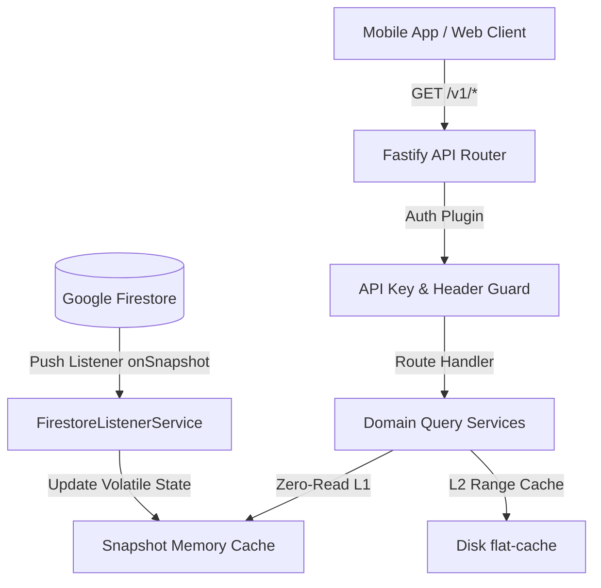
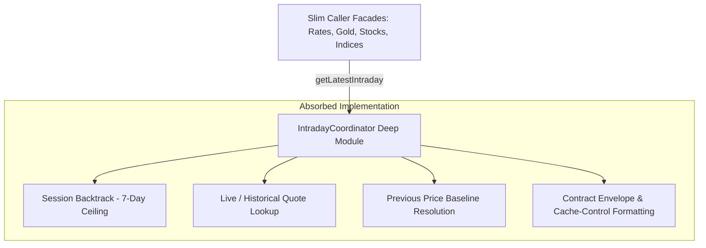
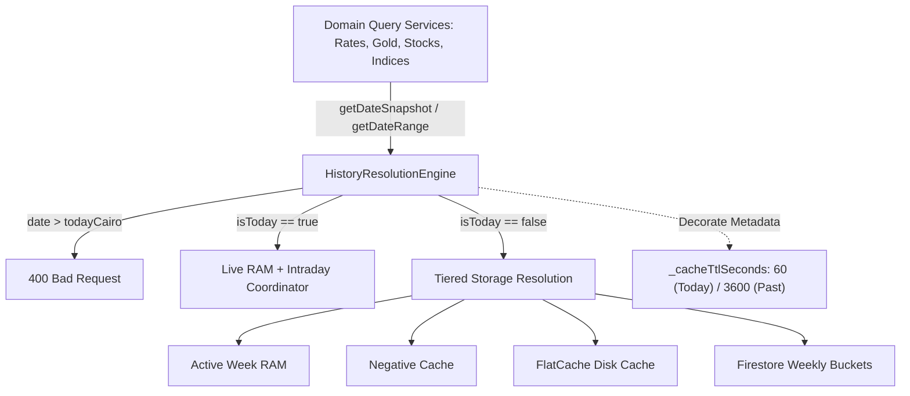

# Bkam API Gateway - Architecture Document

This document outlines the software architecture, data flows, routing components, and caching mechanisms of the standalone Bkam API service (`bkam-api`).

---

## 🗺️ System Overview

The Bkam API Gateway is a high-performance Fastify service (Node.js 22+, ESM, TypeScript) optimized to deliver exchange rates, commodity prices, and stock quotes to mobile apps and clients with sub-200ms response times and zero database read fees.

---

## 📦 Core Architectural Components

### 1. Presentation & Routing Layer (`src/routes/`)
- Standardized HTTP endpoints:
  - `/v1/rates`: Bank currency exchange rates with `?bank=` and `?currency=` filtering.
  - `/v1/rates/:currency`: Dedicated currency endpoint with strict catalog validation.
  - `/v1/gold`: Latest domestic karats (24k, 21k, 18k, pound) and international spot gold.
  - `/v1/gold/history`: Historical gold price series.
  - `/v1/gas`: Domestic fuel products from the Ministry of Petroleum.
  - `/v1/stocks`: Regional stock quotes (Egypt EGX, Saudi Tadawul, UAE ADX/DFM, Qatar QSE, Kuwait Boursa).
  - `/v1/stocks/:market/history/:date`: Daily closing market snapshots.
  - `/v1/stocks/:symbol/history/range`: Multi-week range queries with weekly bucketing.
  - `/v1/*/intraday/latest`: Zero-read real-time intraday timeline points.
  - `/v1/quotes`: Unified batch multi-asset quotes in a single round-trip.
  - `/v1/catalog`: Discoverable bank and currency metadata.
  - `/v1/health`: Gateway health and memory status.
  - `/v1/metrics`: Request counters by asset class.

### 2. Service & Caching Layer (`src/services/` & `src/cache/`)
- `SnapshotCache`: In-memory volatile RAM cache providing sub-10ms lookup times.
- `FlatCacheProvider`: Disk-backed caching with 30-day TTL for sealed historical date ranges.
- `FirestoreListenerService`: Establishes real-time push subscriptions to avoid costly polling reads.
- `HistoryResolutionEngine`: Deep market history resolution module behind a single clean seam (`getDateSnapshot`, `getDateRange`). Absorbs Africa/Cairo operational timezone boundary arithmetic, transparently routes queries between live today synthesis (RAM + Intraday Coordinator) and multi-tiered past archives (Active Week RAM -> Negative Cache -> Persistent Disk Cache -> Firestore Weekly Buckets -> Daily Fallback), appends active quotes to multi-day ranges ending today, rejects future dates with 400 Bad Request, and propagates standardized caching metadata (`_isToday`, `_cacheTtlSeconds`) to Fastify route handlers.
- `IntradayCoordinator`: Deep intraday coordination module behind a single high-leverage interface method (`getLatestIntraday`). Absorbs live quote retrieval, symbol/karat/bank timeline point extraction, previous closing price baselining (Feature 100), off-hours session backtracking (capped at 7-day lookback window), ticker alias mapping, consolidated all-item payloads (`item=all`), and caching TTL header metadata (`max-age=60` for active today vs `max-age=3600` for backtracked sessions). Eliminates over 900 lines of duplicate boilerplate across `RatesQueryService`, `GoldQueryService`, `StockQueryService`, and `IndicesQueryService`.
- `MetricsService`: In-memory multi-server request counting.

### 3. Deployment & Runtime
- Containerized via lean `node:22-alpine` Dockerfile (~150MB image, zero Playwright or Chromium overhead).
- Deployed on Oracle Cloud Infrastructure (OCI) Ampere A1 (ARM64) and Portainer.
- Completely decoupled from scraping daemons: bank scraping is 100% offloaded to serverless scrapers, with the API Gateway acting purely as an in-memory ingestion and delivery gateway.

