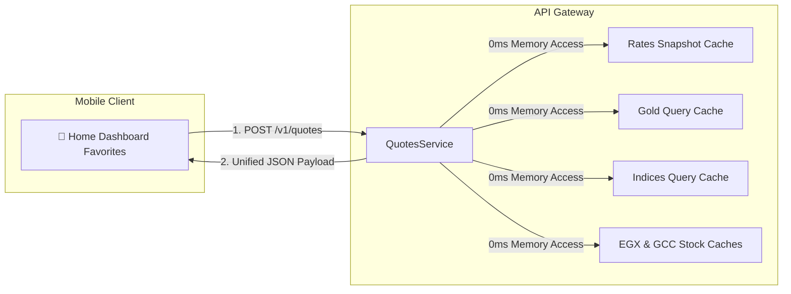

# ⚡ Stateless Batch Quotes API Guide (`/v1/quotes`)

> **Feature Version**: `v2.18.0` (Feature 098)  
> **Target Audience**: Mobile App Developers (Android/iOS), Backend Integrators, Frontend Engineers  
> **Base URLs**:
> - **Local Development**: `http://localhost:3000`
> - **Production**: `https://api.bekamfeelbank.com`

---

## 📑 Table of Contents
1. [Overview & Motivation](#-1-overview--motivation)
2. [Architectural Principles](#-2-architectural-principles)
3. [Supported Identifier Formats](#-3-supported-identifier-formats)
4. [Endpoint Specifications](#-4-endpoint-specifications)
   - [POST /v1/quotes (Recommended)](#41-post-v1quotes-recommended)
   - [GET /v1/quotes (Query Parameter Alternative)](#42-get-v1quotes-query-parameter-alternative)
5. [Request Validation & Constraints](#-5-request-validation--constraints)
6. [Resilience & Partial Resolution](#-6-resilience--partial-resolution)
7. [Android Integration Guide (Kotlin + Retrofit)](#-7-android-integration-guide-kotlin--retrofit)
8. [iOS Integration Guide (Swift + Codable)](#-8-ios-integration-guide-swift--codable)
9. [Troubleshooting & Verification](#-9-troubleshooting--verification)

---

## 🎯 1. Overview & Motivation

In mobile applications (like the Bekam Fe El Bank Android app), users customize their home screen with a mixed list of "Favorites" spanning multiple financial domains:
- Their preferred bank's USD or EUR exchange rate (`CBE_USD`, `MISR_EUR`)
- The 21K gold karat or Gold Pound (`21k`, `pound`)
- Major market benchmark indices (`EGX30`, `TASI`)
- Tracked stock shares (`COMI`, `1120`, `ARAMCO`)

### The Problem (Previous Workflow)
Previously, the mobile app had to dispatch **4 to 5 separate network requests in parallel**:
1. `GET /v1/rates` (~50 KB)
2. `GET /v1/gold` (~2 KB)
3. `GET /v1/indices` (~15 KB)
4. `GET /v1/stocks` (~60 KB)
5. `GET /v1/stocks/saudi` (~40 KB)

This caused:
- Severe mobile bandwidth consumption (~170 KB downloaded for ~6 favorite items).
- High latency on mobile cellular connections (waiting for the slowest HTTP call).
- Inconsistent UI rendering and staggered card loading spinners.

### The Solution: Backend-For-Frontend (BFF) Batch Quotes
The `/v1/quotes` endpoint accepts the client's list of favorite identifiers and returns a single, unified, lightweight JSON dictionary of all requested quotes in a **single network round-trip** ($< 2\text{ KB}$ response payload).



---

## 🏛️ 2. Architectural Principles

1. **Stateless Backend**: The API server **does not** store user accounts, user profiles, or favorite lists in a database. The client supplies its locally stored favorite IDs on every request.
2. **Zero Firestore Reads ($0.00 Cost Guarantee)**: All domain quotes resolve exclusively from in-memory push caches maintained by background Firestore `onSnapshot` real-time listeners. Serving batch quotes costs **0 database read charges**.
3. **Sub-Millisecond Processing**: Internal memory resolution executes in **$< 1\text{ ms}$**.
4. **Keyed Dictionary Response**: Quotes are indexed by the requested identifier (e.g. `body.quotes["CBE_USD"]`), allowing instant $O(1)$ lookups in UI adapters.

---

## 🏷️ 3. Supported Identifier Formats

The resolver dynamically disambiguates identifiers across 4 financial domains:

| Category | Identifier Format | Example IDs | Output Category | Description |
|:---|:---|:---|:---|:---|
| **Bank Currencies** | `<BANK>_<CURRENCY>` | `CBE_USD`, `MISR_EUR`, `CIB_SAR`, `NBE_AED`, `QNB_KWD` | `"currency"` | Supported bank code joined with currency ISO code by an underscore. Case-insensitive. |
| **Gold Commodities** | Karat code or commodity name | `24k`, `21k`, `18k`, `pound`, `ounce` (or `oz`, `international`) | `"gold"` | Egyptian Sagha carats, the Egyptian Gold Pound (Guineh), and spot international gold ounce. |
| **Benchmark Indices** | Canonical index ticker symbol | `EGX30`, `EGX70`, `EGX100`, `EGX33`, `TASI`, `MT30`, `DFMGI`, `FADGI`, `FADX15`, `QSE_INDEX` | `"index"` | Benchmark market tracking indices across Egypt, Saudi Arabia, UAE, and Qatar. |
| **Equities & Stocks** | Ticker symbol or exchange code | `COMI`, `FWRY`, `BQDC` (`BDC`), `HALN` (`MNT`), `1120`, `2222`, `ARAMCO`, `ALRAJHI`, `FAB` | `"stock"` | EGX equities (with canonical and alias support) and regional GCC shares (Saudi Tadawul, UAE DFM/ADX, Qatar QSE, Kuwait KSE). |

---

## 🔌 4. Endpoint Specifications

### 4.1. `POST /v1/quotes` (Recommended)

Optimal for mobile clients to submit arbitrary favorite lists without URL length constraints.

- **URL**: `/v1/quotes`
- **Method**: `POST`
- **Headers**:
  ```http
  Content-Type: application/json
  x-api-key: your-api-key-here
  ```
- **Request Body**:
  ```json
  {
    "items": [
      "CBE_USD",
      "MISR_EUR",
      "21k",
      "pound",
      "EGX30",
      "COMI",
      "1120"
    ]
  }
  ```

#### Example cURL Command
```bash
curl -X POST "http://localhost:3000/v1/quotes" \
  -H "Content-Type: application/json" \
  -H "x-api-key: local-dev-key" \
  -d '{
    "items": [
      "CBE_USD",
      "MISR_EUR",
      "21k",
      "pound",
      "EGX30",
      "COMI",
      "1120"
    ]
  }'
```

---

### 4.2. `GET /v1/quotes` (Query Parameter Alternative)

Supports standard browser/CDN HTTP caching with automatic `Cache-Control` and `ETag` validation headers.

- **URL**: `/v1/quotes?items=<COMMA_SEPARATED_LIST>`
- **Method**: `GET`
- **Headers**:
  ```http
  x-api-key: your-api-key-here
  ```
- **Response Headers**:
  - `Cache-Control: public, max-age=15`
  - `ETag: W/"..."`

#### Example cURL Command
```bash
curl -X GET "http://localhost:3000/v1/quotes?items=CBE_USD,21k,EGX30,COMI" \
  -H "x-api-key: local-dev-key"
```

---

### 4.3. Standard Response Envelope

```json
{
  "quotes": {
    "CBE_USD": {
      "id": "CBE_USD",
      "category": "currency",
      "name": "Central Bank of Egypt - USD",
      "price": 49.30,
      "buyPrice": 49.25,
      "sellPrice": 49.35,
      "change": 0.05,
      "changePercent": 0.10,
      "currency": "EGP",
      "updatedAt": "2026-10-31T12:00:00.000Z"
    },
    "21k": {
      "id": "21k",
      "category": "gold",
      "name": "Gold 21K",
      "price": 3750.00,
      "buyPrice": 3740.00,
      "sellPrice": 3760.00,
      "change": 15.00,
      "changePercent": 0.40,
      "currency": "EGP",
      "updatedAt": "2026-10-31T12:00:00.000Z"
    },
    "pound": {
      "id": "pound",
      "category": "gold",
      "name": "Egyptian Gold Pound",
      "price": 30000.00,
      "buyPrice": 29920.00,
      "sellPrice": 30080.00,
      "change": 120.00,
      "changePercent": 0.40,
      "currency": "EGP",
      "updatedAt": "2026-10-31T12:00:00.000Z"
    },
    "EGX30": {
      "id": "EGX30",
      "category": "index",
      "name": "EGX 30 Index",
      "price": 30550.25,
      "change": 125.50,
      "changePercent": 0.41,
      "currency": "EGP",
      "updatedAt": "2026-10-31T12:00:00.000Z"
    },
    "COMI": {
      "id": "COMI",
      "category": "stock",
      "name": "Commercial International Bank",
      "price": 75.50,
      "change": 1.20,
      "changePercent": 1.61,
      "currency": "EGP",
      "updatedAt": "2026-10-31T12:00:00.000Z"
    },
    "1120": {
      "id": "1120",
      "category": "stock",
      "name": "Al Rajhi Bank",
      "price": 88.40,
      "change": -0.60,
      "changePercent": -0.67,
      "currency": "SAR",
      "updatedAt": "2026-10-31T12:00:00.000Z"
    }
  },
  "unresolved": [],
  "timestamp": "2026-10-31T12:05:00.000Z"
}
```

#### Field Reference for `QuoteItem`
- `id` (`string`): The exact identifier requested by the client.
- `category` (`string`): Asset classification (`"currency"` | `"gold"` | `"index"` | `"stock"`).
- `name` (`string`): Human-readable display label in localized English/Arabic.
- `price` (`number`): Primary numeric value (last traded price or middle rate).
- `buyPrice` (`number | null`): Buy price (populated for bank currencies and gold).
- `sellPrice` (`number | null`): Sell price (populated for bank currencies and gold).
- `change` (`number | null`): Absolute price change vs previous day/session.
- `changePercent` (`number | null`): Percentage price change vs previous day/session.
- `currency` (`string`): Denomination currency (`EGP`, `SAR`, `AED`, `QAR`, `KWD`, `USD`).
- `updatedAt` (`string`): ISO 8601 UTC timestamp of the latest price update.

---

## 🛡️ 5. Request Validation & Constraints

1. **Batch Size Bounds**:
   - Minimum: `1` item.
   - Maximum: `100` items.
   - Submitting an empty array `[]` or $> 100$ items returns `400 Bad Request`.
2. **Whitespace Trimming**: Identifiers with leading or trailing whitespace (e.g. `" 21k "`) are automatically trimmed to `"21k"`.
3. **Automatic Deduplication**: Submitting duplicate IDs (e.g. `["21k", "21k", "CBE_USD"]`) is safely collapsed into unique keys with no duplicated payload overhead.

---

## ⚡ 6. Resilience & Partial Resolution

Mobile app users store favorites locally on their device's SQLite/Room storage. If a user saved an identifier that was subsequently retired or contains a typo:
- The server **does not fail** with a 500 error or reject the entire batch.
- All valid items resolve normally into the `quotes` dictionary.
- Unrecognized or failed items are placed into the `unresolved` string array.

### Example Partial Resolution Payload
```json
{
  "quotes": {
    "CBE_USD": { "id": "CBE_USD", "price": 49.30 }
  },
  "unresolved": [
    "RETIRED_FAVORITE_ITEM",
    "INVALID_BANK_XYZ"
  ],
  "timestamp": "2026-10-31T12:05:00.000Z"
}
```

Mobile apps can easily inspect `response.unresolved` to flag or clean up stale favorites from local disk storage.

---

## 📱 7. Android Integration Guide (Kotlin + Retrofit)

### 7.1. Data Transfer Objects (DTOs)

Create `QuotesDto.kt`:

```kotlin
package com.egp.bank.rates.data.model

import com.google.gson.annotations.SerializedName

data class BatchQuoteRequest(
    @SerializedName("items")
    val items: List<String>
)

data class BatchQuoteResponse(
    @SerializedName("quotes")
    val quotes: Map<String, QuoteItemDto>,
    @SerializedName("unresolved")
    val unresolved: List<String>,
    @SerializedName("timestamp")
    val timestamp: String
)

data class QuoteItemDto(
    @SerializedName("id")
    val id: String,
    @SerializedName("category")
    val category: String, // "currency", "gold", "index", "stock"
    @SerializedName("name")
    val name: String,
    @SerializedName("price")
    val price: Double,
    @SerializedName("buyPrice")
    val buyPrice: Double? = null,
    @SerializedName("sellPrice")
    val sellPrice: Double? = null,
    @SerializedName("change")
    val change: Double? = null,
    @SerializedName("changePercent")
    val changePercent: Double? = null,
    @SerializedName("currency")
    val currency: String,
    @SerializedName("updatedAt")
    val updatedAt: String
)
```

---

### 7.2. Retrofit API Service

Add to your Retrofit interface:

```kotlin
package com.egp.bank.rates.data.api

import com.egp.bank.rates.data.model.BatchQuoteRequest
import com.egp.bank.rates.data.model.BatchQuoteResponse
import retrofit2.Response
import retrofit2.http.Body
import retrofit2.http.POST

interface QuotesApiService {
    @POST("v1/quotes")
    suspend fun getBatchQuotes(
        @Body request: BatchQuoteRequest
    ): Response<BatchQuoteResponse>
}
```

---

### 7.3. Repository Implementation

```kotlin
package com.egp.bank.rates.data.repository

import com.egp.bank.rates.data.api.QuotesApiService
import com.egp.bank.rates.data.model.BatchQuoteRequest
import com.egp.bank.rates.data.model.QuoteItemDto
import kotlinx.coroutines.Dispatchers
import kotlinx.coroutines.withContext
import javax.inject.Inject
import javax.inject.Singleton

@Singleton
class HomeFavoritesRepository @Inject constructor(
    private val quotesApiService: QuotesApiService
) {
    /**
     * Resolves live quotes for all local favorites in a single network round-trip.
     * @param favoriteIds List of stored favorite identifiers (e.g. ["CBE_USD", "21k", "EGX30"])
     * @return Map of resolved QuoteItemDto keyed by identifier
     */
    suspend fun fetchFavoriteQuotes(favoriteIds: List<String>): Result<Map<String, QuoteItemDto>> =
        withContext(Dispatchers.IO) {
            try {
                if (favoriteIds.isEmpty()) {
                    return@withContext Result.success(emptyMap())
                }

                val response = quotesApiService.getBatchQuotes(BatchQuoteRequest(items = favoriteIds))
                if (response.isSuccessful && response.body() != null) {
                    val body = response.body()!!
                    
                    // Optional: Log or clean up any unresolved IDs
                    if (body.unresolved.isNotEmpty()) {
                        println("Unresolved favorite IDs: ${body.unresolved}")
                    }

                    Result.success(body.quotes)
                } else {
                    Result.failure(Exception("HTTP ${response.code()}: ${response.message()}"))
                }
            } catch (e: Exception) {
                Result.failure(e)
            }
        }
}
```

---

### 7.4. UI ViewModel / Composable Consumption

```kotlin
// In your ViewModel
fun loadFavorites() {
    viewModelScope.launch {
        val favoriteIds = localFavoritesDao.getFavoriteIds() // e.g. ["CBE_USD", "21k", "EGX30"]
        val result = homeFavoritesRepository.fetchFavoriteQuotes(favoriteIds)
        
        result.onSuccess { quotesMap ->
            // Update your UI state
            _uiState.update { state ->
                state.copy(
                    quotes = quotesMap,
                    isLoading = false
                )
            }
        }
    }
}

// In Jetpack Compose or RecyclerView Adapter:
// Instant O(1) lookup:
val quote = quotesMap[favoriteItem.id]
if (quote != null) {
    Text(text = "${quote.name}: ${quote.price} ${quote.currency}")
}
```

---

## 🍏 8. iOS Integration Guide (Swift + Codable)

```swift
import Foundation

struct BatchQuoteRequest: Codable {
    let items: [String]
}

struct BatchQuoteResponse: Codable {
    let quotes: [String: QuoteItem]
    let unresolved: [String]
    let timestamp: String
}

struct QuoteItem: Codable {
    let id: String
    let category: String
    let name: String
    let price: Double
    let buyPrice: Double?
    let sellPrice: Double?
    let change: Double?
    let changePercent: Double?
    let currency: String
    let updatedAt: String
}

func fetchFavorites(ids: [String]) async throws -> [String: QuoteItem] {
    guard let url = URL(string: "https://api.bekamfeelbank.com/v1/quotes") else {
        throw URLError(.badURL)
    }

    var request = URLRequest(url: url)
    request.httpMethod = "POST"
    request.addValue("application/json", forHTTPHeaderField: "Content-Type")
    request.addValue("your-api-key-here", forHTTPHeaderField: "x-api-key")
    request.httpBody = try JSONEncoder().encode(BatchQuoteRequest(items: ids))

    let (data, response) = try await URLSession.shared.data(for: request)
    guard (response as? HTTPURLResponse)?.statusCode == 200 else {
        throw URLError(.badServerResponse)
    }

    let decoded = try JSONDecoder().decode(BatchQuoteResponse.self, from: data)
    return decoded.quotes
}
```

---

## 🔍 9. Troubleshooting & Verification

| Symptom | Cause | Solution |
|:---|:---|:---|
| **`401 Unauthorized`** | Missing or invalid `x-api-key` header. | Supply valid API key header `x-api-key: your-api-key`. |
| **`400 Bad Request` (`INVALID_REQUEST`)** | `items` array is empty or exceeds 100 items. | Ensure array contains between 1 and 100 non-empty strings. |
| **Item in `unresolved`** | Typo or unsupported format. | Ensure bank currencies use `<BANK>_<CURRENCY>` (e.g. `CBE_USD`) and gold uses `21k`, `pound`, etc. |
| **Empty `quotes: {}`** | None of the requested IDs matched known assets. | Check `unresolved` array for the requested keys. |
