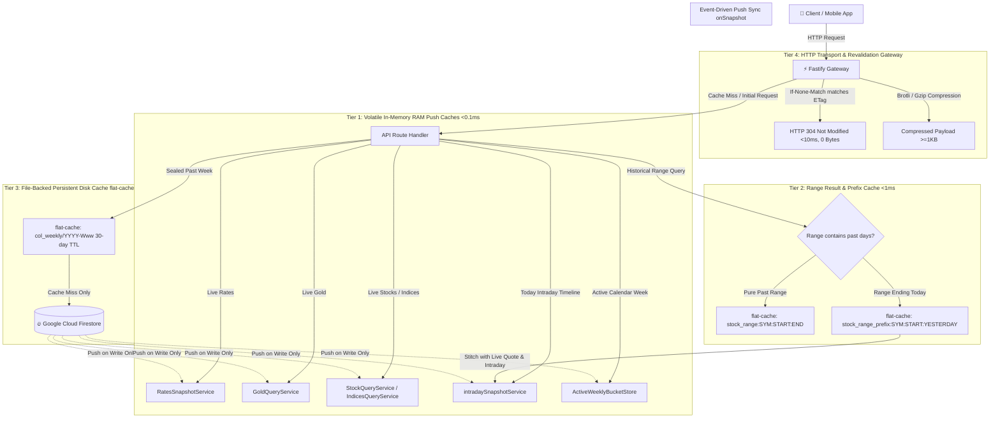

# Unified Caching Architecture Guide (`CACHE.md`)

**Document Status**: Active  
**Last Updated**: 2026-10-24  
**Governing Principles**: [Principle XIII (Tiered Caching & RAM Lifecycle)](file:///d:/Repo/Bekam_Fe_El_bank_Scrapper/.specify/memory/constitution.md) & [Principle VII (Cloud Cost Safeguards)](file:///d:/Repo/Bekam_Fe_El_bank_Scrapper/.specify/memory/constitution.md)  
**Related Documents**: [ADR 0005](file:///d:/Repo/Bekam_Fe_El_bank_Scrapper/docs/adr/0005-tiered-weekly-caching-and-api-optimization.md), [Current Week Caching Guide](file:///d:/Repo/Bekam_Fe_El_bank_Scrapper/docs/current-week-caching-and-trading-hours.md)

---

## 1. Executive Summary & Core Philosophy

The Bekam Fe El Bank platform operates under a strict **$0.00 Always Free Tier** infrastructure constraint on Google Cloud Platform and Oracle Cloud Infrastructure.

To ensure sub-millisecond API response times while eliminating Firestore database read and write quotas, the system employs an **event-driven, 4-tier caching architecture**:
1. **Zero Client Polling Reads**: No incoming client HTTP traffic triggers Firestore document reads. All live rates, gold prices, gas prices, stock quotes, indices, and the active mutating week document resolve directly from **in-memory RAM stores** in `<0.1ms`.
2. **Event-Driven Write-Only Firestore Charges**: Cloud database read charges occur strictly when the background scraper commits an updated document to Firestore.
3. **Strict Intraday RAM-Only Lifecycle**: High-frequency intraday tick points exist exclusively in volatile memory (`intradaySnapshotService`) for the active session, completely bypassing disk to eliminate SSD write churn.
4. **Permanent Past Week Sealing**: Sealed past calendar weeks and pure historical date ranges are cached on disk in `flat-cache` with a **30-day TTL**, surviving server reboots with zero database overhead.

---

## 2. The 4-Tier Caching Architecture

---

## 3. Real-Time Snapshot Push Synchronization (`onSnapshot`)

All live data is synchronized directly from Firestore into volatile RAM via long-lived push listeners in [`FirestoreListenerService`](file:///d:/Repo/Bekam_Fe_El_bank_Scrapper/api/src/services/firestore-listener-service.ts):

| Domain | Firestore Target | In-Memory RAM Cache | Client Read Latency & Cost |
| :--- | :--- | :--- | :--- |
| **Bank Rates** | `rates` (collection) | `RatesSnapshotService` | `<0.1ms` (0 reads) |
| **Gold Prices** | `gold_prices/latest` | `GoldQueryService` | `<0.1ms` (0 reads) |
| **Fuel / Gas Prices** | `gas_prices/latest` | `GasQueryService` | `<0.1ms` (0 reads) |
| **EGX Stocks** | `stock_prices/latest` | `StockQueryService` | `<0.1ms` (0 reads) |
| **EGX Indices** | `index_prices/latest` | `IndicesQueryService` | `<0.1ms` (0 reads) |
| **GCC Regional Stocks** | `stock_prices_{saudi,uae,qatar}/latest` | `GccStockQueryService` | `<0.1ms` (0 reads) |
| **Intraday Tick Curves** | `*_intraday/{today}` (rates, gold, stocks, indices) | `intradaySnapshotService` | `<0.1ms` (0 reads) |
| **Active Calendar Week** | `stock_prices_history_weekly/{currentWeekKey}` `index_prices_history_weekly/{currentWeekKey}` | `ActiveWeeklyBucketStore` | `<0.1ms` (0 reads) |

---

## 4. Intraday RAM-Only Lifecycle (Principle XIII)

1. **High-Frequency Volatility**: Ticks and price shifts during the market session are recorded into `intradayPoints` via Firestore's atomic `FieldValue.arrayUnion`.
2. **Strict Disk Exclusion**: Intraday tick points **MUST NEVER be written to `flat-cache` on disk**. Persisting raw tick points to disk would thrash container SSD write cycles and pollute persistent caches.
3. **Dual-Buffer Session Retention**:
   - `intradaySnapshotService` maintains two buffers: `currentSnapshot` and `previousSnapshot`.
   - Across midnight, weekends, and official holidays, the previous session's intraday curve is preserved in memory so mobile chart screens never render empty graphs before the next market opening session starts.
4. **Daily Pruning**:
   - At 08:00 AM Cairo local time (when the scraper generates the new day's document), `rolloverIntradayListeners()` unsubscribes yesterday's listeners, prunes expired session buffers, and binds to today's date.

---

## 5. Live Market Scraper & Change Detection

The scraper coordinates writes efficiently so Firestore quotas are never exhausted:
1. **Schedule Gating**: Before scraping, the orchestrator checks `isScheduleActive()`. If the market is closed (e.g. nights, Friday, Saturday, or outside 09:30–16:00 Cairo), execution skips inline in **`<1ms`** with 0 network requests and 0 database writes.
2. **In-Memory Diffing (`hasPriceChanges`)**: When the market is open, the scraper extracts fresh quotes and compares them against `existingQuotes` in memory. If no prices changed since the last cycle, **writes to Firestore are 100% bypassed**.
3. **Atomic Scraper Writes**: When price changes occur, the scraper updates:
   - `latest` document with current quotes and `oldPrice`.
   - `*_intraday/{today}` document with new tick points (`arrayUnion`).
   - `*_weekly/{weekKey}` consolidated bucket document.

---

## 6. Active Week vs. Sealed Past Weeks Caching

Consolidated weekly documents (`*_weekly/{YYYY-Www}`) group 7 days of daily snapshots into a single Firestore document to optimize range queries:

### Active Mutating Week (`weekKey === currentWeekKey`)
- Kept synchronized in volatile RAM via `onSnapshot` in [`ActiveWeeklyBucketStore`](file:///d:/Repo/Bekam_Fe_El_bank_Scrapper/api/src/services/active-weekly-bucket-store.ts).
- Resolves in `<0.1ms` with 0 Firestore reads.
- **Trading Hours (09:30–16:00 Cairo)**: Disk writes are strictly bypassed.
- **Off-Hours (evenings, nights, Fri/Sat)**: Persisted to `flat-cache` on disk with a dynamic TTL expiring at the next market open (09:30 AM Cairo next trading day).
- **Cold-Boot Pre-Seeding**: On server restart, `ActiveWeeklyBucketStore` pre-seeds from `flat-cache` immediately to ensure zero startup lag.

### Sealed Past Weeks (`weekKey !== currentWeekKey`)
- Past weeks are permanently closed and strictly immutable.
- Saved to `flat-cache` on disk with a **30-day TTL**.
- Subsequent historical queries across server reboots hit disk in `<1ms` with **0 database reads**.

### Automated ISO Week Rollover Sealing
- Evaluated daily at **00:01 AM** and **08:00 AM Cairo local time**.
- When `currentWeekKey !== this.currentSubscribedWeekKey`:
  1. Retrieves old week from `ActiveWeeklyBucketStore`.
  2. Seals old week to `flat-cache` on disk for 30 days (`30 * 24 * 60 * 60`s).
  3. Clears old week from volatile memory (`activeWeeklyBucketStore.clearWeek(oldWeek)`).
  4. Detaches old weekly listeners (`weeklyUnsubscribes.forEach(unsub => unsub())`).
  5. Binds new `onSnapshot` listeners to the new active calendar week.

---

## 7. Historical Range Query Caching & Prefix Stitching

When clients request a multi-day historical range (`GET /v1/stocks/:symbol/history/range?start=...&end=...`):

1. **Pure Past Ranges (`end < todayCairo`)**:
   - Cache key: `stock_range:${symbol}:${start}:${end}`.
   - Cached directly in `flat-cache` with a **30-day TTL**.
   - Resolves subsequent queries in **`<1ms`**.
   - Response header: `Cache-Control: public, max-age=86400, immutable`.
2. **Ranges Ending Today or Later (`end >= todayCairo`)**:
   - Deconstructs the range into two parts:
     - **Closed Historical Prefix `[start, yesterdayCairo]`**: Retrieved from `flat-cache` (`stock_range_prefix:...`, 30-day TTL) in `<1ms`.
     - **Today's Session (`todayCairo`)**: Dynamically stitched on the fly from RAM (`StockQueryService` live quote + `intradaySnapshotService` tick timeline) in `<0.1ms`.
   - Incurs **0 database reads**.
   - Response header: `Cache-Control: public, max-age=60`.

---

## 8. HTTP Transport & Revalidation Gateway (Tier 4)

1. **HTTP Compression (`@fastify/compress`)**:
   - Threshold: **1KB**.
   - Supported Encodings: **Brotli (`br`)**, **Gzip (`gzip`)**, and Deflate.
   - Reduces JSON chart payloads by up to **85%**.
2. **ETag & Conditional Validation (`@fastify/etag`)**:
   - Fastify generates deterministic entity tags (`W/"..."`) for all responses.
   - When a client or mobile app revalidates with `If-None-Match: W/"..."`, the gateway returns **`HTTP 304 Not Modified`** in **`<10ms`** with **0 payload body bytes**.

---

## 9. Comprehensive TTL & Storage Summary Table

| Endpoint / Data Asset | Primary Storage | Secondary Storage | TTL Strategy | Cache Invalidation Trigger |
| :--- | :--- | :--- | :--- | :--- |
| `GET /v1/rates` | RAM (`RatesSnapshotService`) | None | Indefinite (Live) | `onSnapshot` update on `rates` |
| `GET /v1/gold` | RAM (`GoldQueryService`) | None | Indefinite (Live) | `onSnapshot` update on `gold_prices/latest` |
| `GET /v1/gas` | RAM (`GasQueryService`) | None | Indefinite (Live) | `onSnapshot` update on `gas_prices/latest` |
| `GET /v1/stocks` | RAM (`StockQueryService`) | None | Indefinite (Live) | `onSnapshot` update on `stock_prices/latest` |
| `GET /v1/indices` | RAM (`IndicesQueryService`) | None | Indefinite (Live) | `onSnapshot` update on `index_prices/latest` |
| `GET /v1/stocks/:market` (GCC) | RAM (`GccStockQueryService`) | `flat-cache` (cold boot) | Indefinite (Live) | `onSnapshot` update on `stock_prices_{market}/latest` |
| Today Intraday Curve | RAM (`intradaySnapshotService`) | None (Strictly RAM) | Session Duration | `onSnapshot` on `*_intraday/{today}`; 08:00 AM daily rollover |
| Active Week Document | RAM (`ActiveWeeklyBucketStore`) | `flat-cache` (off-hours) | Off-hours: until 09:30 AM | `onSnapshot` on `*_weekly/{currentWeek}`; Monday rollover |
| Sealed Past Week Document | `flat-cache` | Firestore | 30 Days | Immutable; eviction after 30 days |
| Pure Past History Range | `flat-cache` | Firestore | 30 Days | Immutable; eviction after 30 days |
| Historical Range Prefix | `flat-cache` | Firestore | 30 Days | Immutable; eviction after 30 days |
| Missing Date (404 Fallback) | Memory map | None | Strictly 5 Minutes | 5-minute negative cache eviction |
