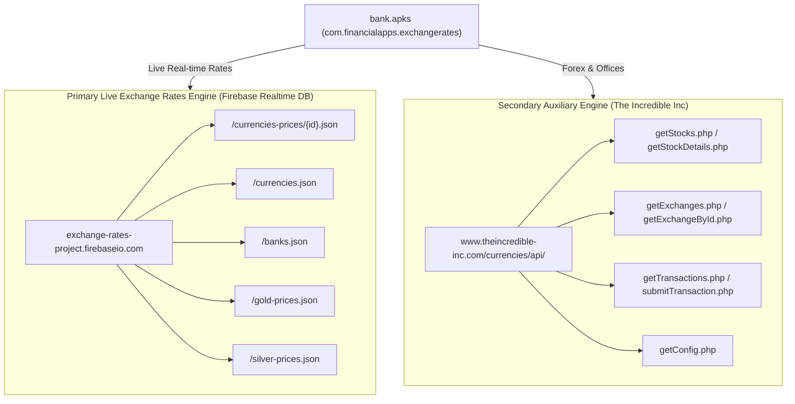

# Investigation Report: `bank.apks` ("بكام في البنك") Exchange Rates APIs

This report presents the reverse-engineering analysis of `bank.apks` using REA (Reverse Engineer Anything) to identify the live APIs and endpoints used by the app to retrieve currency exchange rates, gold/silver prices, and stock/forex data.

---

## 1. Target Identity & Application Overview

| Property | Value |
| :--- | :--- |
| **Package File** | `bank.apks` (Split APK bundle) |
| **Extracted Base** | `base.apk` (15,505,969 bytes) |
| **Package Name** | `com.financialapps.exchangerates` |
| **Application Name** | **بكام في البنك** (Bkam Fel Bank) |
| **Target Functionality** | Real-time Egyptian bank currency exchange rates, gold prices, silver prices, forex tickers, and exchange office directories. |

---

## 2. Architecture Diagram



---

## 3. Primary API: Firebase Realtime Database (Live Tested & Verified)

The primary data feed for bank exchange rates is hosted on Firebase Realtime Database. Because Firebase Realtime Databases expose a standard REST interface by appending `.json`, all endpoints can be queried directly via simple HTTP `GET` requests without authentication tokens.

* **Base URL:**
  `https://exchange-rates-project.firebaseio.com/`

### 3.1. Currency Exchange Rates by Bank
* **Endpoint:**
  `GET https://exchange-rates-project.firebaseio.com/currencies-prices/{currencyId}.json`
* **Currency IDs (`currencyId`):**
  * `1` — US Dollar (USD / دولار أمريكي)
  * `2` — Euro (EUR / يورو)
  * `3` — British Pound (GBP / جنيه إسترليني)
  * `4` — Saudi Riyal (SAR / ريال سعودي)
  * `5` — Kuwaiti Dinar (KWD / دينار كويتي)
  * `6` — UAE Dirham (AED / درهم إماراتي)
  * `8` — Swiss Franc (CHF)
  * `11` — Canadian Dollar (CAD)
  * `12` — Danish Krone (DKK)
  * `13` — Norwegian Krone (NOK)
  * `14` — Swedish Krona (SEK)
  * `15` — 100 Japanese Yen (JPY)
  * `16` — Australian Dollar (AUD)
  * `17` — Bahraini Dinar (BHD)
  * `18` — Omani Rial (OMR)
  * `19` — Qatari Riyal (QAR)
  * `20` — Jordanian Dinar (JOD)
  * `21` — Chinese Yuan (CNY)

* **Sample Response Item (Indexed by Bank ID):**
  ```json
  {
    "buy_price": "53.87",
    "sell_price": "53.97",
    "buy_direction": -1,
    "sell_direction": -1,
    "created": 1793881933646,
    "updated": 1794118937857
  }
  ```
  *(Note: `buy_direction` and `sell_direction`: `1` indicates price increased, `0` unchanged, `-1` decreased).*

---

### 3.2. Currencies Metadata
* **Endpoint:**
  `GET https://exchange-rates-project.firebaseio.com/currencies.json`
* **Description:** Returns the mapping between currency IDs, codes, and Arabic names.
* **Sample Output:**
  ```json
  {
    "-L04TbzwEatvaQXPWnlJ": {
      "currencyCode": "USD",
      "currencyId": "1",
      "currencyName": "دولار أمريكي"
    },
    "-L04Tc-21Sh6oZ0-L2Ia": {
      "currencyCode": "EUR",
      "currencyId": "2",
      "currencyName": "يورو"
    }
  }
  ```

---

### 3.3. Banks Metadata & Directory
* **Endpoint:**
  `GET https://exchange-rates-project.firebaseio.com/banks.json`
* **Description:** Contains metadata for all 37 indexed Egyptian banks, including their logos, names, customer support hotlines, and web portals.
* **Sample Output:**
  ```json
  [
    {
      "id": 1,
      "name": "البنك الأهلي المصري",
      "phone": "19623",
      "icon": "https://firebasestorage.googleapis.com/v0/b/exchange-rates-project.appspot.com/o/uploads%2Fbanks%2Fb1.png?alt=media&token=c61a3b6d-4d96-4ea7-a7bd-6821fbc9d79d",
      "url": "https://www.nbe.com.eg/NBE/E/#/AR/ExchangeRatesAndCurrencyConverter",
      "hidden": false,
      "stop": false
    },
    {
      "id": 2,
      "name": "البنك التجاري الدولي",
      "phone": "19666",
      "icon": "https://firebasestorage.googleapis.com/v0/b/exchange-rates-project.appspot.com/o/uploads%2Fbanks%2Fb2.png?alt=media&token=67ad79a8-9ab2-4085-9c42-7a749726ed66",
      "url": "https://www.cibeg.com/ar/currency-converter",
      "hidden": false,
      "stop": false
    }
  ]
  ```

---

### 3.4. Gold Prices
* **Endpoint:**
  `GET https://exchange-rates-project.firebaseio.com/gold-prices.json`
* **Description:** Live gold prices per gram across different karats (in EGP and USD), plus pound, ounce, and kilogram prices.
* **Sample Output:**
  ```json
  {
    "18": 5323,
    "21": 6210,
    "24": 7097,
    "18-usd": 98.15,
    "21-usd": 114.50,
    "24-usd": 130.86,
    "pound": 49681,
    "pound-usd": 916.02,
    "ounce": 220724,
    "ounce-usd": 4069.75,
    "updated": 1794117640528
  }
  ```

---

### 3.5. Silver Prices
* **Endpoint:**
  `GET https://exchange-rates-project.firebaseio.com/silver-prices.json`
* **Description:** Live silver prices per gram across calibers (800, 900, 925, 950, 999) and ounce.
* **Sample Output:**
  ```json
  {
    "80": "71.77",
    "90": "80.75",
    "92": "82.99",
    "99": "89.72",
    "ounce": "2790.2",
    "ounce_usd": "51.70",
    "updated": 1794118860514
  }
  ```

---

## 4. Secondary API: The Incredible Inc. (PHP REST API)

Used for auxiliary data: stock market/forex rates, physical exchange offices, user buy/sell community postings, and dynamic ad configurations.

* **Base URL:**
  `http://www.theincredible-inc.com/currencies/api/`

| Endpoint | Method | Purpose |
| :--- | :--- | :--- |
| `getStocks.php` | `GET` | Retrieves Egyptian/global stock & forex indices (ticker, last price, change, change percentage, volume) |
| `getStockDetails.php` | `GET` | Retrieves detailed historical prices (open, high, low, close, volume) |
| `getExchanges.php` | `GET` | Retrieves registered currency exchange offices across Egypt |
| `getExchangeById.php` | `GET` | Detailed exchange office profile (address, phone numbers, GPS coordinates) |
| `getTransactions.php` | `GET` | User community exchange transactions (buy/sell listings) |
| `submitTransaction.php` | `POST` | Submits a new user transaction |
| `likeDislikeTransaction.php` | `POST` | Submits upvotes/downvotes on user transaction listings |
| `getConfig.php` | `GET` | App configuration (ad cooldown, interstitial display flags, version rules) |
