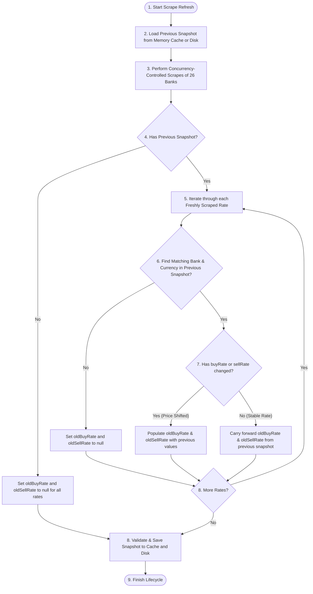

# 📈 EGP Rates API - Rate Delta & Trend Tracking Guide

This document describes how the EGP Scrapper API tracks rate changes over time, specifically outlining the logic behind the calculations of the `oldBuyRate` and `oldSellRate` fields. These fields allow client applications (e.g., Android apps) to instantly detect currency trends and render persistent upward/downward indicator arrows without maintaining complex local databases.

---

## 📌 Conceptual Overview

When exchange rates are updated by a background scrape cycle, it is not enough to simply serve the new rates. To provide a rich user experience, the system calculates price shifts (deltas) relative to the historical snapshots.

Instead of clearing trend references when rates stabilize, the system **carries forward the historical trend references**. This ensures that the mobile client can **always** render a red or green arrow indicating the last actual price shift direction, even if that change occurred several scrape cycles (or hours) ago.

Each returned rate object includes:
* `buyRate`: The newly scraped, active bank buy price.
* `sellRate`: The newly scraped, active bank sell price.
* `oldBuyRate`: The last distinct historical bank buy price prior to the current rate. Carried forward persistently across stable cycles. Settled as `null` only if no history has ever been recorded.
* `oldSellRate`: The last distinct historical bank sell price prior to the current rate. Carried forward persistently across stable cycles. Settled as `null` only if no history has ever been recorded.

---

## 🔄 Delta Calculation Life-Cycle

The entire delta tracking lifecycle runs inside `api/src/services/rates-snapshot-service.ts` during the `refresh()` call. The logical steps are executed as follows:



---

## 🔍 Code Deep-Dive

Below is the exact implementation of the delta calculation engine located in [rates-snapshot-service.ts](file:///d:/Repo/Bekam_Fe_El_bank_Scrapper/api/src/services/rates-snapshot-service.ts):

### 1. The Snapshot Comparison Phase
Before compiling the final snapshot schema, the service loads `previousSnapshot` and loops over the newly scraped `rates` list:

```typescript
// Compare individual rates updates against previous snapshot to track price shift trends.
if (previousSnapshot && previousSnapshot.rates) {
  // Loop over every newly resolved rate to calculate its historical shift.
  for (const currentRate of rates) {
    // Look up the matching rate from the previous snapshot by bank and currency codes.
    const previousRate = previousSnapshot.rates.find(
      (r) =>
        r.bankCode === currentRate.bankCode &&
        r.currencyCode === currentRate.currencyCode
    );

    // Check if a previous matching rate exists.
    if (previousRate) {
      // Check if either the buy rate or the sell rate shifted compared to the last cycle.
      if (
        previousRate.buyRate !== currentRate.buyRate ||
        previousRate.sellRate !== currentRate.sellRate
      ) {
        // If rates changed, record the active previous values as the historical trend reference.
        currentRate.oldBuyRate = previousRate.buyRate;
        // Record the active previous sell rate as the trend reference.
        currentRate.oldSellRate = previousRate.sellRate;
      } else {
        // If rates are identical, carry forward the existing old buy rate from the previous snapshot to keep the trend arrow persistent.
        currentRate.oldBuyRate = previousRate.oldBuyRate !== undefined ? previousRate.oldBuyRate : null;
        // Carry forward the existing old sell rate from the previous snapshot to keep the trend arrow persistent.
        currentRate.oldSellRate = previousRate.oldSellRate !== undefined ? previousRate.oldSellRate : null;
      }
    } else {
      // If no matching rate existed in the previous snapshot, set old buy rate to null.
      currentRate.oldBuyRate = null;
      // Set old sell rate to null as there is no historical point of comparison.
      currentRate.oldSellRate = null;
    }
  }
} else {
  // Initialize to null if no previous snapshot history exists in the system.
  for (const currentRate of rates) {
    // Set the old buy rate to null.
    currentRate.oldBuyRate = null;
    // Set the old sell rate to null.
    currentRate.oldSellRate = null;
  }
}
```

### 2. On-The-Fly Legacy Enrichment & Property Mapping
When snapshots are served via `/v1/rates` or filtering endpoints, the service calls `enrichRates()`. To prevent schema validation issues with legacy/persisted records on disk that may have `undefined` fields, the enrichment routine sanitizes the outputs to strict `null` values:

```typescript
private enrichRates(rates: any[]): any[] {
  return rates.map((rate) => {
    const bank = supportedBanks.find((b) => b.code === rate.bankCode);
    if (!bank) return rate;

    return {
      name_ar: bank.name_ar,
      name_en: bank.name_en,
      logo: bank.logo,
      bankCode: rate.bankCode,
      currencyCode: rate.currencyCode,
      buyRate: rate.buyRate,
      sellRate: rate.sellRate,
      // Map undefined or missing properties to strict JSON nulls
      oldBuyRate: rate.oldBuyRate !== undefined ? rate.oldBuyRate : null,
      oldSellRate: rate.oldSellRate !== undefined ? rate.oldSellRate : null,
      retrievedAt: rate.retrievedAt,
      freshness: rate.freshness || "current",
      sourceTraceId: rate.sourceTraceId !== undefined ? rate.sourceTraceId : undefined
    };
  });
}
```

---

## 📱 Client Integration Guidelines

Mobile or web clients can implement simple conditional rendering strategies using this metadata:

### A. Buy Rate Trend
```kotlin
// Android Kotlin UI Example:
val trend = when {
    rate.oldBuyRate == null -> Trend.STABLE
    rate.buyRate > rate.oldBuyRate -> Trend.UP     // Render Green Up Arrow 🟢 📈 (Higher than last distinct price)
    rate.buyRate < rate.oldBuyRate -> Trend.DOWN   // Render Red Down Arrow 🔴 📉 (Lower than last distinct price)
    else -> Trend.STABLE
}
```

### B. Sell Rate Trend
```kotlin
val trend = when {
    rate.oldSellRate == null -> Trend.STABLE
    rate.sellRate > rate.oldSellRate -> Trend.UP   // Render Green Up Arrow 🟢 📈 (Higher than last distinct price)
    rate.sellRate < rate.oldSellRate -> Trend.DOWN // Render Red Down Arrow 🔴 📉 (Lower than last distinct price)
    else -> Trend.STABLE
}
```

> [!TIP]
> **Persistent Trend Arrows**: Because of this carry-forward design, the client application will **always** display the correct green or red trend arrow matching the last known price transition, regardless of how long ago that transition occurred. It will remain visible until the exchange rate shifts to a new level.
