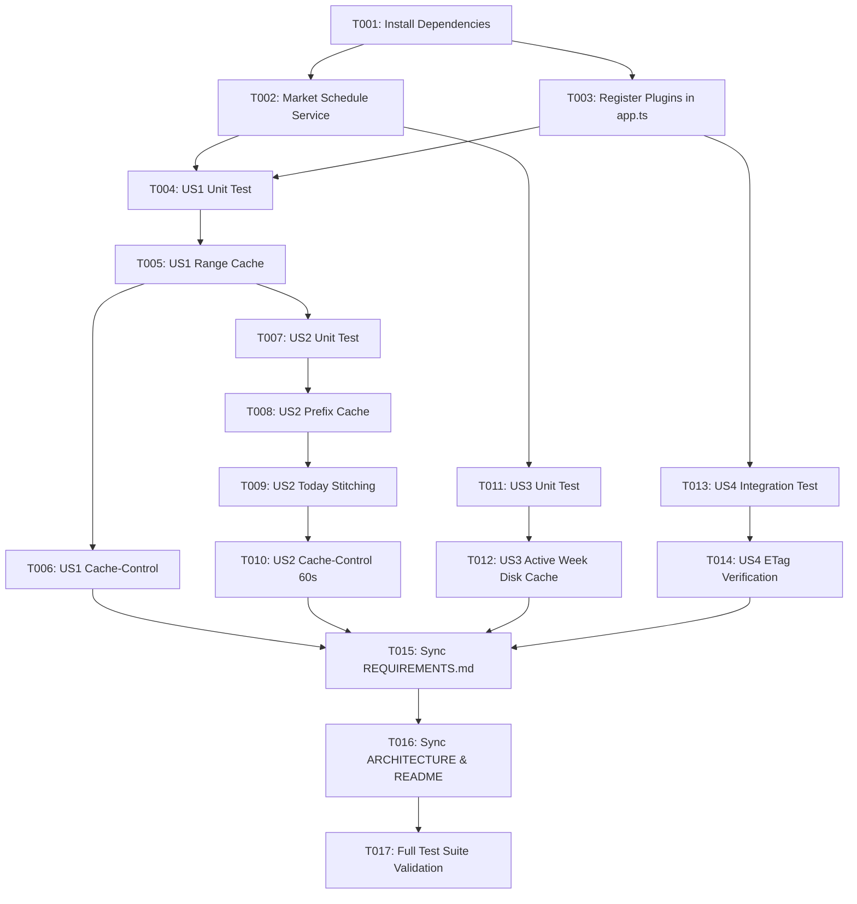

# Tasks: Tiered Weekly Caching & API Performance Optimization

**Input**: Design documents from `/specs/095-tiered-weekly-caching/`  
**Prerequisites**: [plan.md](file:///d:/Repo/Bekam_Fe_El_bank_Scrapper/specs/095-tiered-weekly-caching/plan.md), [spec.md](file:///d:/Repo/Bekam_Fe_El_bank_Scrapper/specs/095-tiered-weekly-caching/spec.md), [research.md](file:///d:/Repo/Bekam_Fe_El_bank_Scrapper/specs/095-tiered-weekly-caching/research.md), [data-model.md](file:///d:/Repo/Bekam_Fe_El_bank_Scrapper/specs/095-tiered-weekly-caching/data-model.md), [contracts/](file:///d:/Repo/Bekam_Fe_El_bank_Scrapper/specs/095-tiered-weekly-caching/contracts/stock-history-range.contract.md)

## Format: `[ID] [P?] [Story] Description`
- **[P]**: Can run in parallel (different files, no blocking dependencies)
- **[Story]**: User story identifier (US1, US2, US3, US4)
- Exact file paths are provided for each task.

---

## Phase 1: Setup (Shared Dependencies)

**Purpose**: Install required gateway compression and ETag plugins

- [X] T001 Install `@fastify/compress` and `@fastify/etag` dependencies in [api/package.json](file:///d:/Repo/Bekam_Fe_El_bank_Scrapper/api/package.json)

---

## Phase 2: Foundational (Blocking Prerequisites)

**Purpose**: Core temporal and gateway infrastructure required by all user stories

- [X] T002 [P] Implement market session schedule helper and off-hours expiration calculator in [api/src/services/market-schedule-service.ts](file:///d:/Repo/Bekam_Fe_El_bank_Scrapper/api/src/services/market-schedule-service.ts)
- [X] T003 [P] Register `@fastify/compress` (1KB threshold) and `@fastify/etag` in Fastify gateway in [api/src/app.ts](file:///d:/Repo/Bekam_Fe_El_bank_Scrapper/api/src/app.ts)

**Checkpoint**: Gateway compression, ETags, and market session logic ready. User story implementation can begin.

---

## Phase 3: User Story 1 - Instant Historical Stock Chart Loading on Mobile Networks (Priority: P1) 🎯 MVP

**Goal**: Pure historical range queries (`end < todayCairo`) are cached in `flat-cache`, compressed with Brotli/Gzip, and resolve in `<20ms` with immutable Cache-Control.

**Independent Test**: Query `GET /v1/stocks/COMI/history/range?start=2026-05-01&end=2026-10-20` with `Accept-Encoding: gzip`. Returns compressed response with `Cache-Control: public, max-age=86400, immutable`.

### Tests for User Story 1
- [X] T004 [P] [US1] Unit test for pure historical range caching in [api/tests/unit/stock-query-service.test.ts](file:///d:/Repo/Bekam_Fe_El_bank_Scrapper/api/tests/unit/stock-query-service.test.ts)

### Implementation for User Story 1
- [X] T005 [US1] Implement Range Result Cache in [api/src/services/stock-query-service.ts](file:///d:/Repo/Bekam_Fe_El_bank_Scrapper/api/src/services/stock-query-service.ts) for pure past ranges (`end < todayCairo`)
- [X] T006 [US1] Configure dynamic immutable `Cache-Control` header for historical ranges in [api/src/routes/stock-routes.ts](file:///d:/Repo/Bekam_Fe_El_bank_Scrapper/api/src/routes/stock-routes.ts)

**Checkpoint**: User Story 1 delivers an independently testable MVP for past historical chart queries.

---

## Phase 4: User Story 2 - Real-Time Today Stitching with Zero-Stale Quotes (Priority: P2)

**Goal**: Range queries ending today (`end >= todayCairo`) fetch the historical prefix from `flat-cache` and stitch today's live rate and in-memory intraday points from RAM.

**Independent Test**: Query `GET /v1/stocks/COMI/history/range?start=2026-05-01&end=todayCairo` returns stitched timeline with live today quote and RAM intraday points, with `Cache-Control: public, max-age=60`.

### Tests for User Story 2
- [X] T007 [P] [US2] Unit test for historical prefix caching and dynamic today stitching in [api/tests/unit/stock-query-service.test.ts](file:///d:/Repo/Bekam_Fe_El_bank_Scrapper/api/tests/unit/stock-query-service.test.ts)

### Implementation for User Story 2
- [X] T008 [US2] Implement closed historical prefix caching (`[start, yesterdayCairo]`) in [api/src/services/stock-query-service.ts](file:///d:/Repo/Bekam_Fe_El_bank_Scrapper/api/src/services/stock-query-service.ts)
- [X] T009 [US2] Implement dynamic today quote and in-memory intraday stitching in [api/src/services/stock-query-service.ts](file:///d:/Repo/Bekam_Fe_El_bank_Scrapper/api/src/services/stock-query-service.ts)
- [X] T010 [US2] Configure 60s `Cache-Control` header for ranges ending on or after today in [api/src/routes/stock-routes.ts](file:///d:/Repo/Bekam_Fe_El_bank_Scrapper/api/src/routes/stock-routes.ts)

**Checkpoint**: User Stories 1 and 2 deliver complete, end-to-end range query resolution across both past and active trading days.

---

## Phase 5: User Story 3 - Off-Hours Server Reboot with Zero Database Reads (Priority: P3)

**Goal**: Active calendar week document is saved to `flat-cache` outside trading hours (evenings and weekends) with expiration set to the next market open (09:30 AM Cairo), strictly bypassing disk writes during market hours.

**Independent Test**: Mock off-hours in [api/tests/unit/firestore-service.test.ts](file:///d:/Repo/Bekam_Fe_El_bank_Scrapper/api/tests/unit/firestore-service.test.ts) and verify `fetchWeeklyBucketDocument` reads/writes active week from/to `flat-cache`.

### Tests for User Story 3
- [X] T011 [P] [US3] Unit test for session-aware active week disk caching in [api/tests/unit/firestore-service.test.ts](file:///d:/Repo/Bekam_Fe_El_bank_Scrapper/api/tests/unit/firestore-service.test.ts)

### Implementation for User Story 3
- [X] T012 [US3] Integrate session gating and dynamic next-market-open TTL for active week in [api/src/services/firestore-service.ts](file:///d:/Repo/Bekam_Fe_El_bank_Scrapper/api/src/services/firestore-service.ts)

**Checkpoint**: Process restarts during evenings and weekends hit disk cache with 0 Firestore reads.

---

## Phase 6: User Story 4 - Instant Chart Tab Switching via Conditional Revalidation (Priority: P4)

**Goal**: Repeated chart views with `If-None-Match` header return `304 Not Modified` with zero payload body bytes in `<10ms`.

**Independent Test**: Integration test querying `GET /v1/stocks/:symbol/history/range` with `If-None-Match` returns HTTP 304.

### Tests for User Story 4
- [X] T013 [P] [US4] Integration test for ETag generation and `304 Not Modified` revalidation in [api/tests/integration/stock-history.test.ts](file:///d:/Repo/Bekam_Fe_El_bank_Scrapper/api/tests/integration/stock-history.test.ts)

### Implementation for User Story 4
- [X] T014 [US4] Verify global ETag header generation across all Fastify routes in [api/src/app.ts](file:///d:/Repo/Bekam_Fe_El_bank_Scrapper/api/src/app.ts)

**Checkpoint**: Conditional HTTP revalidation functional across all endpoints.

---

## Phase 7: Polish & Living Documentation Sync

**Purpose**: Update system documentation and run full test suites

- [X] T015 [P] Update living requirements with FR-STK-007 through FR-STK-010 in [.specify/memory/REQUIREMENTS.md](file:///d:/Repo/Bekam_Fe_El_bank_Scrapper/.specify/memory/REQUIREMENTS.md)
- [X] T016 [P] Update system architecture and cache tiering in [.specify/memory/ARCHITECTURE.md](file:///d:/Repo/Bekam_Fe_El_bank_Scrapper/.specify/memory/ARCHITECTURE.md) and [README.md](file:///d:/Repo/Bekam_Fe_El_bank_Scrapper/README.md)
- [X] T017 Execute full unit and integration test suites via `npm run test:unit` and `npm test tests/integration/stock-history.test.ts`

---

## Dependencies & Execution Order

