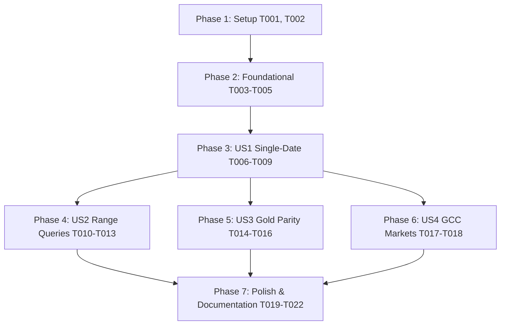

# Tasks: Unified History Resolution Engine

**Input**: Design documents from `specs/096-unified-history-engine/`  
**Prerequisites**: [plan.md](./plan.md) (required), [spec.md](./spec.md) (required), [research.md](./research.md), [data-model.md](./data-model.md), [contracts/](./contracts/)

## Format: `[ID] [P?] [Story] Description`

- **[P]**: Can run in parallel (different files, no dependencies)
- **[Story]**: Which user story this task belongs to (e.g., US1, US2, US3, US4)
- Include exact file paths in descriptions

---

## Phase 1: Setup & Shared Infrastructure

**Purpose**: Register bank rate weekly listeners and establish interface contracts.

- [X] T001 Register `rates_history_weekly` in `watchedWeeklyCollections` in `api/src/services/firestore-listener-service.ts` to synchronize Bank Rates Active Week in volatile RAM.
- [X] T002 [P] Define `IHistoryResolutionEngine` contract, types (`AssetClass`, `GccMarket`, `RangeOptions`), and helper interfaces in `api/src/services/history-resolution-engine.ts`.

---

## Phase 2: Foundational (Blocking Prerequisites)

**Purpose**: Core engine implementation that MUST be complete before query services can be refactored.

**⚠️ CRITICAL**: No user story integration work can begin until this phase is complete.

- [X] T003 Implement `HistoryResolutionEngine` class skeleton injecting `cacheService`, `activeWeeklyBucketStore`, `marketScheduleService`, and negative caching in `api/src/services/history-resolution-engine.ts`.
- [X] T004 [P] Implement ISO week calculation helpers (`getISOWeekString`, `getISOWeekRange`) and negative cache management in `api/src/services/history-resolution-engine.ts`.
- [X] T005 [P] Create comprehensive unit tests in `api/tests/unit/services/history-resolution-engine.test.ts` validating Active Week RAM lookup, Sealed Week `CacheService` disk lookup, and negative caching.

**Checkpoint**: Foundation ready — user story implementations can now begin.

---

## Phase 3: User Story 1 - Unified Historical Single-Date Quote Retrieval (Priority: P1) 🎯 MVP

**Goal**: Deliver a single, authoritative single-date historical lookup method (`getDateSnapshot`) across all asset classes with multi-tier caching.

**Independent Test**: Query `GET /v1/rates/history/:date`, `GET /v1/stocks/history/:date`, and `GET /v1/indices/history/:date` for past dates, verifying `<1ms` RAM hits for active week, disk cache hits for sealed weeks, and negative cache hits for holidays.

- [X] T006 [US1] Implement `getDateSnapshot(assetClass, date, market?)` in `api/src/services/history-resolution-engine.ts` with tiered resolution: Active Week RAM -> negative cache -> `cacheService` flat-cache -> Firestore fallback -> legacy daily fallback.
- [X] T007 [P] [US1] Refactor `RatesQueryService.getRatesHistory` in `api/src/services/rates-query-service.ts` to delegate single-date resolution to `historyResolutionEngine.getDateSnapshot('rates', date)`.
- [X] T008 [P] [US1] Refactor `StockQueryService.fetchStockPriceHistory` in `api/src/services/stock-query-service.ts` to delegate single-date resolution to `historyResolutionEngine.getDateSnapshot('stocks', date)`.
- [X] T009 [P] [US1] Refactor `IndicesQueryService.fetchIndexPriceHistory` in `api/src/services/indices-query-service.ts` to delegate single-date resolution to `historyResolutionEngine.getDateSnapshot('indices', date)`.

**Checkpoint**: User Story 1 is functional and testable independently.

---

## Phase 4: User Story 2 - Multi-Day Historical Range Querying (Priority: P2)

**Goal**: Deliver multi-day range queries across all assets by slicing weekly buckets from RAM and `CacheService`, eliminating per-day loop overhead for Bank Rates.

**Independent Test**: Query multi-month ranges across `/v1/rates/history/range`, `/v1/stocks/:symbol/history/range`, and `/v1/indices/:symbol/history/range` and verify sub-second execution without per-day loop overhead.

- [X] T010 [US2] Implement `getDateRange(assetClass, options)` in `api/src/services/history-resolution-engine.ts` slicing ISO weeks covering the interval, batch-resolving weekly buckets from RAM/`cacheService`, and sorting daily entries.
- [X] T011 [P] [US2] Refactor `RatesQueryService.getRatesHistoryRange` in `api/src/services/rates-query-service.ts` to delegate range queries to `historyResolutionEngine.getDateRange('rates', { start, end, bank, currency })` without creating combinatorial `rates_range:*` disk cache keys.
- [X] T012 [P] [US2] Refactor `StockQueryService.fetchStockPriceHistoryRange` in `api/src/services/stock-query-service.ts` to delegate range queries to `historyResolutionEngine.getDateRange('stocks', { start, end, symbol })`.
- [X] T013 [P] [US2] Refactor `IndicesQueryService.fetchIndexPriceHistoryRange` in `api/src/services/indices-query-service.ts` to delegate range queries to `historyResolutionEngine.getDateRange('indices', { start, end, symbol })`.

**Checkpoint**: User Story 2 is functional and testable independently.

---

## Phase 5: User Story 3 - Gold Endpoint Parity & Yesterday Close Resolution (Priority: P3)

**Goal**: Eliminate the range workaround for Gold single-date queries and live gold yesterday price deltas.

**Independent Test**: Verify `GET /v1/gold/history/:date` and `GET /v1/gold` yesterday prices resolve directly via `getDateSnapshot('gold', date)`.

- [X] T014 [US3] Implement `fetchGoldPriceHistory(date)` in `api/src/services/gold-query-service.ts` calling `historyResolutionEngine.getDateSnapshot('gold', date)`.
- [X] T015 [P] [US3] Refactor `goldQueryService.fetchGoldPriceHistoryRange` in `api/src/services/gold-query-service.ts` to delegate to `historyResolutionEngine.getDateRange('gold', { start, end })`.
- [X] T016 [P] [US3] Update route handlers in `api/src/routes/gold-routes.ts` (`/v1/gold` yesterday lookup and `/v1/gold/history/:date`) to call `goldQueryService.fetchGoldPriceHistory(date)`.

**Checkpoint**: User Story 3 is functional and testable independently.

---

## Phase 6: User Story 4 - Regional Equities (GCC Markets) History Integration (Priority: P4)

**Goal**: Parameterize the engine for regional GCC markets (`saudi`, `uae`, `qatar`) and eliminate duplicate week logic.

**Independent Test**: Query `/v1/stocks/:market/history/:date` and `/v1/stocks/:market/:symbol/history/range` for a GCC market and verify correct resolution.

- [X] T017 [US4] Add GCC market collection mapping (`stock_prices_{market}_history_weekly`) to `api/src/services/history-resolution-engine.ts`.
- [X] T018 [US4] Refactor `GccStockQueryService.fetchStockPriceHistory` and `fetchStockPriceHistoryRange` in `api/src/modules/gcc-stocks/services/gcc-stock-query-service.ts` to delegate to `historyResolutionEngine`.

**Checkpoint**: User Story 4 is functional and testable independently.

---

## Phase 7: Polish, Documentation & Verification

**Purpose**: Ensure strict compliance with all constitutional principles (Principles VI, X, XI, XII, XV, XVI, XVII).

- [X] T019 [P] Update `.specify/memory/ARCHITECTURE.md` detailing the `HistoryResolutionEngine` architecture and RAM synchronization of `rates_history_weekly`.
- [X] T020 [P] Update `.specify/memory/REQUIREMENTS.md` with new functional requirements (FR-001 through FR-011).
- [X] T021 [P] Update `MODULAR_COMPONENTS.md` and `.specify/memory/MODULAR_COMPONENTS.md` registering `HistoryResolutionEngine` in the component registry.
- [X] T022 Execute unit and E2E regression tests (`npm run test:unit` and `npm run test:e2e`) in `api/` to verify clean execution with 0 failures and 100% contract compliance.

---

## Dependencies & Execution Order

### Parallel Execution Opportunities
- **Phase 1**: T002 can run in parallel with T001.
- **Phase 2**: T004 and T005 can run in parallel with T003.
- **Phase 3**: T007, T008, and T009 can run in parallel once T006 is complete.
- **Phase 4**: T011, T012, and T013 can run in parallel once T010 is complete.
- **Phase 5**: T015 and T016 can run in parallel once T014 is complete.
- **Phase 7**: T019, T020, and T021 can run in parallel before running T022.

### Implementation Strategy
1. **MVP First**: Complete Phase 1, Phase 2, and Phase 3 (US1) to establish the working engine and single-date parity across rates, stocks, and indices.
2. **Incremental Enhancements**: Implement multi-day range queries (US2), Gold parity (US3), and GCC markets (US4) as discrete, independently verifiable increments.
3. **Strict Quality Gates**: Ensure exhaustive comments on every modified line (Principle VI) and execute both unit and E2E suites before completion (Principle XII).
