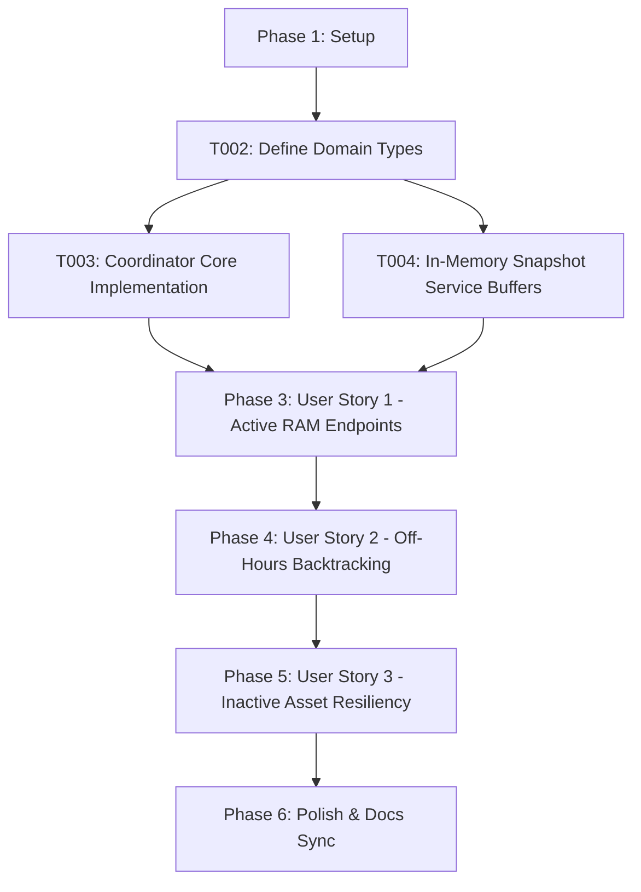

# Tasks: Dedicated Latest Intraday Timeline Endpoints

**Input**: Design documents from `/specs/097-latest-intraday-api/` (`plan.md`, `spec.md`, `research.md`, `data-model.md`, `contracts/`, `quickstart.md`)  
**Prerequisites**: `plan.md` (completed), `spec.md` (completed), `research.md` (completed), `data-model.md` (completed), `contracts/` (completed)  

---

## Phase 1: Setup (Shared Infrastructure)

**Purpose**: Verify dependencies and test configuration for the Fastify API service.

- [X] T001 Review and verify project dependencies and test runner configuration in `api/package.json`

---

## Phase 2: Foundational (Blocking Prerequisites)

**Purpose**: Core types, coordinator abstractions, and memory snapshot enhancements that MUST be completed before route handlers can resolve latest intraday timelines.

**⚠️ CRITICAL**: No user story work can begin until this phase is complete.

- [X] T002 Define domain types and parameter interfaces (`ResolveLatestTimelineOptions`, `LatestIntradayTimelineResult`) in `api/src/services/intraday-types.ts`
- [X] T003 Implement `resolveLatestTimeline` core coordinator method with in-memory RAM check and single-read Firestore query abstraction in `api/src/services/intraday-coordinator.ts`
- [X] T004 [P] Update `IntradaySnapshotService` to support setting, inspecting, and checking fallback session snapshots across all categories in `api/src/services/intraday-snapshot-service.ts`

**Checkpoint**: Foundation ready — user story implementation can now begin.

---

## Phase 3: User Story 1 - Active Trading Day Intraday Timeline Retrieval (Priority: P1) 🎯 MVP

**Goal**: Serve active market session intraday timelines for Stocks, Indices, Gold, and Bank Rates directly from volatile RAM with sub-millisecond response time and zero database reads.

**Independent Test**: Invoke `GET /v1/stocks/COMI/intraday/latest` with populated RAM cache and verify it returns today's date, live quote, and intraday points with `Cache-Control: public, max-age=60` in <10ms.

### Tests for User Story 1
- [X] T005 [P] [US1] Create unit tests for active in-memory timeline resolution in `api/tests/unit/intraday-coordinator.test.ts`

### Implementation for User Story 1
- [X] T006 [P] [US1] Implement `fetchLatestStockIntraday` query delegate in `api/src/services/stock-query-service.ts`
- [X] T007 [P] [US1] Implement `fetchLatestIndexIntraday` query delegate in `api/src/services/indices-query-service.ts`
- [X] T008 [P] [US1] Implement `fetchLatestGoldIntraday` query delegate in `api/src/services/gold-query-service.ts`
- [X] T009 [P] [US1] Implement `fetchLatestRateIntraday` query delegate in `api/src/services/rates-query-service.ts`
- [X] T010 [US1] Register `GET /v1/stocks/:symbol/intraday/latest` route handler with API key protection in `api/src/routes/stock-routes.ts`
- [X] T011 [US1] Register `GET /v1/indices/:symbol/intraday/latest` route handler with API key protection in `api/src/routes/indices-routes.ts`
- [X] T012 [US1] Register `GET /v1/gold/:item/intraday/latest` and `GET /v1/gold/intraday/latest` route handlers in `api/src/routes/gold-routes.ts`
- [X] T013 [US1] Register `GET /v1/rates/:currency/intraday/latest` route handler with bank query filtering in `api/src/routes/rates-routes.ts`

**Checkpoint**: User Story 1 complete — live active sessions resolve instantly across all 4 asset domains.

---

## Phase 4: User Story 2 - Off-Hours, Weekend, and Holiday Session Backtracking (Priority: P2)

**Goal**: When today's intraday is empty (weekends, exchange holidays, pre-market morning hours), automatically backtrack to the most recent active session in Firestore (capped at 7 days) and buffer in RAM with `max-age=900`.

**Independent Test**: Query any latest intraday endpoint on a weekend/off-hours and verify it returns the preceding session's date, complete points, and `Cache-Control: public, max-age=900`.

### Tests for User Story 2
- [X] T014 [P] [US2] Create unit tests for Firestore descending query backtracking and 7-day lookback bounds in `api/tests/unit/intraday-coordinator.test.ts`

### Implementation for User Story 2
- [X] T015 [US2] Implement descending Firestore collection lookup (`orderBy(FieldPath.documentId(), 'desc').limit(1)`) with 7-day lookback guard in `api/src/services/intraday-coordinator.ts`
- [X] T016 [US2] Wire off-hours closing quote resolution from `HistoryResolutionEngine` or daily snapshots in `api/src/services/stock-query-service.ts` and `api/src/services/indices-query-service.ts`
- [X] T017 [US2] Wire off-hours closing quote resolution in `api/src/services/gold-query-service.ts` and `api/src/services/rates-query-service.ts`
- [X] T018 [US2] Apply adaptive `Cache-Control` header logic (`max-age=60` active vs. `max-age=900` closed) across all four route handlers in `api/src/routes/`

**Checkpoint**: User Story 2 complete — 24/7 seamless charting with zero 404 errors during weekends and holidays.

---

## Phase 5: User Story 3 - Inactive Asset and Zero-Trade Graceful Resiliency (Priority: P3)

**Goal**: Ensure catalog securities with zero trade executions during the session return HTTP 200 OK with `intraday: []` and their latest price, while invalid symbols reject cleanly.

**Independent Test**: Query an illiquid catalog stock with no trades and verify it returns HTTP 200 OK with `intraday: []`; query an invalid symbol and verify HTTP 400 Bad Request.

### Tests for User Story 3
- [X] T019 [P] [US3] Create unit tests for zero-trade symbol handling and unknown symbol rejection in `api/tests/unit/stock-query-service.test.ts`

### Implementation for User Story 3
- [X] T020 [US3] Implement catalog presence check and zero-trade fallback logic in `api/src/services/stock-query-service.ts` and `api/src/services/indices-query-service.ts`
- [X] T021 [US3] Add parameter validation for Gold items and Rate currencies in `api/src/routes/gold-routes.ts` and `api/src/routes/rates-routes.ts`

**Checkpoint**: User Story 3 complete — client applications receive resilient, crash-proof envelopes for all catalog assets.

---

## Phase 6: Polish & Cross-Cutting Concerns

**Goal**: Integration testing, documentation synchronization, and constitutional compliance verification.

- [X] T022 [P] Create comprehensive HTTP integration test suite for latest intraday endpoints in `api/tests/integration/latest-intraday-routes.test.ts`
- [X] T023 [P] Update `API_ENDPOINTS_GUIDE.md` with new latest intraday endpoint documentation, query parameters, and response schemas
- [X] T024 [P] Update `MODULAR_COMPONENTS.md` registering the enhanced `IntradayCoordinator` latest session capability
- [X] T025 [P] Update `.specify/memory/REQUIREMENTS.md` documenting `FR-INTRA-001` through `FR-INTRA-004` under Caching & Intraday Data requirements
- [X] T026 Execute full test suite (`npm run test:unit` and `npm run test:integration`) in `api/` and verify 100% green pass rate

---

## Dependencies & Execution Order

---

## Parallel Execution Opportunities

### Phase 3 (User Story 1)
- `T006` (Stocks Query), `T007` (Indices Query), `T008` (Gold Query), and `T009` (Rates Query) touch completely different service files and can run in parallel.
- `T010` (Stock Routes), `T011` (Indices Routes), `T012` (Gold Routes), and `T013` (Rates Routes) touch different route files and can run in parallel once service delegates are ready.

### Phase 6 (Polish)
- `T022` (Integration Tests), `T023` (API Endpoints Guide), `T024` (Modular Components), and `T025` (Requirements Memory) touch disjoint files and can run concurrently.

---

## Implementation Strategy

1. **MVP First (Phase 1 to Phase 3)**: Establish `IntradayCoordinator` RAM resolution and wire the 4 primary endpoints for active market sessions. This immediately unblocks Android client development.
2. **Off-Hours Backtracking (Phase 4)**: Introduce the descending Firestore query for weekend and holiday protection, wrapping it with RAM fallback caching and adaptive HTTP headers.
3. **Resilience & Edge Cases (Phase 5)**: Add zero-trade handling (`intraday: []`) and catalog validation.
4. **Verification & Governance (Phase 6)**: Run test suites and update all living architecture documentation.
