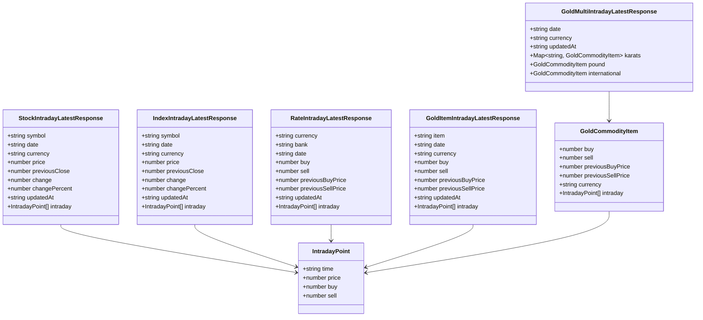

# Data Model: Expose Previous Day Price in Latest Intraday Endpoints

**Feature Branch**: `100-intraday-previous-price`  
**Date**: 2026-11-05  
**Spec**: [Feature Specification](file:///d:/Repo/Bekam_Fe_El_bank_Scrapper/specs/100-intraday-previous-price/spec.md)  
**Status**: Completed  

---

## 1. Overview & Entity Model

This document specifies the updated response structures for all four latest intraday timeline endpoints. All changes are non-breaking additions of top-level or nested numeric properties representing the preceding session's closing prices.

---

## 2. Entity Specifications

### 2.1 Stock Intraday Latest Response (`StockIntradayLatestResponse`)
Applies to `GET /v1/stocks/:symbol/intraday/latest?market={egx|saudi|uae|qatar|kuwait}`.

| Field Name | Type | Presence | Description | Validation / Constraints |
|:---|:---|:---|:---|:---|
| `symbol` | `string` | Mandatory | Canonical stock ticker symbol (e.g. `"COMI"`, `"1120"`) | Non-empty, uppercase |
| `date` | `string` | Mandatory | Calendar date of the resolved trading session (`YYYY-MM-DD`) | ISO date string format |
| `currency` | `string` | Mandatory | Currency denomination (`EGP`, `SAR`, `AED`, `QAR`, `KWD`) | 3-letter currency code |
| `price` | `number` | Mandatory | Current trading or closing price | Positive floating-point or 0 |
| **`previousClose`** | **`number`** | **Mandatory** | **Previous trading session closing price** | **Positive floating-point or 0** |
| `change` | `number` | Mandatory | Net price change relative to `previousClose` | Floating-point (can be negative, 0, or positive) |
| `changePercent` | `number` | Mandatory | Percentage price change relative to `previousClose` | Floating-point |
| `updatedAt` | `string` | Mandatory | Timestamp of latest quote update | ISO-8601 datetime string |
| `intraday` | `IntradayPoint[]` | Mandatory | Array of executed intraday price movement points | Chronologically ordered |

---

### 2.2 Index Intraday Latest Response (`IndexIntradayLatestResponse`)
Applies to `GET /v1/indices/:symbol/intraday/latest?market={egx|saudi|uae|qatar}`.

| Field Name | Type | Presence | Description | Validation / Constraints |
|:---|:---|:---|:---|:---|
| `symbol` | `string` | Mandatory | Canonical index code (e.g. `"EGX30"`, `"TASI"`, `"FADX15"`) | Non-empty, uppercase |
| `date` | `string` | Mandatory | Calendar date of the resolved trading session (`YYYY-MM-DD`) | ISO date string format |
| `currency` | `string` | Mandatory | Currency denomination (`EGP`, `SAR`, `AED`, `QAR`) | 3-letter currency code |
| `price` | `number` | Mandatory | Current benchmark index level | Positive floating-point or 0 |
| **`previousClose`** | **`number`** | **Mandatory** | **Previous trading session closing index level** | **Positive floating-point or 0** |
| `change` | `number` | Mandatory | Net index point change relative to `previousClose` | Floating-point |
| `changePercent` | `number` | Mandatory | Percentage index change relative to `previousClose` | Floating-point |
| `updatedAt` | `string` | Mandatory | Timestamp of latest index level update | ISO-8601 datetime string |
| `intraday` | `IntradayPoint[]` | Mandatory | Array of benchmark intraday movement points | Chronologically ordered |

---

### 2.3 Bank Rates Intraday Latest Response (`RateIntradayLatestResponse`)
Applies to `GET /v1/rates/:currency/intraday/latest?bank={BANK_CODE}`.

| Field Name | Type | Presence | Description | Validation / Constraints |
|:---|:---|:---|:---|:---|
| `currency` | `string` | Mandatory | Currency code (e.g. `"USD"`, `"EUR"`, `"SAR"`, `"CNY"`) | 3-letter uppercase currency code |
| `bank` | `string` | Optional | Bank identifier (e.g. `"cbe"`, `"cib"`, `"nbe"`), present when filtered | Lowercase short code |
| `date` | `string` | Mandatory | Calendar date of resolved banking session (`YYYY-MM-DD`) | ISO date string format |
| `buy` | `number` | Mandatory | Current buy exchange rate (bank buys from customer) | Positive float (2 decimals) |
| `sell` | `number` | Mandatory | Current sell exchange rate (bank sells to customer) | Positive float (2 decimals) |
| **`previousBuyPrice`** | **`number`** | **Mandatory** | **Previous session closing buy exchange rate** | **Positive float (2 decimals)** |
| **`previousSellPrice`** | **`number`** | **Mandatory** | **Previous session closing sell exchange rate** | **Positive float (2 decimals)** |
| `updatedAt` | `string` | Mandatory | Timestamp of latest exchange rate update | ISO-8601 datetime string |
| `intraday` | `IntradayPoint[]` | Mandatory | Timeline of recorded currency exchange rate shifts | Chronologically ordered |

---

### 2.4 Gold Single Item Intraday Latest Response (`GoldItemIntradayLatestResponse`)
Applies to `GET /v1/gold/:item/intraday/latest` (where `:item` is `24`, `21`, `18`, `pound`, or `international`).

| Field Name | Type | Presence | Description | Validation / Constraints |
|:---|:---|:---|:---|:---|
| `item` | `string` | Mandatory | Gold commodity key (`"24"`, `"21"`, `"18"`, `"pound"`, `"international"`) | Recognized item identifier |
| `date` | `string` | Mandatory | Calendar date of resolved trading session (`YYYY-MM-DD`) | ISO date string format |
| `currency` | `string` | Mandatory | Currency code (`"EGP"` for domestic items, `"USD"` for international) | 3-letter code |
| `buy` | `number` | Mandatory | Current buy price (retailer buyback from customer) | Positive float (2 decimals) |
| `sell` | `number` | Mandatory | Current sell price (retailer sale to customer) | Positive float (2 decimals) |
| **`previousBuyPrice`** | **`number`** | **Mandatory** | **Previous session closing buy price** | **Positive float (2 decimals)** |
| **`previousSellPrice`** | **`number`** | **Mandatory** | **Previous session closing sell price** | **Positive float (2 decimals)** |
| `updatedAt` | `string` | Mandatory | Timestamp of latest quote update | ISO-8601 datetime string |
| `intraday` | `IntradayPoint[]` | Mandatory | Timeline of recorded price ticks | Chronologically ordered |

---

### 2.5 Gold Multi-Commodity Intraday Latest Response (`GoldMultiIntradayLatestResponse`)
Applies to `GET /v1/gold/intraday/latest` and `GET /v1/gold/all/intraday/latest`.

| Field Name | Type | Presence | Description |
|:---|:---|:---|:---|
| `date` | `string` | Mandatory | Calendar date of resolved session (`YYYY-MM-DD`) |
| `currency` | `string` | Mandatory | Default currency (`"EGP"`) |
| `updatedAt` | `string` | Mandatory | Timestamp of update |
| `karats` | `object` | Mandatory | Karats map keyed by `"24"`, `"21"`, `"18"` |
| `karats[k].buy` | `number` | Mandatory | Current buy price |
| `karats[k].sell` | `number` | Mandatory | Current sell price |
| **`karats[k].previousBuyPrice`** | **`number`** | **Mandatory** | **Previous session closing buy price** |
| **`karats[k].previousSellPrice`** | **`number`** | **Mandatory** | **Previous session closing sell price** |
| `karats[k].intraday` | `IntradayPoint[]` | Mandatory | Karat timeline points |
| `pound` | `object` | Mandatory | Egyptian Gold Pound commodity object (contains `buy`, `sell`, `previousBuyPrice`, `previousSellPrice`, `intraday`) |
| `international` | `object` | Mandatory | International Spot Gold Ounce object (contains `buy`, `sell`, `previousBuyPrice`, `previousSellPrice`, `currency: "USD"`, `intraday`) |

