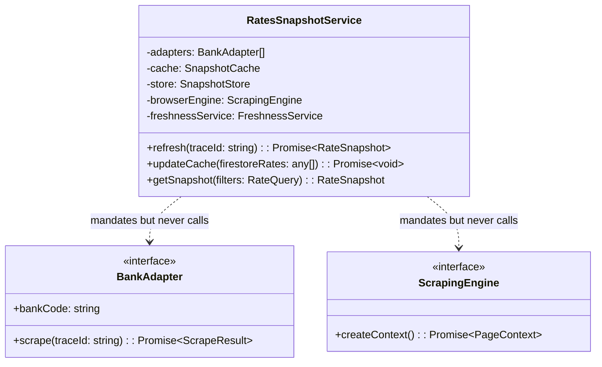
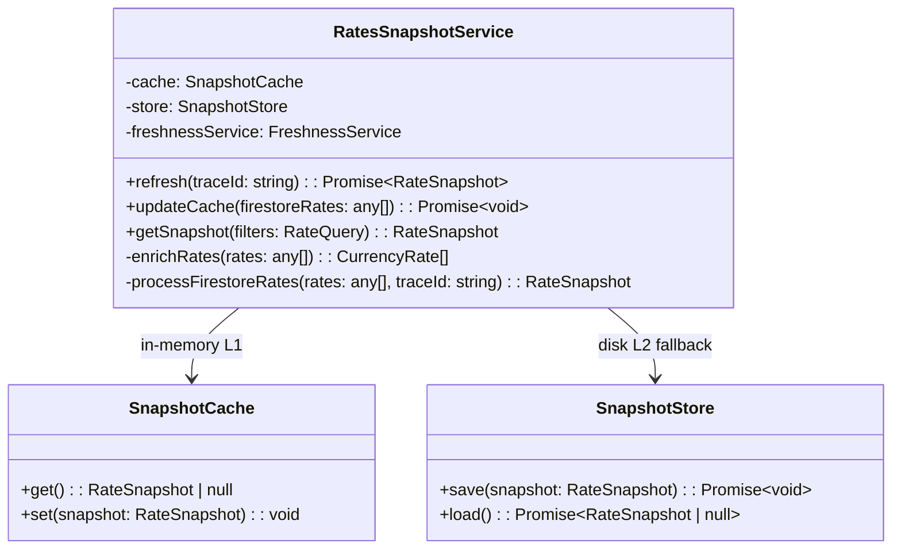

# Data Model: RatesSnapshotService Refactoring

**Feature**: `105-eliminate-phantom-scrapers`

**Date**: 2026-11-15

---

## 1. Class Structure & Seam Specification

### Before (Shallow & Leaking Phantom Dependencies)



### After (Deep Module with True Locality)



---

## 2. Ingested Data Structures

### Firestore Raw Document Schema (`rates/{bankId}`)
Incoming data ingested from Firestore push listener (`onSnapshot`) or fallback fetch:
```typescript
interface FirestoreBankRateDoc {
  bankId: string;                     // e.g. "nbe", "cib", "aaib"
  timestamp: string | Timestamp;      // Ingestion timestamp
  bankUpdatedAt?: string | null;      // Bank's officially reported rate update time
  rates: Record<string, {             // Map of currency codes to price details
    buy: number;                      // Current buy rate (EGP per 1 foreign currency)
    sell: number;                     // Current sell rate (EGP per 1 foreign currency)
    oldBuy?: number | null;           // Previous observation buy rate
    oldSell?: number | null;          // Previous observation sell rate
    trend?: 'up' | 'down' | 'stable'; // Movement direction
    dailyHighBuy?: number | null;     // Session extreme high buy
    dailyHighSell?: number | null;    // Session extreme high sell
    dailyLowBuy?: number | null;      // Session extreme low buy
    dailyLowSell?: number | null;     // Session extreme low sell
    yesterdayCloseBuy?: number | null;// Previous session closing buy
    yesterdayCloseSell?: number | null;// Previous session closing sell
  }>;
}
```

### Normalized Output Snapshot Schema (`RateSnapshot`)
Output payload served to Fastify API routes and cached in volatile RAM:
```typescript
interface RateSnapshot {
  requestedAt: string;                // ISO 8601 timestamp of snapshot generation
  freshness: 'current' | 'partial' | 'stale'; // Freshness classification
  requestFilters: RateQuery;          // Applied request query parameters
  rates: CurrencyRate[];              // Normalized flat rate array
  availability: AvailabilityRecord[]; // Health status of each catalog bank
  warnings: string[];                 // Operational or degradation notices
}

interface CurrencyRate {
  name_ar: string;                    // Arabic bank name from static catalog
  name_en: string;                    // English bank name from static catalog
  logo: string;                       // HTTPS bank logo URL
  bankCode: string;                   // Normalized uppercase bank code (e.g. "NBE")
  currencyCode: string;               // Normalized uppercase currency (e.g. "USD")
  buyRate: number;                    // Current buy rate
  sellRate: number;                   // Current sell rate
  trend: 'up' | 'down';               // Binary trend direction
  oldBuyRate: number | null;          // Resolved previous buy rate
  oldSellRate: number | null;         // Resolved previous sell rate
  retrievedAt: string;                // Snapshot timestamp
  bankUpdatedAt: string | null;       // Normalized bank update timestamp
  freshness: 'current' | 'stale';     // Rate freshness
  sourceTraceId?: string;             // Correlation trace ID
  dailyHighBuy: number | null;        // Intraday highest buy
  dailyHighSell: number | null;       // Intraday highest sell
  dailyLowBuy: number | null;         // Intraday lowest buy
  dailyLowSell: number | null;        // Intraday lowest sell
  yesterdayCloseBuy: number | null;   // Previous day close
  yesterdayCloseSell: number | null;  // Previous day close
  lastCloseSnapshotDate?: string;     // Snapshot date for closing rates
}
```
