# Tasks: Eliminate Phantom Scraping Machinery from API Gateway

**Input**: Design documents from `specs/105-eliminate-phantom-scrapers/`
- `spec.md`: User stories, acceptance criteria, and priority rankings
- `plan.md`: Refactoring strategy, file structures, and constitution checkpoints
- `research.md`: Architectural decisions regarding constructor simplification and Docker migration
- `data-model.md`: Class seam models and Firestore ingestion schema
- `contracts/snapshot-service-contract.md`: Simplified `RatesSnapshotService` and `app.ts` interfaces
- `quickstart.md`: Validation scenarios for compilation, unit testing, and contract verification

---

## Format: `[ID] [P?] [Story] Description`
- **[P]**: Can run in parallel (different files, no dependencies)
- **[Story]**: Which user story this task belongs to (`US1`, `US2`, `US3`)
- Includes exact file paths for every task

---

## Phase 1: Setup

**Purpose**: Baseline verification of current repository state before refactoring

- [X] T001 Verify clean repository state and baseline test execution in `D:\Repo\Bkam\Bkam_Api/package.json`

---

## Phase 2: Foundational (Blocking Prerequisites)

**Purpose**: Inventory and audit all active references to scraping machinery across the codebase

- [X] T002 [P] Inspect and catalog all references to `createSupportedAdapters` and `BankAdapter` across `D:\Repo\Bkam\Bkam_Api/src` and `D:\Repo\Bkam\Bkam_Api/tests`
- [X] T003 [P] Verify Firestore fallback mechanisms and memory snapshot schemas in `D:\Repo\Bkam\Bkam_Api/src/models/rate-snapshot.ts`

---

## Phase 3: User Story 2 - Decoupled Snapshot Ingestion Interface (Priority: P1) 🎯 MVP Component

**Goal**: Simplify `RatesSnapshotService` constructor to accept only real dependencies (`cache`, `store`, `freshnessService`) and eliminate phantom parameters (`adapters`, `browserEngine`).

**Independent Test**: Instantiate `RatesSnapshotService` with only `SnapshotCache` and `SnapshotStore`. Verify that `getSnapshot()`, `refresh()`, and `updateCache()` execute without requiring any adapter or browser engine instances.

- [X] T004 [US2] Refactor constructor in `D:\Repo\Bkam\Bkam_Api/src/services/rates-snapshot-service.ts` to remove `adapters: BankAdapter[]` and `browserEngine?: ScrapingEngine` parameters
- [X] T005 [US2] Remove `BankAdapter` and `ScrapingEngine` imports and typings from `D:\Repo\Bkam\Bkam_Api/src/services/rates-snapshot-service.ts`
- [X] T006 [P] [US2] Update unit tests in `D:\Repo\Bkam\Bkam_Api/tests/unit/rates-snapshot-service.test.ts` to pass only cache and store dependencies to `RatesSnapshotService`
- [X] T007 [P] [US2] Update unit tests in `D:\Repo\Bkam\Bkam_Api/tests/unit/rates-query-service.test.ts` to instantiate `RatesSnapshotService` without adapters

---

## Phase 4: User Story 1 - Clean Standalone API Gateway Startup & Memory Footprint (Priority: P1) 🎯 MVP Completion

**Goal**: Remove `createSupportedAdapters()` from `app.ts` so the API Gateway initializes instantly without launching background browser contexts or instantiating scraping adapters.

**Independent Test**: Start the server via `buildApp()`. Verify that the Fastify server starts listening on port `3001` with zero browser initialization logs and responds with `200 OK` on `/v1/health` and `/v1/rates`.

- [X] T008 [US1] Remove `createSupportedAdapters` import and invocation from `D:\Repo\Bkam\Bkam_Api/src/app.ts`
- [X] T009 [US1] Instantiate `RatesSnapshotService` directly with `snapshotCache` and `snapshotStore` in `D:\Repo\Bkam\Bkam_Api/src/app.ts`
- [X] T010 [P] [US1] Remove `createSupportedAdapters` mock definitions from `D:\Repo\Bkam\Bkam_Api/tests/contract/catalog-and-rates.contract.test.ts`
- [X] T011 [P] [US1] Remove `createSupportedAdapters` mock definitions from `D:\Repo\Bkam\Bkam_Api/tests/contract/filtered-rates.contract.test.ts`
- [X] T012 [P] [US1] Remove `createSupportedAdapters` mock definitions from `D:\Repo\Bkam\Bkam_Api/tests/contract/freshness-and-availability.contract.test.ts`
- [X] T013 [P] [US1] Remove `createSupportedAdapters` mock definitions from `D:\Repo\Bkam\Bkam_Api/tests/integration/filtered-rates.integration.test.ts`
- [X] T014 [P] [US1] Remove `createSupportedAdapters` mock definitions from `D:\Repo\Bkam\Bkam_Api/tests/integration/gas-routes.test.ts`
- [X] T015 [P] [US1] Remove `createSupportedAdapters` mock definitions from `D:\Repo\Bkam\Bkam_Api/tests/integration/gold-routes.test.ts`
- [X] T016 [P] [US1] Remove `createSupportedAdapters` mock definitions from `D:\Repo\Bkam\Bkam_Api/tests/integration/metrics.test.ts`
- [X] T017 [P] [US1] Remove `createSupportedAdapters` and `ta3weem-adapter.js` mock definitions from `D:\Repo\Bkam\Bkam_Api/tests/integration/rate-change-tracking.integration.test.ts`
- [X] T018 [P] [US1] Update `RatesSnapshotService` constructor call in `D:\Repo\Bkam\Bkam_Api/tests/integration/stale-fallback.integration.test.ts` to remove `BankAdapter[]` parameter
- [X] T019 [P] [US1] Remove `createSupportedAdapters` and `ta3weem-adapter.js` mock definitions from `D:\Repo\Bkam\Bkam_Api/tests/integration/get-rates.integration.test.ts`, `gcc-catalog-routes.test.ts`, `qatar-stock-routes.test.ts`, `saudi-stock-routes.test.ts`, `uae-stock-routes.test.ts`, `regional-indices-routes.test.ts`, and `indices-constituents.test.ts`

---

## Phase 5: User Story 3 - Elimination of Dead Scraping Dependencies and Artifacts (Priority: P2)

**Goal**: Purge all 30+ dead bank scraping adapters, Playwright engines, browser services, and scraping fixture tests from `Bkam_Api`, remove browser dependencies from `package.json`, and migrate `Dockerfile` to `node:22-alpine`.

**Independent Test**: Run `npm run build` and `npm run test:unit` in an environment without Playwright or Chromium. All tests pass with zero browser errors. Build Docker image and verify size drops to ~150MB.

- [X] T020 [P] [US3] Delete all individual bank scraping adapter files in `D:\Repo\Bkam\Bkam_Api/src/adapters/banks/`
- [X] T021 [P] [US3] Delete scraping engines and registry in `D:\Repo\Bkam\Bkam_Api/src/adapters/engines/` and `D:\Repo\Bkam\Bkam_Api/src/adapters/registry.ts`
- [X] T022 [P] [US3] Delete base scraping adapter interfaces in `D:\Repo\Bkam\Bkam_Api/src/adapters/base/`
- [X] T023 [P] [US3] Delete browser launcher service in `D:\Repo\Bkam\Bkam_Api/src/services/browser-service.ts`
- [X] T024 [P] [US3] Delete obsolete bank scraper fixture tests, unit adapter tests, and helpers in `D:\Repo\Bkam\Bkam_Api/tests/fixtures/`, `D:\Repo\Bkam\Bkam_Api/tests/adapters/`, `D:\Repo\Bkam\Bkam_Api/tests/helpers/load-fixture.ts`, and `D:\Repo\Bkam\Bkam_Api/tests/utils/capture-fixture.ts`
- [X] T025 [P] [US3] Delete obsolete live bank integration tests and engine tests in `D:\Repo\Bkam\Bkam_Api/tests/integration/banks/`, `D:\Repo\Bkam\Bkam_Api/tests/integration/playwright-engine.test.ts`, `D:\Repo\Bkam\Bkam_Api/tests/integration/expand-bank-support.integration.test.ts`, and `D:\Repo\Bkam\Bkam_Api/tests/integration/rates-snapshot-service.test.ts`
- [X] T026 [US3] Remove `playwright`, `playwright-stealth`, `cheerio`, `@playwright/test`, and obsolete scripts (`playwright:install`, `test:fixtures`, `capture:fixture`) from `D:\Repo\Bkam\Bkam_Api/package.json`
- [X] T027 [US3] Migrate Dockerfile to `node:22-alpine` base image and remove Chromium installation steps in `D:\Repo\Bkam\Bkam_Api/Dockerfile`

---

## Phase 6: Polish & Cross-Cutting Concerns

**Purpose**: Dependency pruning, full test validation, governance synchronization, and documentation updates

- [X] T028 Run `npm install` to update and prune lockfile in `D:\Repo\Bkam\Bkam_Api/package-lock.json`
- [X] T029 Execute TypeScript build check with `npm run build` in `D:\Repo\Bkam\Bkam_Api/`
- [X] T030 Execute full unit test suite with `npm run test:unit` in `D:\Repo\Bkam\Bkam_Api/`
- [X] T031 Execute contract test suite with `npm run test:contract` in `D:\Repo\Bkam\Bkam_Api/`
- [X] T032 Update architectural and requirements documentation in `D:\Repo\Bkam\Bkam_Api/.specify/memory/ARCHITECTURE.md` and `REQUIREMENTS.md`

---

## Dependencies & Execution Graph

```mermaid
flowchart TD
  subgraph Phase2[Foundational Audit]
    T002[T002 Catalog references]
    T003[T003 Verify Firestore schemas]
  end

  subgraph Phase3[US2: Refactor Snapshot Service]
    T004[T004 Refactor constructor]
    T005[T005 Remove BankAdapter types]
    T006[T006 Update unit tests]
    T007[T007 Update query service tests]
  end

  subgraph Phase4[US1: Clean App Bootstrap]
    T008[T008 Remove createSupportedAdapters]
    T009[T009 Rewire app.ts bootstrap]
    T010[T010-T019 Clean contract/integration test mocks]
  end

  subgraph Phase5[US3: Purge Dead Code & Dependencies]
    T020[T020 Delete src/adapters/banks]
    T021[T021 Delete src/adapters/engines]
    T022[T022 Delete src/adapters/base]
    T023[T023 Delete browser-service.ts]
    T024[T024 Delete tests/fixtures]
    T025[T025 Delete tests/integration/banks]
    T026[T026 Purge package.json dependencies]
    T027[T027 Migrate Dockerfile to node:22-alpine]
  end

  subgraph Phase6[Polish & Verification]
    T028[T028 npm install]
    T029[T029 npm run build]
    T030[T030 npm run test:unit]
    T031[T031 npm run test:contract]
    T032[T032 Update ARCHITECTURE.md]
  end

  Phase2 --> Phase3
  Phase3 --> Phase4
  Phase4 --> Phase5
  Phase5 --> Phase6
```

---

## Implementation Strategy

1. **Incremental MVP**: Phases 1–4 deliver the core functional MVP: `RatesSnapshotService` constructor is decoupled and `app.ts` boots without scraper overhead.
2. **Safe Code Purge**: Phase 5 safely removes the dead files and dependencies only after `app.ts` and test mocks are completely decoupled.
3. **Continuous Verification**: Each phase runs `npm run build` and tests to guarantee 0 regressions to API contracts.
