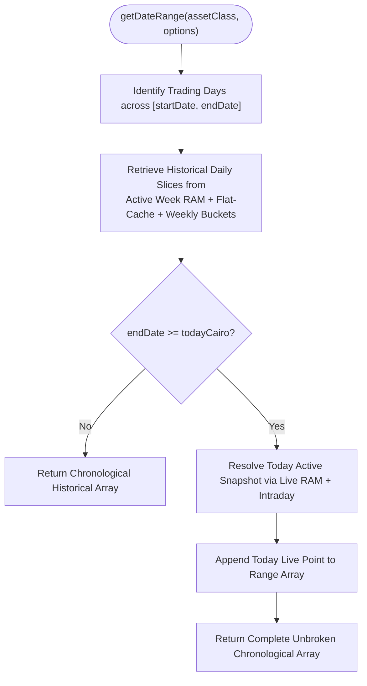

# Data Model & Domain Entities: Deepen History Resolution Engine

**Feature**: `106-deepen-history-resolution`  
**Date**: 2026-11-15  
**Domain**: API Gateway / Market History Resolution

---

## 1. Domain Entities & Type Definitions

### 1.1 Supported Asset Classes
High-level categories of financial instruments tracked by the platform:

```typescript
export type AssetClass = 'rates' | 'gold' | 'stocks' | 'indices';
```

### 1.2 Regional Markets
Regional GCC stock exchanges supported across equities and indices:

```typescript
export type GccMarket = 'saudi' | 'uae' | 'qatar' | 'kuwait';
```

### 1.3 Snapshot Query Options
Input options passed to `getDateSnapshot` allowing granular asset filtering:

```typescript
export interface DateSnapshotOptions {
  // Optional regional market identifier for GCC equities/indices
  market?: GccMarket;
  // Optional bank identifier filter for foreign exchange rates (e.g., 'NBE', 'CIB')
  bank?: string;
  // Optional currency ISO code filter for rates (e.g., 'USD', 'EUR')
  currency?: string;
  // Optional ticker symbol filter for stocks/indices (e.g., 'COMI', 'EGX30')
  symbol?: string;
}
```

### 1.4 Resolved Date Snapshot Envelope
Unified result object returned by `getDateSnapshot` containing the resolved payload and caching metadata:

```typescript
export interface ResolvedDateSnapshot<T = any> {
  // Structured snapshot payload (matches historical daily archive shape)
  data: T | null;
  // True if queried date corresponds to the active trading day in Africa/Cairo
  isToday: boolean;
  // Canonical YYYY-MM-DD date string
  date: string;
  // Recommended public HTTP Cache-Control max-age in seconds (60 for today, 3600 for sealed history)
  cacheTtlSeconds: number;
}
```

### 1.5 Historical Date Range Options
Options specifying a multi-day or multi-week historical range query:

```typescript
export interface RangeOptions {
  // ISO start date formatted as YYYY-MM-DD
  startDate: string;
  // ISO end date formatted as YYYY-MM-DD (can be today or past)
  endDate: string;
  // Optional single symbol filter (stocks and indices)
  symbol?: string;
  // Optional bank filter (bank exchange rates)
  bank?: string;
  // Optional currency filter (bank exchange rates)
  currency?: string;
  // Optional regional market identifier (GCC equities)
  market?: GccMarket;
}
```

---

## 2. Resolution State Machine & Lifecycle Flow

```mermaid
flowchart TD
    Start(["getDateSnapshot(assetClass, date, options)"]) --> CheckFuture{"date > todayCairo?"}
    
    CheckFuture -->|Yes| FutureErr["Throw 400 Bad Request\n(Cannot query future dates)"]
    CheckFuture -->|No| CheckToday{"date === todayCairo?"}
    
    CheckToday -->|Yes (Active Session)| LiveRAM["1. Retrieve Live In-Memory Snapshot\n2. Coordinate Intraday Points (intradayCoordinator)\n3. Synthesize Daily Snapshot\n4. Set isToday: true, TTL: 60s"]
    
    CheckToday -->|No (Concluded Session)| StorageTier["1. Check Active Week RAM Store\n2. Check Flat-Cache Disk Cache (TTL: 30 days)\n3. Query Firestore Weekly Bucket (rates_history_weekly/YYYY-Www)\n4. Set isToday: false, TTL: 3600s"]
    
    LiveRAM --> ApplyFilters["Apply Asset Filters\n(bank, currency, symbol)"]
    StorageTier --> ApplyFilters
    
    ApplyFilters --> ReturnResult(["Return ResolvedDateSnapshot"])
```

---

## 3. Date Range Synthesis Lifecycle



