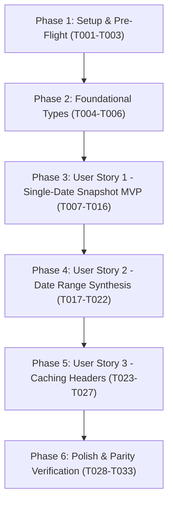

# Tasks: Deepen History Resolution Engine

**Input**: Design documents from `specs/106-deepen-history-resolution/` (`spec.md`, `plan.md`, `research.md`, `data-model.md`, `contracts/`, `quickstart.md`)  
**Prerequisites**: Branch `106-deepen-history-resolution` active on `Bekam_Fe_El_bank_Scrapper` and `Bkam_Api`.

## Format: `[ID] [P?] [Story] Description`

- **[P]**: Can run in parallel (different files, no dependencies on incomplete tasks)
- **[Story]**: Which user story this task belongs to (`[US1]`, `[US2]`, `[US3]`)
- Every task includes the exact file path and action

---

## Phase 1: Setup & Pre-Flight Verification

**Purpose**: Confirm test baselines and verify current repository state before modifications.

- [X] T001 Verify clean git working tree and active feature branch `106-deepen-history-resolution` across both repositories
- [X] T002 Execute baseline unit test suite in `D:\Repo\Bkam\Bkam_Api` via `npm run test:unit`
- [X] T003 Execute baseline 36-scenario verification suite in `D:\Repo\Bkam\Bkam_Api` via `npm run verify:remote -- --url http://84.235.253.78:3001 --key local-dev-key`

---

## Phase 2: Foundational Prerequisites

**Purpose**: Core type definitions and contract extensions in `HistoryResolutionEngine` required by all user stories.

- [X] T004 [P] Define `DateSnapshotOptions` and `ResolvedDateSnapshot` interfaces in `D:\Repo\Bkam\Bkam_Api\src\services\history-resolution-engine.ts`
- [X] T005 [P] Update `IHistoryResolutionEngine` contract to accept `DateSnapshotOptions` and return `ResolvedDateSnapshot` in `D:\Repo\Bkam\Bkam_Api\src\services\history-resolution-engine.ts`
- [X] T006 Implement centralized future date validation guard (`date > todayCairo` throws 400 Bad Request) in `D:\Repo\Bkam\Bkam_Api\src\services\history-resolution-engine.ts`

**Checkpoint**: Core types and boundary validation guards ready.

---

## Phase 3: User Story 1 - Unified Single-Date Market Snapshot Retrieval (Priority: P1) 🎯 MVP

**Goal**: Deliver a single unified `getDateSnapshot` entry point that transparently resolves today's active session (live RAM + intraday coordinator) or past archives (RAM bucket -> flat-cache -> Firestore) across all 4 asset classes.

**Independent Test**: Query single-date endpoints for both yesterday and today across FX, gold, stocks, and indices. Both return contract-compliant snapshots with zero caller branching.

### Implementation for User Story 1

- [X] T007 [US1] Implement active today resolution helper for Bank FX rates in `D:\Repo\Bkam\Bkam_Api\src\services\history-resolution-engine.ts`
- [X] T008 [US1] Implement active today resolution helper for Gold commodities in `D:\Repo\Bkam\Bkam_Api\src\services\history-resolution-engine.ts`
- [X] T009 [US1] Implement active today resolution helper for Equities (EGX and GCC) in `D:\Repo\Bkam\Bkam_Api\src\services\history-resolution-engine.ts`
- [X] T010 [US1] Implement active today resolution helper for Benchmark Indices in `D:\Repo\Bkam\Bkam_Api\src\services\history-resolution-engine.ts`
- [X] T011 [US1] Deepen `getDateSnapshot` to branch between active today synthesis and historical storage retrieval in `D:\Repo\Bkam\Bkam_Api\src\services\history-resolution-engine.ts`
- [X] T012 [P] [US1] Refactor `RatesQueryService.getRatesHistory` to delegate directly to `historyResolutionEngine.getDateSnapshot` in `D:\Repo\Bkam\Bkam_Api\src\services\rates-query-service.ts`
- [X] T013 [P] [US1] Refactor `GoldQueryService.fetchGoldPriceHistory` to delegate directly to `historyResolutionEngine.getDateSnapshot` in `D:\Repo\Bkam\Bkam_Api\src\services\gold-query-service.ts`
- [X] T014 [P] [US1] Refactor `StockQueryService.fetchStockPriceHistory` to delegate directly to `historyResolutionEngine.getDateSnapshot` in `D:\Repo\Bkam\Bkam_Api\src\services\stock-query-service.ts`
- [X] T015 [P] [US1] Refactor `IndicesQueryService.fetchIndexPriceHistory` to delegate directly to `historyResolutionEngine.getDateSnapshot` in `D:\Repo\Bkam\Bkam_Api\src\services\indices-query-service.ts`
- [X] T016 [US1] Update existing unit tests in `D:\Repo\Bkam\Bkam_Api\tests\unit\history-resolution-engine.test.ts` to assert active today synthesis

**Checkpoint**: User Story 1 is functional and verifiable independently as an MVP.

---

## Phase 4: User Story 2 - Continuous Multi-Day Historical Range Across Session Boundaries (Priority: P2)

**Goal**: Seamlessly combine historical closing slices with today's live session in `getDateRange` when the range bounds span into the active day.

**Independent Test**: Query a 5-day range ending today. Verify that past days contain sealed closing values and the final element contains today's live synthesized quote without timeline gaps.

### Implementation for User Story 2

- [X] T017 [US2] Update `HistoryResolutionEngine.getDateRange` to detect `endDate >= todayCairo` and append synthesized live today quote in `D:\Repo\Bkam\Bkam_Api\src\services\history-resolution-engine.ts`
- [X] T018 [P] [US2] Simplify `RatesQueryService.getRatesHistoryRange` to delegate directly to `historyResolutionEngine.getDateRange` in `D:\Repo\Bkam\Bkam_Api\src\services\rates-query-service.ts`
- [X] T019 [P] [US2] Simplify `GoldQueryService.fetchGoldPriceHistoryRange` to delegate directly to `historyResolutionEngine.getDateRange` in `D:\Repo\Bkam\Bkam_Api\src\services\gold-query-service.ts`
- [X] T020 [P] [US2] Simplify `StockQueryService.fetchStockPriceHistoryRange` to delegate directly to `historyResolutionEngine.getDateRange` in `D:\Repo\Bkam\Bkam_Api\src\services\stock-query-service.ts`
- [X] T021 [P] [US2] Simplify `IndicesQueryService.fetchIndexPriceHistoryRange` to delegate directly to `historyResolutionEngine.getDateRange` in `D:\Repo\Bkam\Bkam_Api\src\services\indices-query-service.ts`
- [X] T022 [US2] Add unit test in `D:\Repo\Bkam\Bkam_Api\tests\unit\history-resolution-engine.test.ts` verifying seamless live today appending in multi-day range queries

**Checkpoint**: User Story 2 is functional and independently testable.

---

## Phase 5: User Story 3 - Operational Timezone Consistency and Caching Policies (Priority: P3)

**Goal**: Ensure all routes consume engine caching metadata (`isToday` and `cacheTtlSeconds`) to set standardized HTTP `Cache-Control` headers.

**Independent Test**: Inspect response headers for `/v1/rates/history/:date` with today vs past date; confirm `max-age=60` for today and `max-age=3600` for past.

### Implementation for User Story 3

- [X] T023 [P] [US3] Update `rates-routes.ts` to utilize engine caching metadata in `D:\Repo\Bkam\Bkam_Api\src\routes\rates-routes.ts`
- [X] T024 [P] [US3] Update `gold-routes.ts` to utilize engine caching metadata in `D:\Repo\Bkam\Bkam_Api\src\routes\gold-routes.ts`
- [X] T025 [P] [US3] Update `stock-routes.ts` to utilize engine caching metadata in `D:\Repo\Bkam\Bkam_Api\src\routes\stock-routes.ts`
- [X] T026 [P] [US3] Update `indices-routes.ts` to utilize engine caching metadata in `D:\Repo\Bkam\Bkam_Api\src\routes\indices-routes.ts`
- [X] T027 [US3] Verify midnight Africa/Cairo rollover behavior in `D:\Repo\Bkam\Bkam_Api\src\services\history-resolution-engine.ts`

**Checkpoint**: User Story 3 is complete.

---

## Phase 6: Polish, Verification & Governance

**Purpose**: Exhaustive commenting, regression testing, living documentation synchronization, and parity benchmarking.

- [X] T028 [P] Ensure exhaustive line-by-line commenting on every modified line per Constitution Principle V across all touched files in `D:\Repo\Bkam\Bkam_Api\src`
- [X] T029 Execute full unit test suite via `npm run test:unit` in `D:\Repo\Bkam\Bkam_Api`
- [X] T030 Execute full 36-scenario verification suite via `npm run verify:remote -- --url http://84.235.253.78:3001 --key local-dev-key` in `D:\Repo\Bkam\Bkam_Api`
- [X] T031 Execute differential parity runner via `npm run verify:diff -- --base http://84.235.253.78:3000 --target http://84.235.253.78:3001 --key local-dev-key` in `D:\Repo\Bkam\Bkam_Api`
- [X] T032 [P] Update `D:\Repo\Bekam_Fe_El_bank_Scrapper\.specify\memory\REQUIREMENTS.md` with updated architectural capability description
- [X] T033 [P] Update `D:\Repo\Bekam_Fe_El_bank_Scrapper\.specify\memory\ARCHITECTURE.md` and `MODULAR_COMPONENTS.md` reflecting deepened engine seam

---

## Dependencies & Sequence

---

## Parallel Execution Opportunities

- **T012, T013, T014, T015**: The 4 query service refactorings operate on independent files and can be executed concurrently once T011 lands.
- **T018, T019, T020, T021**: The 4 range query simplifications operate on independent files and can run concurrently once T017 lands.
- **T023, T024, T025, T026**: Route header updates can run concurrently across route files.
- **T032, T033**: Memory documentation updates can run in parallel with polish tasks.

---

## Implementation Strategy: MVP First

1. **MVP Cut (Phases 1-3)**: Deliver T001 through T016. At this point, single-date queries for today and past dates across all 4 asset classes are 100% unified behind `HistoryResolutionEngine`. The 4 query services immediately eliminate over 200 lines of branching.
2. **Incremental Delivery (Phase 4)**: Unify date range lookups in `getDateRange`.
3. **Hardening (Phases 5-6)**: Standardize route cache headers, verify 100% parity against baseline server, and synchronize living memory documents.

