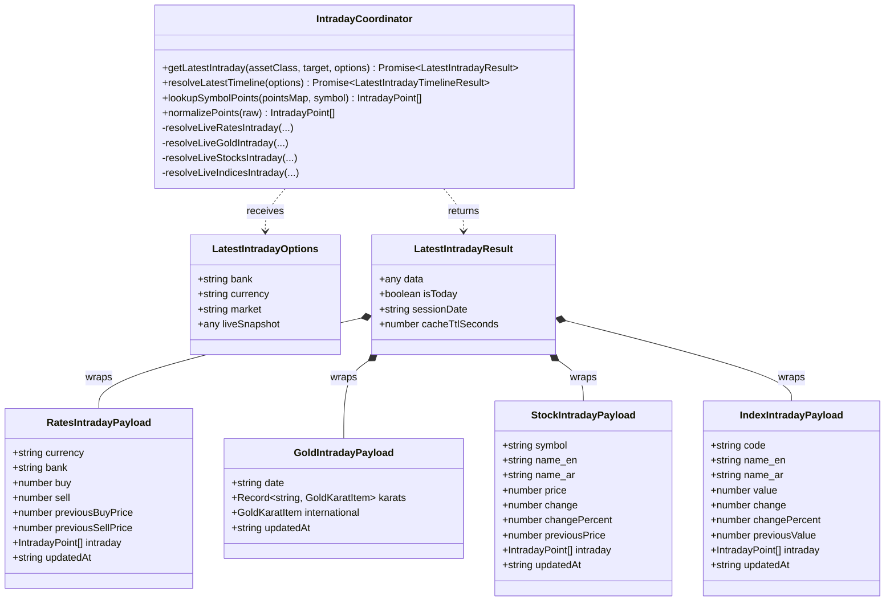
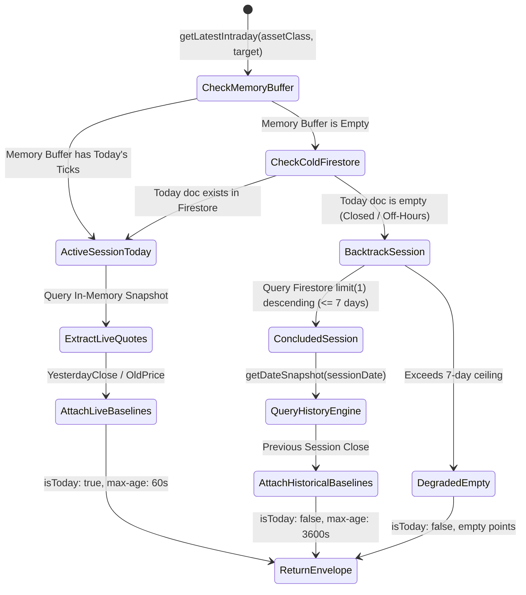

# Data Model: Deepen Intraday Coordinator

**Branch**: `107-deepen-intraday-coordinator` | **Date**: 2026-11-15 | **Spec**: [spec.md](./spec.md)

---

## Entity Relationships & Seam Architecture



---

## Interface Definitions & Types

### 1. `LatestIntradayOptions`
```typescript
export interface LatestIntradayOptions {
  // Optional bank short code filter for bank exchange rates (e.g. 'NBE', 'CIB')
  bank?: string;
  // Optional currency code filter for bank rates (e.g. 'USD', 'EUR')
  currency?: string;
  // Optional regional GCC equity exchange (e.g. 'saudi', 'uae', 'qatar', 'kuwait')
  market?: GccMarket;
  // Optional pre-resolved live snapshot payload to avoid redundant fetches or for unit testing
  liveSnapshot?: any;
}
```

### 2. `LatestIntradayResult<T>`
```typescript
export interface LatestIntradayResult<T = any> {
  // Domain payload matching exact client JSON route shape
  data: T;
  // Boolean flag indicating if data represents active today session
  isToday: boolean;
  // Resolved trading session calendar date (YYYY-MM-DD)
  sessionDate: string;
  // Standard HTTP Cache-Control max-age lifetime (60 for today, 3600 for past)
  cacheTtlSeconds: number;
}
```

---

## State Transition & Session Lifecycles



