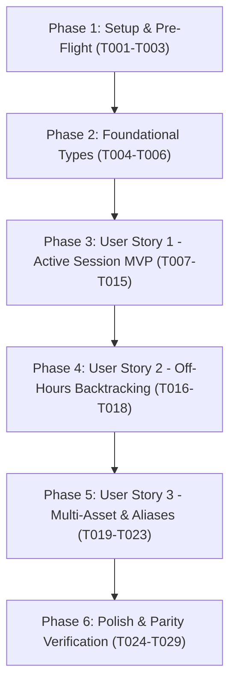

# Tasks: Deepen Intraday Coordinator

**Input**: Design documents from `specs/107-deepen-intraday-coordinator/` (`spec.md`, `plan.md`, `research.md`, `data-model.md`, `contracts/`, `quickstart.md`)  
**Prerequisites**: Branch `107-deepen-intraday-coordinator` active across `Bekam_Fe_El_bank_Scrapper` and `Bkam_Api`.

## Format: `[ID] [P?] [Story] Description`

- **[P]**: Can run in parallel (different files, no dependencies on incomplete tasks)
- **[Story]**: Which user story this task belongs to (`[US1]`, `[US2]`, `[US3]`)
- Every task includes the exact file path and action

---

## Phase 1: Setup & Pre-Flight Verification

**Purpose**: Confirm test baselines and verify current repository state before modifications.

- [X] T001 Verify clean git working tree and active feature branch `107-deepen-intraday-coordinator` across both repositories
- [X] T002 Execute baseline unit test suite in `D:\Repo\Bkam\Bkam_Api` via `npm run test:unit`
- [X] T003 Execute baseline 36-scenario verification suite in `D:\Repo\Bkam\Bkam_Api` via `npm run verify:remote -- --url http://84.235.253.78:3001 --key local-dev-key`

---

## Phase 2: Foundational Prerequisites

**Purpose**: Core type definitions and contract extensions in `IntradayCoordinator` required by all user stories.

- [X] T004 [P] Define `LatestIntradayOptions` and `LatestIntradayResult` interfaces in `D:\Repo\Bkam\Bkam_Api\src\services\intraday-types.ts`
- [X] T005 [P] Update `IIntradayCoordinator` contract interface to include `getLatestIntraday` in `D:\Repo\Bkam\Bkam_Api\src\services\intraday-types.ts`
- [X] T006 Implement core `getLatestIntraday` dispatcher method in `D:\Repo\Bkam\Bkam_Api\src\services\intraday-coordinator.ts`

**Checkpoint**: Core types and dispatcher seam ready.

---

## Phase 3: User Story 1 - Unified Active Session Intraday Delivery (Priority: P1) 🎯 MVP

**Goal**: Deliver a single unified `getLatestIntraday` entry point that resolves the ongoing session's intraday timeline combined with current quotes and previous closing price baselines across all 4 asset classes.

**Independent Test**: Query latest intraday endpoints for active sessions across FX, gold, stocks, and indices. All return contract-compliant envelopes with live quotes, baselines, and tick arrays with zero caller assembly logic.

### Implementation for User Story 1

- [X] T007 [US1] Implement active session rates resolution helper (`resolveLiveRatesIntraday`) with baseline extraction in `D:\Repo\Bkam\Bkam_Api\src\services\intraday-coordinator.ts`
- [X] T008 [US1] Implement active session gold resolution helper (`resolveLiveGoldIntraday`) with karat extraction in `D:\Repo\Bkam\Bkam_Api\src\services\intraday-coordinator.ts`
- [X] T009 [US1] Implement active session stocks resolution helper (`resolveLiveStocksIntraday`) with symbol lookup and alias matching in `D:\Repo\Bkam\Bkam_Api\src\services\intraday-coordinator.ts`
- [X] T010 [US1] Implement active session indices resolution helper (`resolveLiveIndicesIntraday`) with index catalog validation in `D:\Repo\Bkam\Bkam_Api\src\services\intraday-coordinator.ts`
- [X] T011 [P] [US1] Refactor `RatesQueryService.fetchLatestRatesIntraday` to delegate directly to `intradayCoordinator.getLatestIntraday` in `D:\Repo\Bkam\Bkam_Api\src\services\rates-query-service.ts`
- [X] T012 [P] [US1] Refactor `GoldQueryService.fetchLatestGoldIntraday` to delegate directly to `intradayCoordinator.getLatestIntraday` in `D:\Repo\Bkam\Bkam_Api\src\services\gold-query-service.ts`
- [X] T013 [P] [US1] Refactor `StockQueryService.fetchLatestStockIntraday` to delegate directly to `intradayCoordinator.getLatestIntraday` in `D:\Repo\Bkam\Bkam_Api\src\services\stock-query-service.ts`
- [X] T014 [P] [US1] Refactor `IndicesQueryService.fetchLatestIndexIntraday` to delegate directly to `intradayCoordinator.getLatestIntraday` in `D:\Repo\Bkam\Bkam_Api\src\services\indices-query-service.ts`
- [X] T015 [US1] Add unit tests in `D:\Repo\Bkam\Bkam_Api\tests\unit\intraday-coordinator.test.ts` verifying active session quotes, baseline prices, and points synthesis across all 4 asset classes

**Checkpoint**: User Story 1 is functional and verifiable independently as an MVP.

---

## Phase 4: User Story 2 - Automated Session Backtracking During Off-Hours (Priority: P2)

**Goal**: Automatically backtrack to the most recent concluded trading session within a 7-day lookback ceiling during off-hours, weekends, or holidays, retrieving closing quotes from `HistoryResolutionEngine`.

**Independent Test**: Query latest intraday endpoints outside market hours. Confirm the system delivers the concluded session's timeline with `isToday: false` and accurate historical closing baseline quotes.

### Implementation for User Story 2

- [X] T016 [US2] Implement off-hours concluded session historical quote resolution in `D:\Repo\Bkam\Bkam_Api\src\services\intraday-coordinator.ts` via `HistoryResolutionEngine.getDateSnapshot`
- [X] T017 [US2] Implement previous session closing price baseline recovery for backtracked sessions in `D:\Repo\Bkam\Bkam_Api\src\services\intraday-coordinator.ts`
- [X] T018 [US2] Add unit tests in `D:\Repo\Bkam\Bkam_Api\tests\unit\intraday-coordinator.test.ts` verifying off-hours session backtracking, 7-day lookback ceiling enforcement, and `isToday: false` response metadata

**Checkpoint**: User Story 2 is functional and independently testable.

---

## Phase 5: User Story 3 - Consolidated Multi-Asset Views & Resilient Identifier Resolution (Priority: P3)

**Goal**: Support consolidated all-karat gold lookups (`item=all`), omitted bank currency views, ticker alias mapping, and uniform HTTP `Cache-Control` header metadata.

**Independent Test**: Query `/v1/gold/intraday/latest?item=all` and verify all karats are returned in one envelope. Verify that responses include `Cache-Control: public, max-age=60` (today) and `max-age=3600` (past).

### Implementation for User Story 3

- [X] T019 [US3] Implement consolidated all-karat gold response assembly (`item=all`) in `D:\Repo\Bkam\Bkam_Api\src\services\intraday-coordinator.ts`
- [X] T020 [US3] Implement multi-bank benchmark currency lookup when bank parameter is omitted in `D:\Repo\Bkam\Bkam_Api\src\services\intraday-coordinator.ts`
- [X] T021 [US3] Implement equity ticker alias resolution (e.g. `BDC` / `BQDC`) and regional GCC equity exchange support in `D:\Repo\Bkam\Bkam_Api\src\services\intraday-coordinator.ts`
- [X] T022 [P] [US3] Update route handlers in `D:\Repo\Bkam\Bkam_Api\src\routes\` (`rates-routes.ts`, `gold-routes.ts`, `stock-routes.ts`, `indices-routes.ts`) to consume `cacheTtlSeconds` for standardized HTTP `Cache-Control` headers
- [X] T023 [US3] Add unit tests in `D:\Repo\Bkam\Bkam_Api\tests\unit\intraday-coordinator.test.ts` verifying `item=all` gold payloads, multi-bank currency lookups, and alias normalization

**Checkpoint**: User Story 3 is complete.

---

## Phase 6: Polish, Verification & Governance

**Purpose**: Exhaustive commenting, regression testing, living documentation synchronization, and parity benchmarking.

- [X] T024 [P] Ensure exhaustive line-by-line commenting on every modified line per Constitution Principle V across all touched files in `D:\Repo\Bkam\Bkam_Api\src`
- [X] T025 Execute full unit test suite via `npm run test:unit` in `D:\Repo\Bkam\Bkam_Api`
- [X] T026 Execute full 36-scenario verification suite via `npm run verify:remote -- --url http://84.235.253.78:3001 --key local-dev-key` in `D:\Repo\Bkam\Bkam_Api`
- [X] T027 Execute differential parity runner via `npm run verify:diff -- --base http://84.235.253.78:3000 --target http://84.235.253.78:3001 --key local-dev-key` in `D:\Repo\Bkam\Bkam_Api`
- [X] T028 [P] Update `D:\Repo\Bekam_Fe_El_bank_Scrapper\.specify\memory\REQUIREMENTS.md` with updated architectural capability description (`FR-API-014`)
- [X] T029 [P] Update `D:\Repo\Bekam_Fe_El_bank_Scrapper\.specify\memory\ARCHITECTURE.md` and `MODULAR_COMPONENTS.md` reflecting deepened intraday coordinator seam

---

## Dependencies & Sequence

---

## Parallel Execution Opportunities

- **T011, T012, T013, T014**: The 4 query service refactorings operate on independent files and can run concurrently once T006–T010 land.
- **T022, T028, T029**: Route caching header updates and memory documentation updates can run in parallel.

---

## Implementation Strategy: MVP First

1. **MVP Cut (Phases 1-3)**: Deliver T001 through T015. At this point, active session intraday queries across FX, Gold, Stocks, and Indices delegate 100% to `IntradayCoordinator`. Over 300 lines of duplicate boilerplate are immediately deleted from caller query services.
2. **Incremental Delivery (Phase 4)**: Centralize session backtracking and historical closing baseline resolution in Phase 4.
3. **Hardening (Phases 5-6)**: Standardize consolidated views (`item=all`), alias resolution, cache headers, verify 100% parity against baseline server, and update living memory documents.
