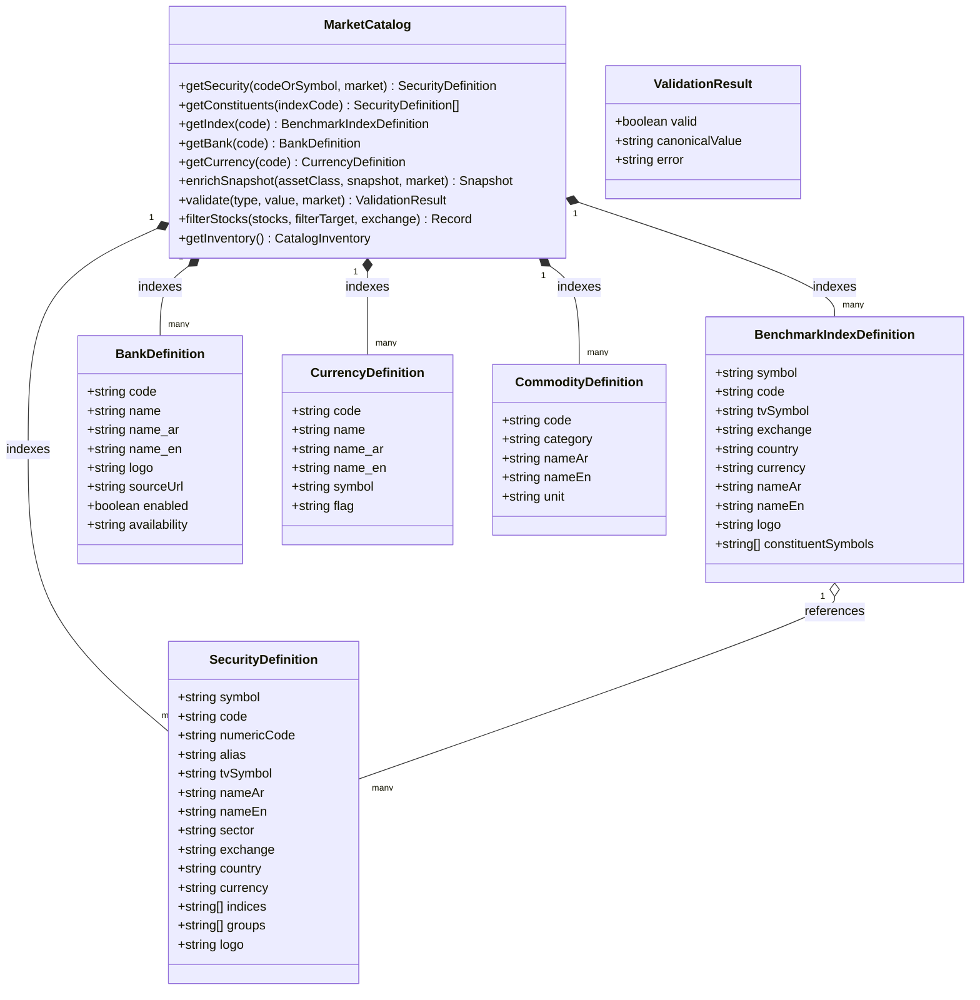

# Data Model & Entity Specifications: Unified Market Catalog

**Branch**: `108-unified-market-catalog` | **Date**: 2026-11-15 | **Spec**: [spec.md](./spec.md)

---

## Domain Entity Model



---

## Entity Details

### 1. `SecurityDefinition`
Represents an individual tradable equity across domestic (EGX) and regional (GCC) exchanges.

| Field | Type | Required | Description |
| :--- | :--- | :--- | :--- |
| `symbol` | `string` | Yes | Canonical uppercase alphanumeric ticker symbol (e.g. `"COMI"`, `"RIBL"`). |
| `code` | `string` | Yes | Primary lookup code without exchange suffixes (e.g. `"COMI"`). |
| `numericCode` | `string` | No | Optional 4-digit numeric code for Tadawul equities (e.g. `"1010"`). |
| `alias` | `string` | No | Retail abbreviation or legacy alias (e.g. `"BDC"` for `"BQDC"`). |
| `tvSymbol` | `string` | No | Upstream TradingView query ticker (e.g. `"EGX:COMI"`). |
| `nameAr` | `string` | Yes | Localized official Arabic company title. |
| `nameEn` | `string` | Yes | Localized official English company title. |
| `sector` | `string` | Yes | Industry sector classification (e.g. `"Banking"`, `"Real Estate"`). |
| `exchange` | `string` | Yes | Operating exchange (`"EGX"`, `"TADAWUL"`, `"ADX"`, `"DFM"`, `"QSE"`, `"BK"`). |
| `country` | `string` | Yes | ISO 3166-1 alpha-2 country (`"EG"`, `"SA"`, `"AE"`, `"QA"`, `"KW"`). |
| `currency` | `string` | Yes | Trading currency (`"EGP"`, `"SAR"`, `"AED"`, `"QAR"`, `"KWD"`). |
| `indices` | `string[]` | Yes | Benchmark index affiliations containing this equity (e.g. `["EGX30", "EGX100"]`). |
| `groups` | `string[]` | Yes | Sector and screening groups (e.g. `["EGX30", "Sharia", "Dividend"]`). |
| `logo` | `string` | Yes | Absolute HTTPS URL to verified corporate brand logo image. |

---

### 2. `BenchmarkIndexDefinition`
Represents an official market benchmark index.

| Field | Type | Required | Description |
| :--- | :--- | :--- | :--- |
| `symbol` | `string` | Yes | Canonical exchange index symbol (e.g. `"EGX30"`, `"TASI"`). |
| `code` | `string` | Yes | Normalized uppercase code identifier. |
| `tvSymbol` | `string` | Yes | Upstream scanner ticker (e.g. `"EGX:EGX30"`). |
| `exchange` | `string` | Yes | Operating exchange name. |
| `country` | `string` | Yes | ISO country code (`"EG"`, `"SA"`, `"AE"`, `"QA"`, `"KW"`). |
| `currency` | `string` | Yes | Denominated currency code. |
| `nameAr` | `string` | Yes | Localized Arabic index name. |
| `nameEn` | `string` | Yes | Localized English index name. |
| `logo` | `string` | Yes | Absolute HTTPS URL to index badge icon. |
| `constituentSymbols` | `string[]` | Yes | Ordered array of canonical security symbols belonging to this index. |

---

### 3. `CatalogInventory`
Exposes the complete platform catalog for discovery endpoints (`GET /v1/catalog`).

```typescript
export interface CatalogInventory {
  banks: Bank[];
  currencies: Currency[];
  commodities: CommodityDefinition[];
  indices: BenchmarkIndexDefinition[];
  counts: {
    totalBanks: number;
    totalCurrencies: number;
    totalCommodities: number;
    totalIndices: number;
    totalSecurities: number;
  };
}
```

---

### 4. `ValidationResult`
Unified contract returned by catalog parameter validation guards.

```typescript
export interface ValidationResult {
  valid: boolean;
  canonicalValue?: string;
  error?: string;
}
```

---

## In-Memory Multi-Key Indexing Structure

```mermaid
flowchart TD
  RAW[Static Catalog Arrays] --> BUILD[MarketCatalog Index Builder]

  BUILD --> IX1[symbolMap: Map&lt;string, SecurityDefinition&gt;]
  BUILD --> IX2[marketSymbolMap: Map&lt;string, SecurityDefinition&gt;]
  BUILD --> IX3[aliasMap: Map&lt;string, SecurityDefinition&gt;]
  BUILD --> IX4[numericCodeMap: Map&lt;string, SecurityDefinition&gt;]
  BUILD --> IX5[indexMap: Map&lt;string, BenchmarkIndexDefinition&gt;]
  BUILD --> IX6[constituentIndex: Map&lt;string, SecurityDefinition[]&gt;]
  BUILD --> IX7[bankMap: Map&lt;string, Bank&gt;]
  BUILD --> IX8[currencyMap: Map&lt;string, Currency&gt;]

  IX1 --> LOOKUP[getSecurity / resolveSymbol]
  IX2 --> LOOKUP
  IX3 --> LOOKUP
  IX4 --> LOOKUP

  IX5 --> IDX_LOOKUP[getIndex / validateIndex]
  IX6 --> CONST_LOOKUP[getConstituents]
  IX7 --> BANK_LOOKUP[getBank / validateBank]
  IX8 --> CURR_LOOKUP[getCurrency / validateCurrency]
```

### Lookup Time Complexity:
- `getSecurity(symbol)`: **O(1)**
- `getSecurity(symbol, market)`: **O(1)**
- `getConstituents(indexCode)`: **O(1)**
- `getBank(code)`: **O(1)**
- `getCurrency(code)`: **O(1)**
- `validate(type, value)`: **O(1)**
- `enrichSnapshot(snapshot)`: **O(K)** where K is number of quotes in snapshot (single linear pass using pre-indexed hash lookups).
