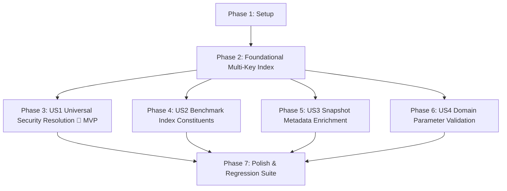

# Tasks: Unified Market Catalog

**Input**: Design documents from `specs/108-unified-market-catalog/` (`spec.md`, `plan.md`, `research.md`, `data-model.md`, `contracts/`, `quickstart.md`)

**Prerequisites**:
- `plan.md`: Technical context, in-process architecture, constitution gates.
- `spec.md`: User stories with priorities (US1 P1, US2 P1, US3 P2, US4 P2).
- `data-model.md`: Domain entities (`SecurityDefinition`, `BenchmarkIndexDefinition`, etc.) and multi-key index layout.
- `contracts/`: TypeScript contract (`market-catalog.contract.ts`) and REST contract (`catalog-routes.contract.md`).
- `constitution.md`: Principle V (Exhaustive Comments) & Principle VII (Mandatory Testing).

---

## Phase 1: Setup (Shared Infrastructure)

**Purpose**: Type definitions and shared testing infrastructure for the catalog module.

- [X] T001 Create unified catalog types and interfaces in `src/models/market-catalog-types.ts`
- [X] T002 [P] Create mock catalog test fixtures in `tests/helpers/mock-market-catalog.ts`

---

## Phase 2: Foundational (Blocking Prerequisites)

**Purpose**: Core in-memory multi-key index builder that MUST be complete before ANY user story can be implemented.

**⚠️ CRITICAL**: No user story work can begin until this foundational phase is complete.

- [X] T003 Implement `MarketCatalog` class scaffold and multi-key hash map index builder in `src/services/catalog-service.ts`
- [X] T004 [P] Implement unit tests for multi-key indexing and startup integrity in `tests/unit/market-catalog.test.ts`
- [X] T005 [P] Register `MarketCatalog` singleton export and Fastify plugin integration in `src/app.ts`

**Checkpoint**: Foundation ready — user story implementation can now begin.

---

## Phase 3: User Story 1 - Universal Security and Asset Resolution (Priority: P1) 🎯 MVP

**Goal**: Downstream callers, quote processors, and history engines resolve any supported security (domestic EGX equities, regional GCC equities across Saudi Arabia, UAE, Qatar, Kuwait), currency, bank, commodity, or benchmark index by symbol, code, or alias with automatic whitespace and case normalization.

**Independent Test**: `npm run test:unit tests/unit/market-catalog.test.ts` passes for universal symbol and alias resolution scenarios.

### Tests for User Story 1

- [X] T006 [P] [US1] Create unit tests for security normalization and alias resolution in `tests/unit/market-catalog-lookup.test.ts`

### Implementation for User Story 1

- [X] T007 [US1] Implement `getSecurity`, `resolveSymbol`, and `getInventory` in `src/services/catalog-service.ts`
- [X] T008 [US1] Update `src/services/stock-query-service.ts` to use `catalogService.getSecurity` for stock lookup
- [X] T009 [US1] Update `src/modules/gcc-stocks/services/gcc-stock-query-service.ts` to delegate `lookupCatalogEntry` to `catalogService.getSecurity`
- [X] T010 [US1] Update `src/routes/catalog-routes.ts` to serve unified inventory from `catalogService.getInventory()`

**Checkpoint**: User Story 1 is fully functional and independently testable (MVP delivery point).

---

## Phase 4: User Story 2 - Benchmark Index Constituent Resolution (Priority: P1)

**Goal**: Deliver instant O(1) constituent member lookups for any domestic or regional benchmark index with complete display metadata, eliminating live nested scanning loops.

**Independent Test**: `npm run test:unit tests/integration/indices-constituents.test.ts` passes with instant constituent resolution.

### Tests for User Story 2

- [X] T011 [P] [US2] Create unit tests for index constituent reverse indexing in `tests/unit/market-catalog-constituents.test.ts`

### Implementation for User Story 2

- [X] T012 [US2] Implement `getConstituents` and `getIndex` in `src/services/catalog-service.ts`
- [X] T013 [US2] Refactor `src/services/indices-query-service.ts` to delegate constituent extraction to `catalogService.getConstituents()`
- [X] T014 [US2] Update `src/routes/indices-routes.ts` to use `catalogService.getConstituents()` for `/v1/indices/:code/constituents`

**Checkpoint**: User Stories 1 and 2 work independently and in combination.

---

## Phase 5: User Story 3 - Snapshot Metadata and Visual Asset Enrichment (Priority: P2)

**Goal**: Standardize and centralize quote metadata enrichment (logos, localized names, sectors, benchmark indices) onto raw price snapshots across domestic and GCC equities.

**Independent Test**: `npm run test:unit tests/unit/stock-query-service.test.ts` and `npm run test:unit tests/unit/gcc-expansion.test.ts` pass with enriched quotes.

### Tests for User Story 3

- [X] T015 [P] [US3] Create unit tests for quote enrichment in `tests/unit/market-catalog-enrichment.test.ts`

### Implementation for User Story 3

- [X] T016 [US3] Implement `enrichSnapshot` in `src/services/catalog-service.ts`
- [X] T017 [US3] Refactor `enrichSnapshotWithCatalog` in `src/services/stock-query-service.ts` to call `catalogService.enrichSnapshot`
- [X] T018 [US3] Refactor `enrichSnapshotWithCatalog` in `src/modules/gcc-stocks/services/gcc-stock-query-service.ts` to call `catalogService.enrichSnapshot`

**Checkpoint**: Metadata enrichment is consolidated behind the single catalog seam.

---

## Phase 6: User Story 4 - Centralized Domain Validation and Parameter Filtering (Priority: P2)

**Goal**: Centralize domain parameter validation (banks, currencies, exchange markets, stock groups, index codes) and stock filtering at the edge of route handlers.

**Independent Test**: `npm run test:contract` and `npm run test:unit tests/unit/catalog-validation.test.ts` pass with unified error envelopes.

### Tests for User Story 4

- [X] T019 [P] [US4] Create unit tests for parameter validation guards and error formatting in `tests/unit/catalog-validation.test.ts`

### Implementation for User Story 4

- [X] T020 [US4] Implement `validate` and `filterStocks` in `src/services/catalog-service.ts`
- [X] T021 [US4] Update `src/routes/stock-routes.ts` to validate group and symbol parameters via `catalogService.validate`
- [X] T022 [US4] Update `src/routes/indices-routes.ts` to validate index codes via `catalogService.validate`
- [X] T023 [US4] Refactor `filterStocksByIndexOrGroup` in `src/services/stock-query-service.ts` to delegate to `catalogService.filterStocks`

**Checkpoint**: All user stories functional, tested, and integrated.

---

## Phase 7: Polish & Cross-Cutting Concerns

**Purpose**: Documentation updates, exhaustive commenting audit, and end-to-end regression verification.

- [X] T024 [P] Update domain memory in `.specify/memory/GLOSSARY.md` and `.specify/memory/MODULAR_COMPONENTS.md`
- [X] T025 [P] Update API documentation in `API_ENDPOINTS_GUIDE.md` and `README.md`
- [X] T026 Audit all newly authored and refactored code for exhaustive commenting compliance with Constitution Principle V
- [X] T027 Run full test suite (`npm run test:unit` and `npm run test:contract`) to ensure 100% green pass rate

---

## Dependencies & Execution Order

### Phase Dependencies



### User Story Dependencies

- **User Story 1 (P1)**: Starts immediately after Phase 2 (Foundational). Has no dependencies on other stories.
- **User Story 2 (P1)**: Starts after Phase 2 (Foundational). Operates independently on index constituent mappings.
- **User Story 3 (P2)**: Starts after Phase 2 (Foundational). Reuses indexed security metadata from US1.
- **User Story 4 (P2)**: Starts after Phase 2 (Foundational). Validates parameter membership across all indexed collections.

### Parallel Opportunities

- **Setup & Foundational**:
  - `T002` (test fixtures) can run in parallel with `T001` (type definitions).
  - `T004` (indexing tests) and `T005` (Fastify plugin) can run in parallel once `T003` begins.
- **Across User Stories**:
  - Once Phase 2 completes, `US1`, `US2`, `US3`, and `US4` can be implemented in parallel or sequentially.
- **Within Stories**:
  - All test tasks marked `[P]` (`T006`, `T011`, `T015`, `T019`) can be written in parallel before implementation.
  - Route and query service delegations (`T008`, `T009`, `T010`) can execute in parallel once `T007` is complete.

---

## Parallel Example: User Story 1 & User Story 2

```bash
# Launch test creation for US1 and US2 in parallel:
Task: "Create unit tests for security normalization and alias resolution in tests/unit/market-catalog-lookup.test.ts"
Task: "Create unit tests for index constituent reverse indexing in tests/unit/market-catalog-constituents.test.ts"

# Once foundational MarketCatalog exists, implement lookup and constituent methods:
Task: "Implement getSecurity, resolveSymbol, and getInventory in src/services/catalog-service.ts"
Task: "Implement getConstituents and getIndex in src/services/catalog-service.ts"
```

---

## Implementation Strategy

### MVP First (User Story 1 Only)
1. Complete Phase 1: Setup (`T001`–`T002`).
2. Complete Phase 2: Foundational Multi-Key Hash Map (`T003`–`T005`).
3. Complete Phase 3: User Story 1 Universal Security Lookup (`T006`–`T010`).
4. **STOP and VALIDATE**: Run `npm run test:unit tests/unit/market-catalog.test.ts`. This delivers the Minimum Viable Product.

### Incremental Delivery
1. Add User Story 2 (Index Constituents, `T011`–`T014`) &rarr; Validate with `indices-constituents.test.ts`.
2. Add User Story 3 (Snapshot Enrichment, `T015`–`T018`) &rarr; Validate with `stock-query-service.test.ts`.
3. Add User Story 4 (Validation & Filtering, `T019`–`T023`) &rarr; Validate with `catalog-validation.test.ts` & contract tests.
4. Run Phase 7 Polish (`T024`–`T027`) to update documentation and run the complete regression suite.
