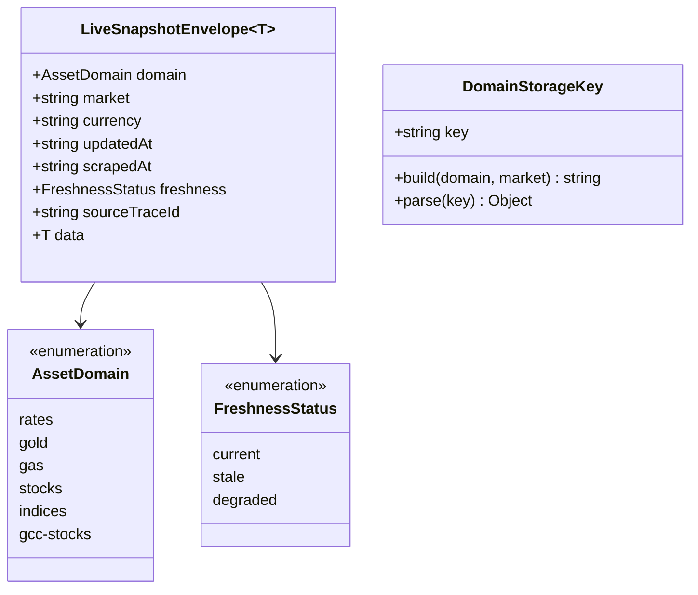
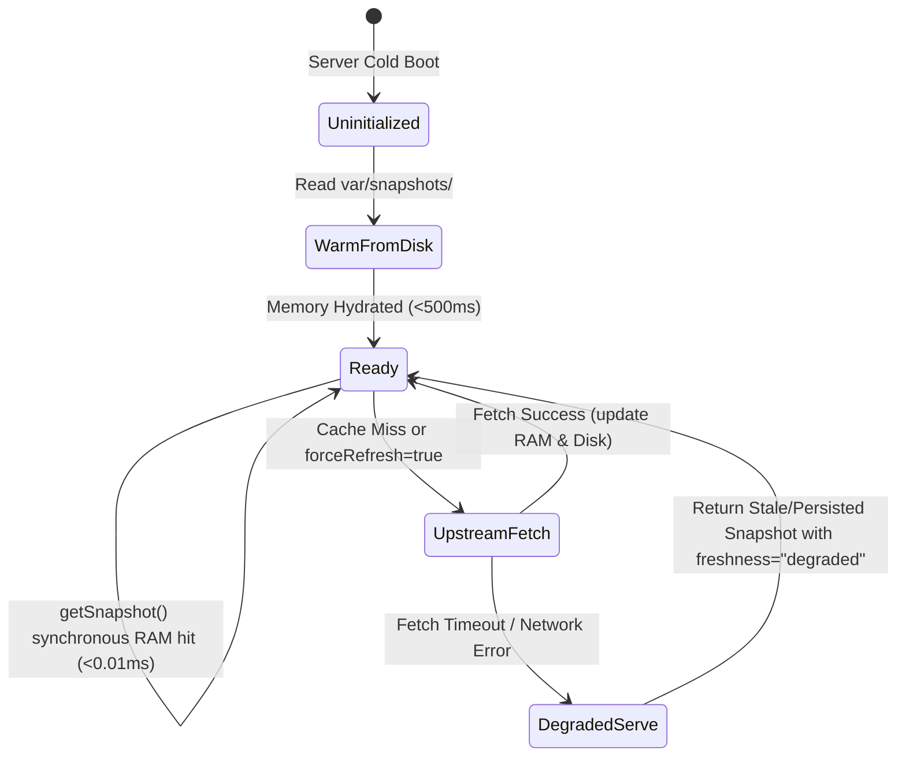

# Data Model: Live Snapshot Coordinator

**Feature Branch**: `109-live-snapshot-coordinator`  
**Date**: 2026-11-15  
**Spec Reference**: [spec.md](./spec.md) | **Research Reference**: [research.md](./research.md)

---

## 1. Domain Entities & Type Definitions



### 1.1 `AssetDomain`
Enumeration of all supported live real-time pricing asset categories:
```typescript
export type AssetDomain = 
  | "rates"       // Bank foreign currency exchange rates
  | "gold"        // Domestic gold karats, bullion coins & international spot
  | "gas"         // Domestic fuel and petroleum prices
  | "stocks"      // Egyptian Exchange (EGX) equities
  | "indices"     // Domestic and regional benchmark market indices
  | "gcc-stocks"; // Regional GCC equities (Saudi, UAE, Qatar, Kuwait)
```

### 1.2 `LiveSnapshotEnvelope<T>`
Standardized metadata envelope wrapping raw domain quotes:
```typescript
export interface LiveSnapshotEnvelope<T = any> {
  // Asset category domain identifier
  domain: AssetDomain;
  // Optional sovereign market or exchange code (e.g. "egx", "saudi", "uae", "qatar", "kuwait")
  market?: string;
  // Denominated currency code (e.g. "EGP", "SAR", "AED", "QAR", "KWD", "USD")
  currency: string;
  // Source official timestamp
  updatedAt: string;
  // Scraper retrieval timestamp
  scrapedAt: string;
  // Dynamic freshness classification status
  freshness: "current" | "stale" | "degraded";
  // Distributed telemetry trace identification string
  sourceTraceId: string;
  // Domain quote payload dictionary
  data: T;
}
```

---

## 2. In-Memory Multi-Domain Key Mapping

The coordinator maps requested domains and optional regional market qualifiers into deterministic composite cache keys:

| Domain | Market Parameter | Storage Key (`${domain}:${market}`) | Target Collection / Document |
|:---|:---|:---|:---|
| `rates` | `undefined` | `rates` | `rates` (collection of all banks) |
| `gold` | `undefined` | `gold` | `gold_prices/latest` |
| `gas` | `undefined` | `gas` | `gas_prices/latest` |
| `stocks` | `egx` / `undefined` | `stocks:egx` | `stock_prices/latest` |
| `indices` | `egx` / `undefined` | `indices:egx` | `index_prices/latest` |
| `indices` | `saudi` | `indices:saudi` | `index_prices_saudi/latest` |
| `indices` | `uae` | `indices:uae` | `index_prices_uae/latest` |
| `indices` | `qatar` | `indices:qatar` | `index_prices_qatar/latest` |
| `indices` | `kuwait` | `indices:kuwait` | `index_prices_kuwait/latest` |
| `gcc-stocks`| `saudi` / `sa` | `gcc-stocks:sa` | `saudi_stock_prices/latest` |
| `gcc-stocks`| `uae` / `ae` | `gcc-stocks:ae` | `uae_stock_prices/latest` |
| `gcc-stocks`| `qatar` / `qa` | `gcc-stocks:qa` | `qatar_stock_prices/latest` |
| `gcc-stocks`| `kuwait` / `kw`| `gcc-stocks:kw` | `kuwait_stock_prices/latest` |

---

## 3. State Transitions & Lifecycle



---

## 4. Complexity & Sizing Analysis

- **Storage Space Complexity**: $O(D)$ where $D$ is the number of active domain keys ($\approx 13$ keys). Total heap usage is $<10\text{ MB}$.
- **Lookup Time Complexity**: $O(1)$ constant time lookup via JavaScript native `Map.get()`.
- **Push Ingestion Complexity**: $O(1)$ constant time atomic pointer assignment via `Map.set()`.
- **Concurrency Complexity**: Single-flight promise pooling guarantees exactly one in-flight promise per domain key, preventing thundering herds on Firestore.
