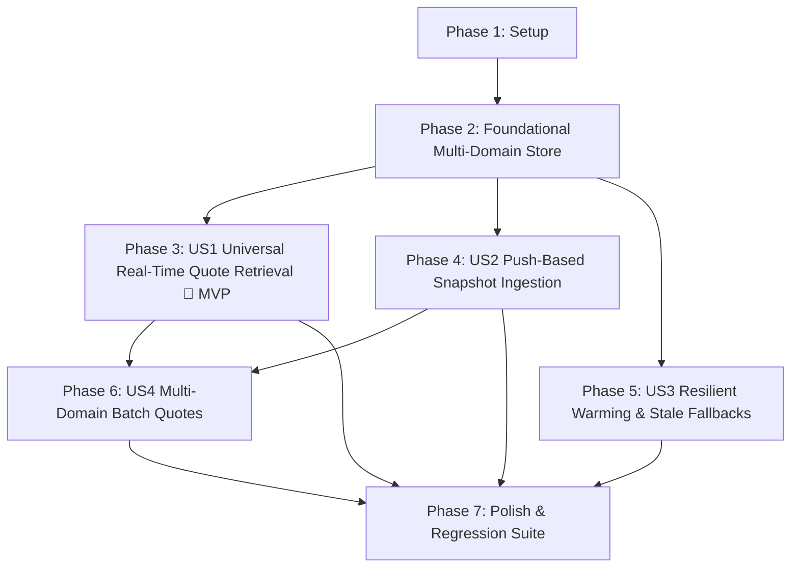

# Tasks: Live Snapshot Coordinator

**Input**: Design documents from `specs/109-live-snapshot-coordinator/` (`spec.md`, `plan.md`, `research.md`, `data-model.md`, `contracts/`, `quickstart.md`)

**Prerequisites**:
- `plan.md`: Technical context, in-memory architecture, constitution gates.
- `spec.md`: User stories with priorities (US1 P1, US2 P1, US3 P2, US4 P2).
- `data-model.md`: Domain entities (`LiveSnapshotEnvelope`, `AssetDomain`, etc.) and multi-domain key mapping.
- `contracts/`: TypeScript contract (`live-snapshot-coordinator.contract.ts`) and REST contract (`coordinator-routes.contract.md`).
- `constitution.md`: Principle V (Exhaustive Comments) & Principle VII (Mandatory Testing).

---

## Phase 1: Setup (Shared Infrastructure)

**Purpose**: Type definitions and shared testing fixtures for the live snapshot coordinator module.

- [X] T001 Create live snapshot domain types and interfaces in `src/models/live-snapshot-types.ts`
- [X] T002 [P] Create mock live snapshot coordinator test fixtures in `tests/helpers/mock-live-snapshot-coordinator.ts`

---

## Phase 2: Foundational (Blocking Prerequisites)

**Purpose**: Core in-memory multi-domain RAM storage that MUST be complete before ANY user story can be implemented.

**⚠️ CRITICAL**: No user story work can begin until this foundational phase is complete.

- [X] T003 Implement `LiveSnapshotCoordinator` class scaffold, composite key resolver, and in-memory Map store in `src/services/live-snapshot-coordinator.ts`
- [X] T004 [P] Implement unit tests for multi-domain RAM storage and isolation in `tests/unit/live-snapshot-coordinator.test.ts`
- [X] T005 [P] Register `LiveSnapshotCoordinator` singleton export in `src/services/live-snapshot-coordinator.ts` and wire into `AppContext` in `src/app.ts`

**Checkpoint**: Foundation ready — user story implementation can now begin.

---

## Phase 3: User Story 1 - Universal Real-Time Quote Retrieval (Priority: P1) 🎯 MVP

**Goal**: Deliver synchronous, non-blocking in-memory retrieval of active price snapshots across all 6 asset domains (`rates`, `gold`, `gas`, `stocks`, `indices`, `gcc-stocks`) in $<0.01\text{ ms}$ without database I/O.

**Independent Test**: `npm run test:unit tests/unit/live-snapshot-retrieval.test.ts` passes for all domain and regional market snapshot queries.

### Tests for User Story 1

- [X] T006 [P] [US1] Create unit tests for synchronous snapshot retrieval, market parameter routing, and error handling in `tests/unit/live-snapshot-retrieval.test.ts`

### Implementation for User Story 1

- [X] T007 [US1] Implement `getSnapshot<T>(domain, market?)` in `src/services/live-snapshot-coordinator.ts`
- [X] T008 [US1] Refactor `StockQueryService.fetchLatestStockPrices` in `src/services/stock-query-service.ts` to delegate in-memory snapshot retrieval to `liveSnapshotCoordinator`
- [X] T009 [US1] Refactor `IndicesQueryService.fetchLatestIndexPrices` in `src/services/indices-query-service.ts` to delegate in-memory snapshot retrieval to `liveSnapshotCoordinator`
- [X] T010 [US1] Refactor `GoldQueryService.fetchLatestGoldPrices` in `src/services/gold-query-service.ts` and `GasQueryService.fetchLatestGasPrices` in `src/services/gas-query-service.ts` to delegate to `liveSnapshotCoordinator`
- [X] T011 [US1] Refactor `GccStockQueryService.fetchLatestStockPrices` in `src/modules/gcc-stocks/services/gcc-stock-query-service.ts` to delegate in-memory regional snapshots to `liveSnapshotCoordinator`

**Checkpoint**: User Story 1 is fully functional and independently testable (MVP delivery point).

---

## Phase 4: User Story 2 - Push-Based Real-Time Snapshot Ingestion (Priority: P1)

**Goal**: Establish a single ingestion sink for background real-time push listeners with atomic RAM updates and corrupted payload defense.

**Independent Test**: `npm run test:unit tests/unit/live-snapshot-ingestion.test.ts` passes for real-time listener pushes and corrupted payload defense.

### Tests for User Story 2

- [X] T012 [P] [US2] Create unit tests for push ingestion and atomic updates in `tests/unit/live-snapshot-ingestion.test.ts`

### Implementation for User Story 2

- [X] T013 [US2] Implement `updateSnapshot(domain, data, market?)` with atomic pointer updates and payload validation in `src/services/live-snapshot-coordinator.ts`
- [X] T014 [US2] Refactor `FirestoreListenerService` in `src/services/firestore-listener-service.ts` to push updates directly to `liveSnapshotCoordinator.updateSnapshot` across rates, gold, gas, stocks, indices, and regional GCC markets
- [X] T015 [US2] Simplify `FirestoreListenerService` constructor in `src/services/firestore-listener-service.ts` to remove redundant query service injections

**Checkpoint**: User Stories 1 and 2 work independently and in combination.

---

## Phase 5: User Story 3 - Resilient On-Demand Warming and Fail-Safe Fallbacks (Priority: P2)

**Goal**: Deliver transparent on-demand warming, in-flight promise deduplication (thundering herd guard), local disk snapshot persistence, and degraded fallback serving.

**Independent Test**: `npm run test:unit tests/unit/live-snapshot-warming.test.ts` passes for disk warming, thundering herd deduplication, and stale fallbacks.

### Tests for User Story 3

- [X] T016 [P] [US3] Create unit tests for disk warming, in-flight promise coalescing, and fail-safe fallback in `tests/unit/live-snapshot-warming.test.ts`

### Implementation for User Story 3

- [X] T017 [US3] Implement `DiskSnapshotAdapter` and `warm()` method in `src/services/live-snapshot-coordinator.ts` to load/save `var/snapshots/{domain}_{market}.json`
- [X] T018 [US3] Implement `fetchFresh(domain, market?, forceRefresh?)` with single-flight promise pooling and degraded cache fallback in `src/services/live-snapshot-coordinator.ts`
- [X] T019 [US3] Refactor `RatesSnapshotService` in `src/services/rates-snapshot-service.ts` to delegate memory snapshot caching and warming to `liveSnapshotCoordinator`
- [X] T020 [US3] Retire obsolete `src/cache/snapshot-cache.ts` and `src/cache/snapshot-store.ts` by delegating their callers to `liveSnapshotCoordinator`

**Checkpoint**: Resilient cold boot warming and fail-safe fallback capabilities verified.

---

## Phase 6: User Story 4 - Multi-Domain Batch Quote Aggregation (Priority: P2)

**Goal**: Consolidate parallel batch quote resolution in `QuotesService` to query `liveSnapshotCoordinator` directly instead of fanning out across 5 separate query services.

**Independent Test**: `npm run test:unit tests/unit/quotes-service-coordinator.test.ts` passes for mixed portfolio quote resolution.

### Tests for User Story 4

- [X] T021 [P] [US4] Create unit tests for batch quote resolution via `LiveSnapshotCoordinator` in `tests/unit/quotes-service-coordinator.test.ts`

### Implementation for User Story 4

- [X] T022 [US4] Refactor `QuotesService` in `src/services/quotes-service.ts` to resolve multi-domain snapshots directly from `liveSnapshotCoordinator.getSnapshot`
- [X] T023 [US4] Simplify `QuotesService` constructor in `src/services/quotes-service.ts` to remove 5 separate query service dependencies

**Checkpoint**: All user stories functional, tested, and integrated.

---

## Phase 7: Polish & Cross-Cutting Concerns

**Purpose**: Documentation updates, exhaustive commenting audit, and end-to-end regression verification.

- [X] T024 [P] Update domain memory in `.specify/memory/GLOSSARY.md` and `.specify/memory/MODULAR_COMPONENTS.md`
- [X] T025 [P] Update API documentation in `API_ENDPOINTS_GUIDE.md` and `README.md`
- [X] T026 Audit all newly authored and refactored code for exhaustive commenting compliance with Constitution Principle V
- [X] T027 Run full test suite (`npm run test:unit`, `npm run test:contract`, and `npm run build`) to ensure 100% green pass rate

---

## Dependencies & Execution Order

### Phase Dependencies

### User Story Dependencies

- **User Story 1 (P1)**: Depends on Foundational Phase 2 (multi-domain RAM store). Delivers immediate MVP value by unifying quote reading across all query services.
- **User Story 2 (P1)**: Depends on Foundational Phase 2 and US1. Wires real-time push listeners to update the unified memory store.
- **User Story 3 (P2)**: Depends on Phase 2, US1, and US2. Adds disk warming and thundering-herd protected on-demand fetching.
- **User Story 4 (P2)**: Depends on US1 and US2. Simplifies `QuotesService` to consume the unified coordinator seam.

---

## Parallel Execution Opportunities

- `T002` (Mock test fixtures) can run in parallel with `T001` (Types).
- `T004` (Unit tests) can run in parallel with `T003` (Scaffold).
- `T008` (StockQueryService), `T009` (IndicesQueryService), `T010` (Gold/GasQueryService), and `T011` (GccStockQueryService) can be executed in parallel once `T007` is complete.
- `T024` (Domain memory) and `T025` (API documentation) can run in parallel in Phase 7.

---

## Implementation Strategy (MVP First)

1. **Phase 1 & 2 (Foundation)**: Establish `live-snapshot-types.ts` and core `LiveSnapshotCoordinator` in-memory Map store.
2. **Phase 3 (MVP Delivery)**: Implement `getSnapshot()` and rewire `StockQueryService`, `IndicesQueryService`, `GoldQueryService`, `GasQueryService`, and `GccStockQueryService`. At this milestone, all quote readers consume the unified seam.
3. **Phase 4 (Real-Time Push Ingestion)**: Wire `FirestoreListenerService` to push directly into `updateSnapshot()`, eliminating 6 listener dependencies.
4. **Phase 5 (Resilience & Cold Boot)**: Add disk persistence (`warm()`) and thundering-herd deduplication (`fetchFresh()`). Retire shallow cache wrappers.
5. **Phase 6 (Batch Quotes Consolidation)**: Wire `QuotesService` to read directly from the coordinator.
6. **Phase 7 (Governance & Verification)**: Perform 100% line-by-line commenting audit, update documentation, and run full regression suite.
