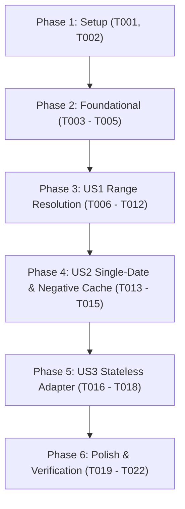

# Tasks: Deepen Historical Engine & Demote Leaky Firestore Storage Layer

**Input**: Design documents from `specs/110-deepen-history-engine/`  
**Prerequisites**: `plan.md` (required), `spec.md` (required), `research.md`, `data-model.md`, `contracts/`, `quickstart.md`  
**Constitution**: Mandatory adherence to Principles I, II, III, IV, V, VI, VII, VIII  

---

## Format: `[ID] [P?] [Story] Description`

- **[P]**: Can run in parallel (different files, no dependencies)
- **[Story]**: Which user story this task belongs to (e.g. `[US1]`, `[US2]`, `[US3]`)
- Every task includes exact file paths

---

## Phase 1: Setup (Shared Infrastructure)

**Purpose**: Project baseline verification and contracts preparation

- [X] T001 Register `IFirestoreHistoryAdapter` interface in `src/models/firestore-adapter-types.ts`
- [X] T002 [P] Verify test baseline and build health with `npm run test:unit` and `npm run test:contract`

---

## Phase 2: Foundational (Blocking Prerequisites)

**Purpose**: Demote storage adapter, delete legacy disk cache store, and consolidate negative caching

**⚠️ CRITICAL**: Must complete before user story range enhancements begin

- [X] T003 Demote `src/services/firestore-service.ts` to a stateless reader by stripping `weeklyBucketCache`, `missingDatesCache`, `activeWeeklyBucketStore`, and `historyCacheStore`
- [X] T004 [P] Delete obsolete disk store `src/cache/history-cache-store.ts` and remove all imports across the codebase
- [X] T005 Consolidate single authoritative in-memory negative cache (`missingDatesCache`) inside `src/services/history-resolution-engine.ts`

**Checkpoint**: Foundation ready — database adapter is stateless and single negative cache is active

---

## Phase 3: User Story 1 - Unified Historical Multi-Day Range Resolution (Priority: P1) 🎯 MVP

**Goal**: Deepen `HistoryResolutionEngine.getDateRange` to absorb range slicing, flat-cache prefix keys, and live today stitching; slim down calling domain query services.

**Independent Test**: Request historical date ranges for stocks, gold, indices, and rates spanning past sealed dates and dynamic today, verifying instant resolution from `flat-cache` and zero direct Firestore reads.

### Implementation for User Story 1

- [X] T006 [P] [US1] Create unit tests for multi-day range slicing, flat-cache prefix storage, and today stitching in `tests/unit/history-resolution-engine.test.ts`
- [X] T007 [US1] Implement pure historical range caching (`{asset}_range:{symbol}:{startDate}:{endDate}`) with 30-day TTL using `cacheService` in `src/services/history-resolution-engine.ts`
- [X] T008 [US1] Implement range splitting for spans extending into today (`{asset}_range_prefix:...` + dynamic live today) in `src/services/history-resolution-engine.ts`
- [X] T009 [US1] Implement defensive yesterday synthesis and live intraday point decoration in `getDateRange` in `src/services/history-resolution-engine.ts`
- [X] T010 [US1] Refactor `StockQueryService.fetchStockPriceHistoryRange` in `src/services/stock-query-service.ts` to delegate directly to `historyResolutionEngine.getDateRange`
- [X] T011 [US1] Refactor `GoldQueryService.fetchGoldPriceHistoryRange` in `src/services/gold-query-service.ts` to delegate directly to `historyResolutionEngine.getDateRange`
- [X] T012 [US1] Refactor `IndicesQueryService.fetchIndexPriceHistoryRange` in `src/services/indices-query-service.ts` to delegate directly to `historyResolutionEngine.getDateRange`

**Checkpoint**: User Story 1 complete — all range queries resolve through `HistoryResolutionEngine` with flat-cache backing; query services are thin facades

---

## Phase 4: User Story 2 - Consolidated Single-Date History & Negative Caching (Priority: P2)

**Goal**: Standardize sealed daily snapshot caching in `flat-cache` and enforce 24-hour negative caching for non-trading dates.

**Independent Test**: Query single past dates and non-trading dates (weekends/holidays) and verify immediate resolution from disk/memory with zero redundant Firestore reads.

### Implementation for User Story 2

- [X] T013 [P] [US2] Create unit tests for single-date sealed snapshots and 24h negative cache eviction in `tests/unit/history-resolution-engine.test.ts`
- [X] T014 [US2] Update `HistoryResolutionEngine.getDateSnapshot` in `src/services/history-resolution-engine.ts` to persist sealed daily snapshots into `flat-cache` (30-day TTL) via `cacheService`
- [X] T015 [US2] Enforce non-trading day fast-path in `HistoryResolutionEngine.getDateSnapshot` in `src/services/history-resolution-engine.ts` to return null on negative cache hit

**Checkpoint**: User Story 2 complete — single-date history and negative caching are completely centralized in the engine

---

## Phase 5: User Story 3 - Stateless Database Adapter Isolation (Priority: P3)

**Goal**: Verify that `firestore-service.ts` operates purely as a stateless read bridge without internal caches, disk stores, or schedule dependencies.

**Independent Test**: Invoke `fetchWeeklyBucketDocument` and `fetchDailyDocument` directly with Firestore stubs and verify no disk files or timer handles are created.

### Implementation for User Story 3

- [X] T016 [P] [US3] Create unit tests for stateless Firestore reads in `tests/unit/firestore-service.test.ts`
- [X] T017 [US3] Refactor `src/services/firestore-service.ts` to ensure `fetchWeeklyBucketDocument` and `fetchDailyDocument` are pure stateless async functions
- [X] T018 [US3] Remove legacy cache-clearing exports (`clearWeeklyBucketCache`) and clean up test teardown references across test suites

**Checkpoint**: User Story 3 complete — storage adapter is completely stateless and decoupled

---

## Phase 6: Polish & Cross-Cutting Concerns

**Purpose**: Test suite alignment, code commenting verification, build validation, and parity verification

- [X] T019 [P] Update existing domain query service tests in `tests/unit/stock-query-service.test.ts`, `tests/unit/gold-query-service.test.ts`, and `tests/unit/indices-query-service.test.ts` to verify range delegation
- [X] T020 Enforce exhaustive code commenting (Constitution Principle V: every single line explicitly commented) across all modified files
- [X] T021 Run full test and build verification (`npm run test:unit`, `npm run test:contract`, `npm run build`)
- [X] T022 Execute differential parity verification between ports 3000 and 3001 (`npm run verify:diff -- --base http://84.235.253.78:3000 --target http://84.235.253.78:3001 --key local-dev-key`)

---

## Dependencies & Execution Order

---

## Implementation Strategy (MVP First)

1. **Foundational Demotion (Phase 2)**: Demote `firestore-service.ts` and delete `history-cache-store.ts`.
2. **MVP Delivery (Phase 3 - US1)**: Deepen `HistoryResolutionEngine.getDateRange` to handle range slicing and flat-cache keys, then slim down query services. This delivers the highest architectural leverage and deletes ~300 lines of duplicate code.
3. **Consolidation (Phases 4-5 - US2 & US3)**: Lock down single-date flat-cache storage and verify stateless adapter isolation.
4. **Verification (Phase 6)**: Run complete test suites, verify code comments per line, and prove 100% parity across ports 3000 and 3001.
