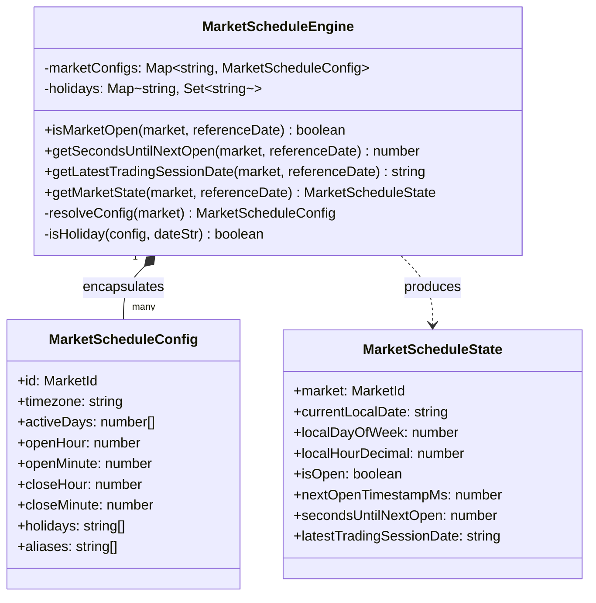

# Data Model & Schema Definitions: MarketScheduleEngine

**Feature Branch**: `111-unify-market-schedules`  
**Date**: 2026-11-15  
**Status**: Completed  

---

## 1. Core Types & Interfaces

### 1.1 Market Identifier Enum & Union

```ts
export type MarketId =
  | 'EGX'
  | 'EGX_INDICES'
  | 'SA'
  | 'SA_INDICES'
  | 'AE'
  | 'AE_INDICES'
  | 'QA'
  | 'QA_INDICES'
  | 'KW'
  | 'KW_INDICES'
  | 'RATES'
  | 'GOLD'
  | 'COMMODITIES';
```

### 1.2 MarketScheduleConfig

```ts
export interface MarketScheduleConfig {
  // Canonical market identifier
  id: MarketId;
  // Official IANA timezone identifier (e.g. 'Africa/Cairo', 'Asia/Riyadh')
  timezone: string;
  // Active trading days represented as day of week integers (0 = Sunday, 1 = Monday, ..., 6 = Saturday)
  activeDays: number[];
  // Opening hour in local market time (24-hour format, e.g. 9 for 09:00)
  openHour: number;
  // Opening minute in local market time (e.g. 0 or 30)
  openMinute: number;
  // Closing hour in local market time (24-hour format, e.g. 15 for 15:30)
  closeHour: number;
  // Closing minute in local market time (e.g. 30)
  closeMinute: number;
  // Set of scheduled market holiday dates (YYYY-MM-DD)
  holidays?: string[];
  // Aliases for user-friendly query resolution (e.g. 'stocks', 'egypt', 'tadawul')
  aliases?: string[];
}
```

### 1.3 MarketScheduleState

```ts
export interface MarketScheduleState {
  // Target market identifier
  market: MarketId;
  // Current ISO calendar date formatted as YYYY-MM-DD in market's local timezone
  currentLocalDate: string;
  // Local day of week integer (0 = Sunday, 1 = Monday, ..., 6 = Saturday)
  localDayOfWeek: number;
  // Decimal hour in local timezone (e.g. 14.5 for 14:30)
  localHourDecimal: number;
  // Flag indicating whether market is currently within active trading window
  isOpen: boolean;
  // Epoch timestamp in milliseconds of the next market opening session
  nextOpenTimestampMs: number;
  // Remaining duration in seconds until next market opening session (minimum 60s)
  secondsUntilNextOpen: number;
  // Canonical ISO calendar date of the latest active or completed trading session
  latestTradingSessionDate: string;
}
```

---

## 2. Market Schedule Master Registry Mapping

| Market Code | Aliases | Timezone | Active Days | Open (Local) | Close (Local) | Notes |
| :--- | :--- | :--- | :--- | :--- | :--- | :--- |
| `EGX` | `EG`, `EGYPT`, `STOCKS` | `Africa/Cairo` | Sun–Thu `[0,1,2,3,4]` | 09:00 | 15:30 | Buffered 10:00–14:30 |
| `EGX_INDICES` | `INDICES`, `EGX30` | `Africa/Cairo` | Sun–Thu `[0,1,2,3,4]` | 09:00 | 15:30 | Aligned with EGX |
| `SA` | `SAUDI`, `TADAWUL` | `Asia/Riyadh` | Sun–Thu `[0,1,2,3,4]` | 09:00 | 16:00 | Buffered 10:00–15:00 |
| `SA_INDICES` | `TASI` | `Asia/Riyadh` | Sun–Thu `[0,1,2,3,4]` | 09:00 | 16:00 | Aligned with SA |
| `AE` | `UAE`, `DUBAI`, `DFM`, `ADX` | `Asia/Dubai` | Mon–Fri `[1,2,3,4,5]` | 09:00 | 16:00 | Buffered 10:00–15:00 |
| `AE_INDICES` | `DFMGI`, `FADX15` | `Asia/Dubai` | Mon–Fri `[1,2,3,4,5]` | 09:00 | 16:00 | Aligned with AE |
| `QA` | `QATAR`, `QSE` | `Asia/Qatar` | Sun–Thu `[0,1,2,3,4]` | 08:30 | 14:15 | Buffered 09:30–13:15 |
| `QA_INDICES` | `QSE_INDEX` | `Asia/Qatar` | Sun–Thu `[0,1,2,3,4]` | 08:30 | 14:15 | Aligned with QA |
| `KW` | `KUWAIT`, `KSE` | `Asia/Kuwait` | Sun–Thu `[0,1,2,3,4]` | 08:00 | 13:30 | Buffered 09:00–12:30 |
| `KW_INDICES` | `BK_PREMIER` | `Asia/Kuwait` | Sun–Thu `[0,1,2,3,4]` | 08:00 | 13:30 | Aligned with KW |
| `RATES` | `BANKS`, `CBE` | `Africa/Cairo` | Sun–Thu `[0,1,2,3,4]` | 08:30 | 17:00 | Egyptian Banking Hours |
| `GOLD` | `METALS`, `COMMODITIES` | `Africa/Cairo` | Mon–Sat `[1,2,3,4,5,6]` | 09:00 | 22:00 | Domestic Gold Market |

---

## 3. Entity Relationships


