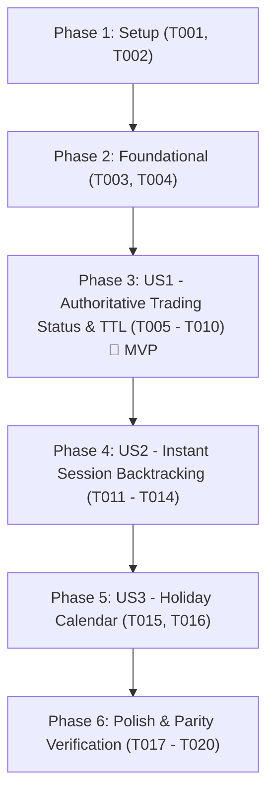

# Tasks: Unify Fragmented Market Schedules into Deep MarketSchedule Engine

**Input**: Design documents from `specs/111-unify-market-schedules/`  
**Prerequisites**: `plan.md` (required), `spec.md` (required), `research.md`, `data-model.md`, `contracts/`, `quickstart.md`  
**Constitution**: Mandatory adherence to Principles I, II, III, IV, V, VI, VII, VIII  

---

## Format: `[ID] [P?] [Story] Description`

- **[P]**: Can run in parallel (different files, no dependencies)
- **[Story]**: Which user story this task belongs to (e.g. `[US1]`, `[US2]`, `[US3]`)
- Every task includes exact file paths

---

## Phase 1: Setup (Shared Infrastructure)

**Purpose**: Project contracts and type definitions preparation

- [X] T001 Register `IMarketScheduleEngine`, `MarketId`, `MarketScheduleConfig`, and `MarketScheduleState` interfaces in `src/models/market-schedule-types.ts`
- [X] T002 [P] Verify baseline test and build health with `npm run test:unit`, `npm run test:contract`, and `npm run build`

---

## Phase 2: Foundational (Blocking Prerequisites)

**Purpose**: Core multi-market schedule registry and canonical operating hours establishment

**⚠️ CRITICAL**: Must complete before user story engine methods and caller refactorings begin

- [X] T003 Create core multi-market schedule registry and IANA timezone calculators in `src/services/market-schedule-engine.ts`
- [X] T004 [P] Reconcile and define canonical operating windows across all 5 financial exchanges (`EGX`: 09:00–15:30 Sun–Thu, `SA`: 09:00–16:00 Sun–Thu, `AE`: 09:00–16:00 Mon–Fri, `QA`: 08:30–14:15 Sun–Thu, `KW`: 08:00–13:30 Sun–Thu) in `src/services/market-schedule-engine.ts`

**Checkpoint**: Foundation ready — multi-market registry configured and canonical hours locked

---

## Phase 3: User Story 1 - Authoritative Multi-Market Trading Status & Cache TTL (Priority: P1) 🎯 MVP

**Goal**: Implement `isMarketOpen`, `getSecondsUntilNextOpen`, and `getMarketState` behind the minimal seam; slim down `market-schedule-service.ts` into a delegating facade.

**Independent Test**: Query market status and seconds until next open for any market identifier (`EGX`, `SA`, `AE`, `QA`, `KW`) across active hours, evenings, weekends, and holidays, verifying deterministic boolean status and accurate non-negative TTLs.

### Implementation for User Story 1

- [X] T005 [P] [US1] Create unit tests for multi-market trading status and TTL calculations in `tests/unit/market-schedule-engine.test.ts`
- [X] T006 [US1] Implement `isMarketOpen` and `getSecondsUntilNextOpen` in `src/services/market-schedule-engine.ts`
- [X] T007 [US1] Implement `getMarketState` returning complete `MarketScheduleState` envelope in `src/services/market-schedule-engine.ts`
- [X] T008 [US1] Refactor `src/services/market-schedule-service.ts` into a lightweight facade delegating directly to `marketScheduleEngine`
- [X] T009 [US1] Refactor `src/config/market-registry.ts` (`isMarketOpenById`, `getOpenMarkets`) to delegate to `marketScheduleEngine`
- [X] T010 [US1] Update `src/services/firestore-listener-service.ts` and `src/services/history-resolution-engine.ts` to consume canonical `marketScheduleEngine`

**Checkpoint**: User Story 1 complete — all market open checks and TTL calculations resolve from the authoritative engine; duplicate EGX hours eliminated

---

## Phase 4: User Story 2 - Instant Session Backtracking Without Storage Scanning (Priority: P2)

**Goal**: Implement pure memory calendar backtracking (`getLatestTradingSessionDate`) in 0ms with 0 database reads, completely replacing the 7-day Firestore document scanning loop in `IntradayCoordinator`.

**Independent Test**: Request the latest trading session date for `EGX` and `AE` during trading hours, pre-market mornings, weekends, and midnight rollovers, verifying exact historical date outputs and zero Firestore reads.

### Implementation for User Story 2

- [X] T011 [P] [US2] Create unit tests for deterministic session backtracking across all weekdays, midnight rollovers, and regional calendars in `tests/unit/market-schedule-engine.test.ts`
- [X] T012 [US2] Implement `getLatestTradingSessionDate` in `src/services/market-schedule-engine.ts` using deterministic calendar backtracking
- [X] T013 [US2] Refactor `IntradayCoordinator` in `src/services/intraday-coordinator.ts` to replace the 7-day Firestore document scanning loop with `marketScheduleEngine.getLatestTradingSessionDate`
- [X] T014 [US2] Update `tests/unit/intraday-coordinator.test.ts` to verify zero-read off-hours session resolution and single targeted document fetch

**Checkpoint**: User Story 2 complete — 7-day Firestore scanning loop eliminated; off-hours session resolution executes in $<1\text{ ms}$ with 0 database reads

---

## Phase 5: User Story 3 - Comprehensive Holiday Calendar & Special Session Support (Priority: P3)

**Goal**: Integrate official holiday calendar registry to handle scheduled multi-day market closures and holiday session skipping.

**Independent Test**: Register market holidays and verify that `isMarketOpen` evaluates to false and `getLatestTradingSessionDate` skips the holiday to the preceding business day.

### Implementation for User Story 3

- [X] T015 [P] [US3] Create unit tests for holiday calendar closures and holiday session skipping in `tests/unit/market-schedule-engine.test.ts`
- [X] T016 [US3] Implement `registerHolidays` and holiday skipping logic in `src/services/market-schedule-engine.ts`

**Checkpoint**: User Story 3 complete — holiday closures seamlessly integrated into status evaluation and session backtracking

---

## Phase 6: Polish & Cross-Cutting Concerns

**Purpose**: Test suite alignment, exhaustive line commenting, build validation, and differential parity verification

- [X] T017 [P] Update and align all test suites referencing market schedules (`tests/unit/market-schedule-engine.test.ts`, `tests/unit/intraday-coordinator.test.ts`, `tests/unit/firestore-listener-service.test.ts`)
- [X] T018 Enforce exhaustive code commenting (Constitution Principle V: every single line explicitly commented) across all modified files
- [X] T019 Run full test and build verification (`npm run test:unit`, `npm run test:contract`, `npm run build`)
- [X] T020 Execute differential parity verification between ports 3000 and 3001 (`npm run verify:diff -- --base http://84.235.253.78:3000 --target http://84.235.253.78:3001 --key local-dev-key`)

---

## Dependencies & Execution Order

---

## Implementation Strategy (MVP First)

1. **MVP First (Phase 1 to Phase 3)**: Establish `MarketScheduleEngine` with the unified registry, resolve EGX conflicting hours to `09:00–15:30`, provide `isMarketOpen` and `getSecondsUntilNextOpen`, and wire `market-schedule-service.ts` as a delegating facade.
2. **High-Impact Performance Win (Phase 4)**: Implement `getLatestTradingSessionDate` and delete the 7-day Firestore document scanning loop in `IntradayCoordinator`, saving up to 7 Firestore reads per off-hours request.
3. **Robustness (Phase 5)**: Add holiday calendar registry to handle public closures gracefully.
4. **Verification & Parity (Phase 6)**: Ensure 100% test pass rate, 100% comment coverage per Principle V, and 100% differential parity across all 30 endpoints.
