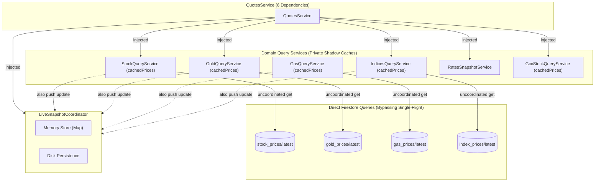
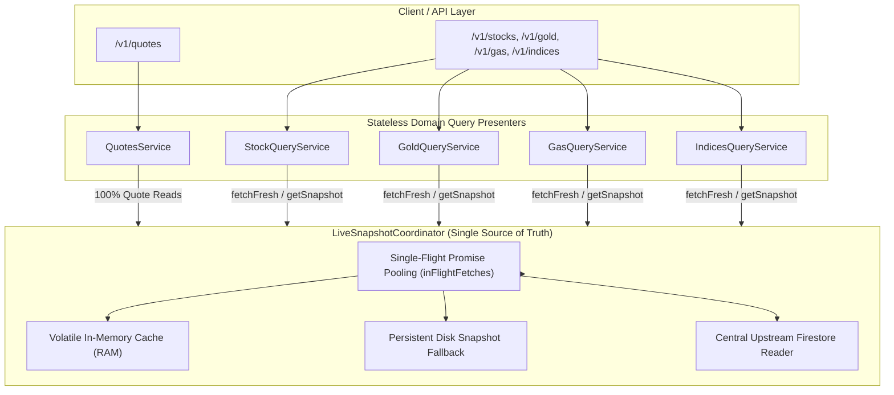
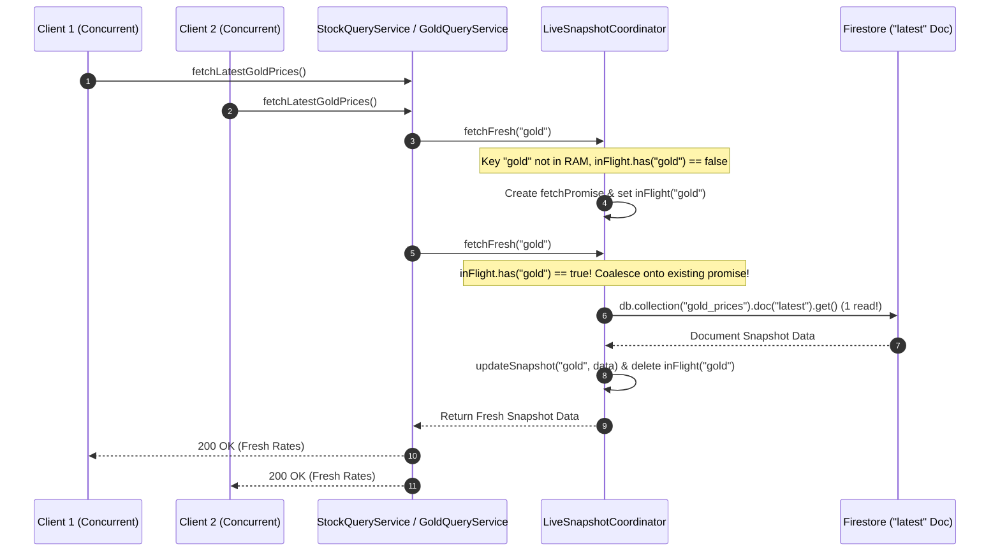

# Data Model & Architecture Design: Dissolve Shadow Caches

**Feature Branch**: `112-dissolve-shadow-caches`  
**Date**: 2026-11-15  
**Status**: Completed  

---

## 1. System Architecture: Before vs. After

### 1.1 Before: Fragmented Shadow Caches & Duplicate Fallbacks



### 1.2 After: Strict Single Authority in LiveSnapshotCoordinator



---

## 2. Service Contracts & State Definitions

### 2.1 Refactored `QuotesService` Interface

```ts
export interface IQuotesService {
  /**
   * Resolves an array of arbitrary multi-asset identifiers into structured quotes.
   * Reads 100% from LiveSnapshotCoordinator with zero domain service dependencies.
   */
  getQuotes(items: string[]): Promise<BatchQuoteResponse>;
}

export class QuotesService implements IQuotesService {
  /**
   * Constructor accepts ONLY the authoritative LiveSnapshotCoordinator.
   */
  constructor(
    private readonly coordinator: LiveSnapshotCoordinator = liveSnapshotCoordinator
  ) {}
}
```

### 2.2 Refactored Query Services Interface Contracts

#### `GoldQueryService`
```ts
export class GoldQueryService {
  // ZERO private cachedPrices field!

  updateCache(data: GoldPriceDocument): void {
    liveSnapshotCoordinator.updateSnapshot("gold", data);
  }

  getCachedPrices(): GoldPriceDocument | null {
    return liveSnapshotCoordinator.getSnapshot<GoldPriceDocument>("gold");
  }

  async fetchLatestGoldPrices(forceRefresh = false): Promise<GoldPriceDocument | null> {
    return liveSnapshotCoordinator.fetchFresh<GoldPriceDocument>("gold", undefined, forceRefresh);
  }
}
```

#### `GasQueryService`
```ts
export class GasQueryService {
  // ZERO private cachedPrices field!

  updateCache(data: GasPriceSnapshot): void {
    liveSnapshotCoordinator.updateSnapshot("gas", data);
  }

  getCachedPrices(): GasPriceSnapshot | null {
    return liveSnapshotCoordinator.getSnapshot<GasPriceSnapshot>("gas");
  }

  async fetchLatestGasPrices(forceRefresh = false): Promise<GasPriceSnapshot | null> {
    return liveSnapshotCoordinator.fetchFresh<GasPriceSnapshot>("gas", undefined, forceRefresh);
  }
}
```

#### `StockQueryService`
```ts
export class StockQueryService {
  // ZERO private cachedPrices field!

  updateCache(data: StockPriceSnapshot): void {
    liveSnapshotCoordinator.updateSnapshot("stocks", data, "egx");
  }

  getCachedPrices(): StockPriceSnapshot | null {
    return liveSnapshotCoordinator.getSnapshot<StockPriceSnapshot>("stocks", "egx");
  }

  async fetchLatestStockPrices(forceRefresh = false): Promise<StockPriceSnapshot | null> {
    return liveSnapshotCoordinator.fetchFresh<StockPriceSnapshot>("stocks", "egx", forceRefresh);
  }

  // Preserved static catalog filtering utility
  filterStocksByIndexOrGroup(stocks: Record<string, any>, filterTarget?: string): Record<string, any> {
    return marketCatalog.filterStocks(stocks, filterTarget);
  }
}
```

#### `IndicesQueryService`
```ts
export class IndicesQueryService {
  // ZERO private cachedPrices or cachedRegionalPrices fields!

  updateCache(data: IndexPriceSnapshot): void {
    liveSnapshotCoordinator.updateSnapshot("indices", data, "egx");
  }

  getCachedPrices(market = "egx"): IndexPriceSnapshot | null {
    return liveSnapshotCoordinator.getSnapshot<IndexPriceSnapshot>("indices", market);
  }

  async fetchLatestIndexPrices(
    marketOrForceRefresh: string | boolean = "egx",
    forceRefresh = false
  ): Promise<IndexPriceSnapshot | null> {
    const isFirstArgBool = typeof marketOrForceRefresh === "boolean";
    const market = isFirstArgBool ? "egx" : marketOrForceRefresh;
    const effectiveForceRefresh = isFirstArgBool ? marketOrForceRefresh : forceRefresh;
    return liveSnapshotCoordinator.fetchFresh<IndexPriceSnapshot>("indices", market, effectiveForceRefresh);
  }

  async fetchConstituentStocks(code: string, forceRefresh = false): Promise<any | null> {
    // Resolves constituent live stocks directly from coordinator
  }
}
```

---

## 3. Concurrency & Single-Flight State Transitions


