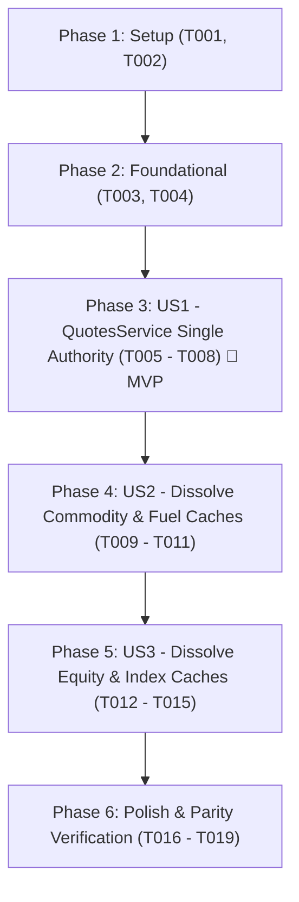

# Tasks: Dissolve Shadow Caches and Firestore Fallbacks in Query Modules

**Input**: Design documents from `specs/112-dissolve-shadow-caches/`  
**Prerequisites**: `plan.md` (required), `spec.md` (required), `research.md`, `data-model.md`, `contracts/`, `quickstart.md`  
**Constitution**: Mandatory adherence to Principles I, II, III, IV, V, VI, VII, VIII  

---

## Format: `[ID] [P?] [Story] Description`

- **[P]**: Can run in parallel (different files, no dependencies)
- **[Story]**: Which user story this task belongs to (e.g. `[US1]`, `[US2]`, `[US3]`)
- Every task includes exact file paths

---

## Phase 1: Setup (Shared Infrastructure)

**Purpose**: Baseline verification and contract alignment

- [X] T001 Verify baseline test and build health with `npm run test:unit`, `npm run test:contract`, and `npm run build`
- [X] T002 [P] Verify contract interfaces in `specs/112-dissolve-shadow-caches/contracts/live-snapshot-coordinator.contract.ts`

---

## Phase 2: Foundational (Blocking Prerequisites)

**Purpose**: Authoritative snapshot coordinator and catalog enrichment verification

**⚠️ CRITICAL**: Must complete before user story refactorings begin

- [X] T003 Verify `LiveSnapshotCoordinator` multi-domain fetchFresh support across `rates`, `gold`, `gas`, `stocks`, `indices`, and `gcc-stocks` in `src/services/live-snapshot-coordinator.ts`
- [X] T004 [P] Verify that `marketCatalog.enrichSnapshot` operates seamlessly during upstream coordinator fetches in `src/services/catalog-service.ts`

**Checkpoint**: Foundation ready — `LiveSnapshotCoordinator` verified as the authoritative upstream reader and single-flight coordinator

---

## Phase 3: User Story 1 - Single-Authority Quote Resolution in Batch Quotes (Priority: P1) 🎯 MVP

**Goal**: Slim down `QuotesService` to inject and query exclusively `LiveSnapshotCoordinator`, eliminating all 5 legacy domain query service dependencies.

**Independent Test**: Request quotes across multiple asset categories (currency rates, gold carats, equities, and indices) via the batch quotes service; verify that all quotes resolve with accurate prices and zero duplicate domain service dependencies.

### Implementation for User Story 1

- [X] T005 [P] [US1] Update unit tests in `tests/unit/quotes-service-coordinator.test.ts` to instantiate `new QuotesService(mockCoordinator)` with zero domain services
- [X] T006 [P] [US1] Update legacy unit tests in `tests/unit/quotes-service.test.ts` to align constructor with single coordinator dependency
- [X] T007 [US1] Refactor `QuotesService` in `src/services/quotes-service.ts` to accept ONLY `LiveSnapshotCoordinator` in its constructor and resolve all asset domains directly from `coordinator.getSnapshot()`
- [X] T008 [US1] Update `QuotesService` instantiation in `src/app.ts` to pass only `liveSnapshotCoordinator`

**Checkpoint**: User Story 1 complete — `QuotesService` is fully decoupled from all domain query services; batch quotes resolve from the authoritative coordinator

---

## Phase 4: User Story 2 - Dissolve Shadow Caches in Commodity and Fuel Services (Priority: P2)

**Goal**: Dissolve private shadow cache fields (`cachedPrices`) and duplicate Firestore fallback reads in `GoldQueryService` and `GasQueryService`.

**Independent Test**: Invoke gold and fuel query methods under cold cache and concurrent load conditions; verify identical price payloads with zero shadow cache fields and unified database fallback coordination.

### Implementation for User Story 2

- [X] T009 [P] [US2] Update unit tests in `tests/unit/gold-query-service.test.ts` to verify zero shadow cache fields and delegation to `liveSnapshotCoordinator.fetchFresh`
- [X] T010 [US2] Refactor `GoldQueryService` in `src/services/gold-query-service.ts`: delete `private cachedPrices`, delegate `updateCache`, `getCachedPrices`, and `fetchLatestGoldPrices` to `liveSnapshotCoordinator`
- [X] T011 [US2] Refactor `GasQueryService` in `src/services/gas-query-service.ts`: delete `private cachedPrices`, dissolve 95 lines of duplicate boilerplate, and delegate directly to `liveSnapshotCoordinator`

**Checkpoint**: User Story 2 complete — shadow caches and uncoordinated Firestore gets in gold and gas services eliminated; 100% delegated to `LiveSnapshotCoordinator`

---

## Phase 5: User Story 3 - Dissolve Shadow Caches in Equity and Benchmark Index Services (Priority: P3)

**Goal**: Dissolve private shadow cache fields (`cachedPrices`, `cachedRegionalPrices`) and duplicate Firestore fallback reads in `StockQueryService`, `IndicesQueryService`, and `GccStockQueryService`.

**Independent Test**: Query latest stock prices and benchmark index values across domestic and regional markets; verify that all live quotes are served from the central snapshot store and that constituent stock lookups reuse central snapshots.

### Implementation for User Story 3

- [X] T012 [P] [US3] Update unit tests in `tests/unit/stock-query-service.test.ts` to verify zero shadow cache fields and delegation to `liveSnapshotCoordinator.fetchFresh`
- [X] T013 [US3] Refactor `StockQueryService` in `src/services/stock-query-service.ts`: delete `private cachedPrices`, delegate `updateCache`, `getCachedPrices`, and `fetchLatestStockPrices` to `liveSnapshotCoordinator.fetchFresh`
- [X] T014 [US3] Refactor `IndicesQueryService` in `src/services/indices-query-service.ts`: delete `private cachedPrices` and `cachedRegionalPrices`, delegate `updateCache`, `getCachedPrices`, and `fetchLatestIndexPrices` to `liveSnapshotCoordinator.fetchFresh`, and update `fetchConstituentStocks` to resolve live stocks from `liveSnapshotCoordinator`
- [X] T015 [US3] Refactor `GccStockQueryService` in `src/modules/gcc-stocks/services/gcc-stock-query-service.ts`: delete `private cachedPrices`, and delegate `getCachedPrices` and `fetchLatestStockPrices` to `liveSnapshotCoordinator`

**Checkpoint**: User Story 3 complete — shadow caches in equity and index services dissolved; all live market quotes served from the authoritative snapshot coordinator

---

## Phase 6: Polish & Cross-Cutting Concerns

**Purpose**: Test suite alignment, exhaustive line commenting, build validation, and differential parity verification

- [X] T016 [P] Update and align all test suites referencing query caches (`tests/unit/quotes-service.test.ts`, `tests/unit/gold-query-service.test.ts`, `tests/unit/stock-query-service.test.ts`, `tests/unit/live-snapshot-coordinator.test.ts`)
- [X] T017 Enforce exhaustive code commenting (Constitution Principle V: every single line explicitly commented) across all modified files
- [X] T018 Run full test and build verification (`npm run test:unit`, `npm run test:contract`, `npm run build`)
- [X] T019 Execute differential parity verification between ports 3000 and 3001 (`npm run verify:diff -- --base http://84.235.253.78:3000 --target http://84.235.253.78:3001 --key local-dev-key`)

---

## Dependencies & Execution Order

---

## Implementation Strategy (MVP First)

1. **MVP First (Phase 1 to Phase 3)**: Decouple `QuotesService` by dropping its 5 domain service dependencies and directing all batch quote lookups to `LiveSnapshotCoordinator`.
2. **Boilerplate Reduction (Phase 4)**: Strip `cachedPrices` and duplicate Firestore logic from `GoldQueryService` and `GasQueryService`, cutting ~150 lines of duplicate fallback code.
3. **Complete Cache Consolidation (Phase 5)**: Strip `cachedPrices` from `StockQueryService`, `IndicesQueryService`, and `GccStockQueryService`, ensuring single-flight promise pooling across all equity routes.
4. **Verification & Parity (Phase 6)**: Ensure 100% test pass rate, 100% comment coverage per Principle V, and 100% differential parity across all 30 endpoints.
