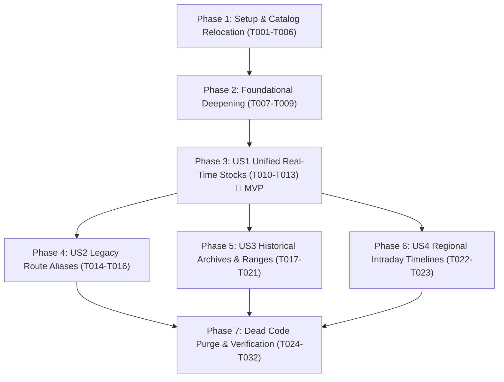

# Tasks: Collapse Artificial GCC Stocks Boundary into Stock Module

**Input**: Design documents from `specs/114-collapse-gcc-stocks/`  
**Prerequisites**: `spec.md`, `plan.md`, `research.md`, `data-model.md`, `contracts/stock-api.md`, `quickstart.md`  
**Organization**: Tasks are grouped by setup, foundation, and prioritized user stories (US1 through US4), concluding with cleanup and verification.

---

## Format: `[ID] [P?] [Story] Description`
- **[P]**: Can run in parallel (different files, no dependencies)
- **[Story]**: Associated user story (US1, US2, US3, US4)

---

## Phase 1: Setup & Catalog Relocation

**Purpose**: Move static security definition catalogs to canonical configuration directory `src/config/catalogs/` and update references.

- [X] T001 Create canonical catalog directory `src/config/catalogs/`
- [X] T002 [P] Relocate Saudi stock catalog from `src/modules/gcc-stocks/catalogs/saudi-catalog.ts` to `src/config/catalogs/saudi-catalog.ts`
- [X] T003 [P] Relocate UAE stock catalog from `src/modules/gcc-stocks/catalogs/uae-catalog.ts` to `src/config/catalogs/uae-catalog.ts`
- [X] T004 [P] Relocate Qatar stock catalog from `src/modules/gcc-stocks/catalogs/qatar-catalog.ts` to `src/config/catalogs/qatar-catalog.ts`
- [X] T005 [P] Relocate Kuwait stock catalog from `src/modules/gcc-stocks/catalogs/kuwait-catalog.ts` to `src/config/catalogs/kuwait-catalog.ts`
- [X] T006 Update catalog imports in `src/services/catalog-service.ts` (`MarketCatalog`) to reference `../config/catalogs/*.js`

**Checkpoint**: Static security catalogs relocated; `MarketCatalog` builds cleanly without relying on `modules/gcc-stocks/`.

---

## Phase 2: Foundational (Type Contracts & StockQueryService Deepening)

**Purpose**: Deepen `StockQueryService` to coordinate all 5 equity exchanges natively behind a clean interface.

- [X] T007 Define `CanonicalMarketId`, `MarketCountryCode`, and market normalization helper in `src/models/stock-rate.ts`
- [X] T008 Deepen `StockQueryService` in `src/services/stock-query-service.ts` to accept optional `market: string = 'egx'` on `getCachedPrices`, `updateCache`, and `fetchLatestStockPrices`, resolving directly through `liveSnapshotCoordinator` and `marketCatalog`
- [X] T009 Deepen `StockQueryService.fetchStockPriceHistory` and `fetchStockPriceHistoryRange` in `src/services/stock-query-service.ts` to accept `market` parameter and delegate to `historyResolutionEngine`

**Checkpoint**: `StockQueryService` is fully multi-market capable; ready for route binding.

---

## Phase 3: User Story 1 - Unified Real-Time Quotes (`GET /v1/stocks?market=...`) (Priority: P1) 🎯 MVP

**Goal**: Deliver a single unified entry point `GET /v1/stocks` accepting `?market=saudi|uae|qatar|kuwait|egx` (and country codes `sa|ae|qa|kw|eg`).

- [X] T010 [US1] Update `GET /v1/stocks` in `src/routes/stock-routes.ts` to parse, validate, and normalize `?market=` query parameter, defaulting to `egx`
- [X] T011 [US1] Connect `GET /v1/stocks` route handler directly to `stockQueryService.fetchLatestStockPrices(market)`
- [X] T012 [P] [US1] Add unit tests in `tests/unit/stock-query-service.test.ts` verifying `fetchLatestStockPrices` returns valid data for each supported market partition
- [X] T013 [P] [US1] Add integration/route test in `tests/unit/` verifying `GET /v1/stocks?market=saudi` and `GET /v1/stocks` (EGX default) return 200 OK

**Checkpoint**: Primary user story complete. Clients can query any regional exchange through `GET /v1/stocks?market=...`.

---

## Phase 4: User Story 2 - Full Backward-Compatible Regional Route Aliases (Priority: P1)

**Goal**: Ensure existing mobile and web clients querying `/v1/stocks/saudi`, `/v1/stocks/uae`, `/v1/stocks/qatar`, `/v1/stocks/kuwait`, and `/v1/stocks/regional/catalog` experience zero breakage.

- [X] T014 [US2] Register legacy aliases in `src/routes/stock-routes.ts`:
  - `GET /v1/stocks/saudi` $\rightarrow$ `stockQueryService.fetchLatestStockPrices('saudi')`
  - `GET /v1/stocks/uae` $\rightarrow$ `stockQueryService.fetchLatestStockPrices('uae')`
  - `GET /v1/stocks/qatar` $\rightarrow$ `stockQueryService.fetchLatestStockPrices('qatar')`
  - `GET /v1/stocks/kuwait` $\rightarrow$ `stockQueryService.fetchLatestStockPrices('kuwait')`
- [X] T015 [US2] Register regional catalog route in `src/routes/stock-routes.ts`:
  - `GET /v1/stocks/regional/catalog` $\rightarrow$ `marketCatalog.getRegionalCatalog()`
- [X] T016 [P] [US2] Add route tests in `tests/unit/` ensuring all 5 legacy path aliases return 200 OK with correct headers and schemas

**Checkpoint**: Legacy routes achieve 100% contract and schema parity with the baseline.

---

## Phase 5: User Story 3 - Historical Archive & Range Queries Across All Markets (Priority: P2)

**Goal**: Support historical single-date and range queries for all regional equities through `stock-routes.ts`.

- [X] T017 [US3] Update `GET /v1/stocks/history/:date` in `src/routes/stock-routes.ts` to accept optional `?market=` query parameter
- [X] T018 [US3] Register legacy path alias `GET /v1/stocks/:market/history/:date` in `src/routes/stock-routes.ts`
- [X] T019 [US3] Update `GET /v1/stocks/:symbol/history/range` in `src/routes/stock-routes.ts` to accept optional `?market=` query parameter
- [X] T020 [US3] Register legacy path alias `GET /v1/stocks/:market/:symbol/history/range` in `src/routes/stock-routes.ts`
- [X] T021 [P] [US3] Add unit tests in `tests/unit/stock-query-service.test.ts` verifying historical single-date and range resolution across regional markets

**Checkpoint**: Historical queries across all exchanges resolve through unified stock routes.

---

## Phase 6: User Story 4 - Dedicated Single-Hop Intraday Timelines for Regional Securities (Priority: P3)

**Goal**: Standardize latest session intraday timeline queries across all regional equities.

- [X] T022 [US4] Register legacy path alias `GET /v1/stocks/:market/:symbol/intraday/latest` in `src/routes/stock-routes.ts` alongside existing `GET /v1/stocks/:symbol/intraday/latest` (with `?market=` support)
- [X] T023 [P] [US4] Add unit tests in `tests/unit/stock-query-service.test.ts` verifying regional intraday timeline resolution and weekend backtracking

**Checkpoint**: Regional intraday timeline endpoints fully operational and parity-aligned.

---

## Phase 7: Polish, Dead Code Elimination & Constitution Compliance

**Purpose**: Clean up obsolete modules, dynamic loaders, and dead scraper daemons, then verify.

- [X] T024 Remove dynamic loader block (lines 172–220) from `src/app.ts`
- [X] T025 Update all imports across `src/` and `tests/` that referenced `src/modules/gcc-stocks/`
- [X] T026 Delete `src/modules/gcc-stocks/` directory entirely (including scraper adapters to fulfill Constitution Principle VIII)
- [X] T027 Verify 100% line comment coverage on all added and modified lines per Constitution Principle V
- [X] T028 Bump application version from `2.18.10` to `2.18.11` in `package.json`, `src/routes/version-routes.ts`, and `tests/unit/version-routes.test.ts` per Constitution Principle IX
- [X] T029 Execute full build and unit test suite: `npm run build && npm run test:unit`
- [X] T030 Execute canonical verification runner: `npm run verify` (37 scenarios must pass)
- [X] T031 Execute differential parity runner: `npm run verify:diff` (31 endpoints must match 100%)
- [X] T032 Generate HTML audit report: `npm run verify:report`

---

## Dependencies & Completion Order

---

## Parallel Execution Opportunities
- Tasks T002, T003, T004, T005 (relocating catalog files) can execute in parallel.
- Tasks T012 and T013 (US1 unit & route tests) can execute in parallel.
- Tasks T014, T015, and T016 (US2 alias registration & tests) can execute in parallel once US1 route structure is in place.
- Tasks T017–T020 (US3 historical routes) and T022–T023 (US4 intraday routes) can execute in parallel.
